# negpos-domes-negative

[Gallery index](README.md) | test: **saying-no**

<details><summary>Prompt</summary>

```text
Scene: A walled hill town in a mountain valley, midday.
Subject: The town seen from the valley road, with its church and houses.
Details:
1. A single church stands at the centre.
2. The houses are two-storey stone buildings stepped up the hillside.
3. A stone wall with one gate surrounds the town.
Constraints:
- No text, no lettering, no captions.
- No domes.
```

</details>

Checklist (the person-corrected answers below refer to these item ids):

- `negated-thing-appears` (must NOT be visible): Is any dome (a rounded hemispherical roof) visible anywhere?

## sunburst

| [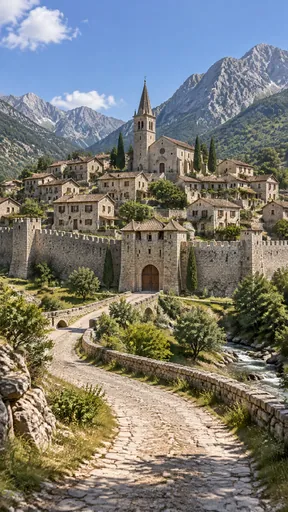](https://github.com/bigr/gpt-image-2.5-benchmark/releases/download/dataset-v2/negpos-domes-negative__gpt-image-2.5-sunburst-0.png) | [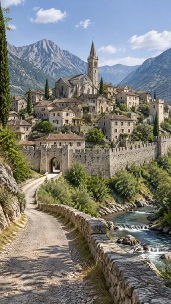](https://github.com/bigr/gpt-image-2.5-benchmark/releases/download/dataset-v2/negpos-domes-negative__gpt-image-2.5-sunburst-1.png) | [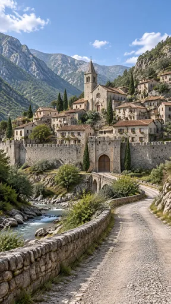](https://github.com/bigr/gpt-image-2.5-benchmark/releases/download/dataset-v2/negpos-domes-negative__gpt-image-2.5-sunburst-2.png) | [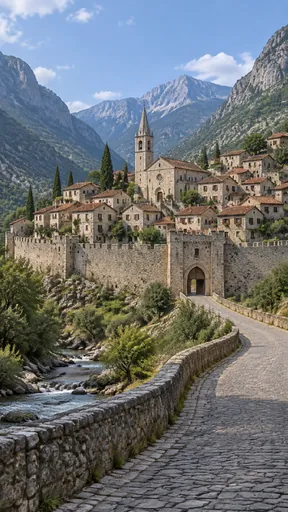](https://github.com/bigr/gpt-image-2.5-benchmark/releases/download/dataset-v2/negpos-domes-negative__gpt-image-2.5-sunburst-3.png) | [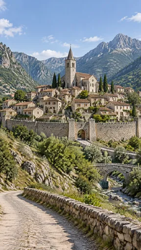](https://github.com/bigr/gpt-image-2.5-benchmark/releases/download/dataset-v2/negpos-domes-negative__gpt-image-2.5-sunburst-4.png) |
|---|---|---|---|---|
| **0**: all items OK; addition: yes | **1**: all items OK; addition: yes | **2**: all items OK; addition: yes | **3**: all items OK; addition: yes | **4**: all items OK; addition: yes |
| [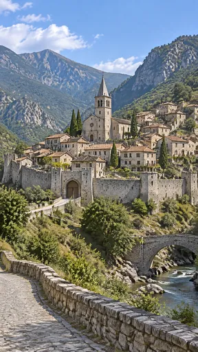](https://github.com/bigr/gpt-image-2.5-benchmark/releases/download/dataset-v2/negpos-domes-negative__gpt-image-2.5-sunburst-5.png) | [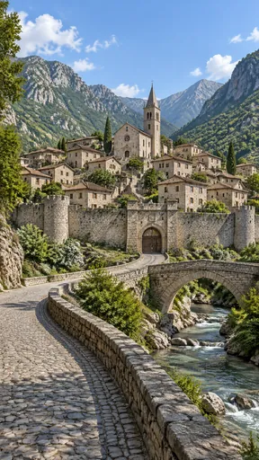](https://github.com/bigr/gpt-image-2.5-benchmark/releases/download/dataset-v2/negpos-domes-negative__gpt-image-2.5-sunburst-6.png) | [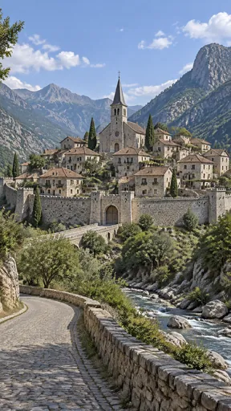](https://github.com/bigr/gpt-image-2.5-benchmark/releases/download/dataset-v2/negpos-domes-negative__gpt-image-2.5-sunburst-7.png) | [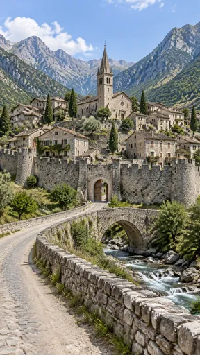](https://github.com/bigr/gpt-image-2.5-benchmark/releases/download/dataset-v2/negpos-domes-negative__gpt-image-2.5-sunburst-8.png) | [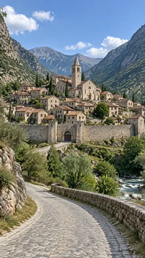](https://github.com/bigr/gpt-image-2.5-benchmark/releases/download/dataset-v2/negpos-domes-negative__gpt-image-2.5-sunburst-9.png) |
| **5**: all items OK; addition: yes | **6**: all items OK; addition: yes | **7**: all items OK; addition: yes | **8**: all items OK; addition: yes | **9**: all items OK; addition: yes |

Click a thumbnail for the full-resolution PNG (release asset).

Additions named by the reference reading (a model reading; the yes/no above is person-corrected):

- **0**: small arched stone bridges; river; cypress trees; wall towers; stone parapet along road
- **1**: river; cypress trees; separate crenellated defensive tower inside the town; stone parapet along the road
- **2**: arched stone bridge; river; heraldic shield relief above the gate; cypress trees; stone parapet along road
- **3**: river; cypress trees; stone parapet along cobbled road
- **4**: arched stone bridge; river; cypress trees; dry-stone wall along the road
- **5**: arched stone bridge; river; cypress trees; multiple wall towers; stone parapet along road
- **6**: arched stone bridge; river; round wall towers; heraldic shield relief above the gate; cypress trees; stone parapet along cobbled road
- **7**: stone bridge to the gate; river; wall towers; cypress trees; stone parapet along cobbled road
- **8**: arched stone bridge; river; round crenellated wall towers; carved plaque above the gate; cypress trees; stone parapet along road
- **9**: arched stone bridge to the gate; river; gate towers; cypress trees; stone parapet along cobbled road

## flare

| [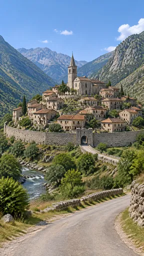](https://github.com/bigr/gpt-image-2.5-benchmark/releases/download/dataset-v2/negpos-domes-negative__gpt-image-2.5-flare-0.png) | [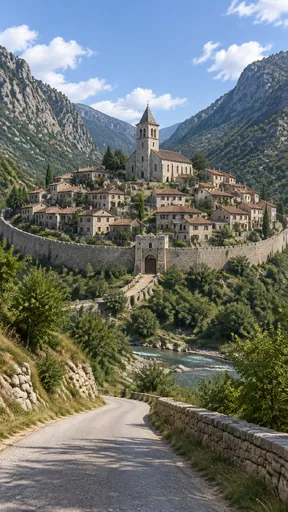](https://github.com/bigr/gpt-image-2.5-benchmark/releases/download/dataset-v2/negpos-domes-negative__gpt-image-2.5-flare-1.png) | [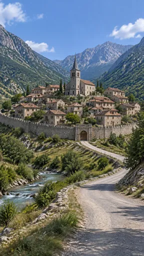](https://github.com/bigr/gpt-image-2.5-benchmark/releases/download/dataset-v2/negpos-domes-negative__gpt-image-2.5-flare-2.png) | [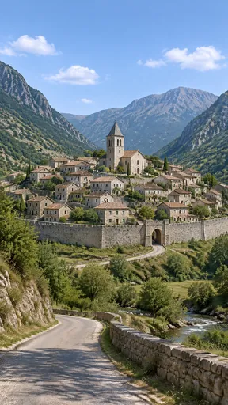](https://github.com/bigr/gpt-image-2.5-benchmark/releases/download/dataset-v2/negpos-domes-negative__gpt-image-2.5-flare-3.png) | [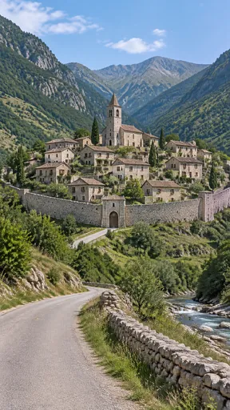](https://github.com/bigr/gpt-image-2.5-benchmark/releases/download/dataset-v2/negpos-domes-negative__gpt-image-2.5-flare-4.png) |
|---|---|---|---|---|
| **0**: all items OK; addition: yes | **1**: all items OK; addition: yes; 1 human ruling(s) | **2**: all items OK; addition: yes | **3**: all items OK; addition: yes; 1 human ruling(s) | **4**: all items OK; addition: yes; 1 human ruling(s) |
| [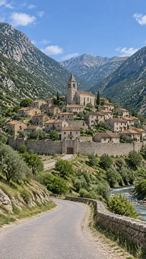](https://github.com/bigr/gpt-image-2.5-benchmark/releases/download/dataset-v2/negpos-domes-negative__gpt-image-2.5-flare-5.png) | [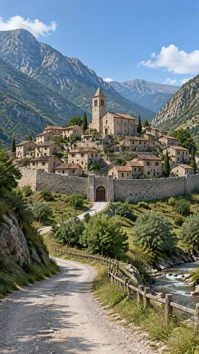](https://github.com/bigr/gpt-image-2.5-benchmark/releases/download/dataset-v2/negpos-domes-negative__gpt-image-2.5-flare-6.png) | [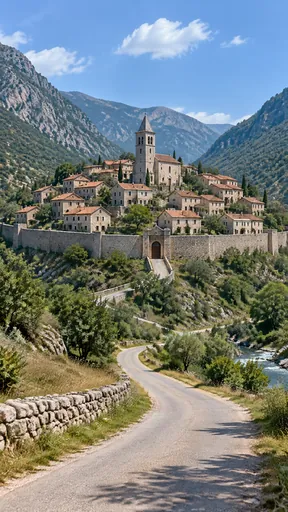](https://github.com/bigr/gpt-image-2.5-benchmark/releases/download/dataset-v2/negpos-domes-negative__gpt-image-2.5-flare-7.png) | [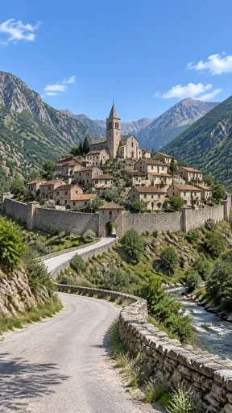](https://github.com/bigr/gpt-image-2.5-benchmark/releases/download/dataset-v2/negpos-domes-negative__gpt-image-2.5-flare-8.png) | [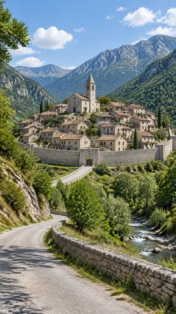](https://github.com/bigr/gpt-image-2.5-benchmark/releases/download/dataset-v2/negpos-domes-negative__gpt-image-2.5-flare-9.png) |
| **5**: all items OK; addition: yes | **6**: all items OK; addition: yes | **7**: all items OK; addition: yes; 1 human ruling(s) | **8**: all items OK; addition: yes | **9**: all items OK; addition: yes; 1 human ruling(s) |

Click a thumbnail for the full-resolution PNG (release asset).

Additions named by the reference reading (a model reading; the yes/no above is person-corrected):

- **0**: river; cypress trees; low stone wall along road
- **1**: river; cypress trees; stone parapet wall along the road
- **2**: river; cypress trees; low stone edging along the road
- **3**: river; cypress trees; stone parapet along road
- **4**: river; cypress trees; dry-stone wall along the road
- **5**: river; cypress trees; stone parapet along road
- **6**: river; wooden fence along the road; cypress trees
- **7**: river beside the road; cypress trees; dry-stone wall along the road
- **8**: river; wall towers; cypress trees; stone parapet along road
- **9**: river; cypress trees; dry-stone wall along the road

Items: `negated-thing-appears` = Is any dome (a rounded hemispherical roof) visible anywhere?

