# negpos-domes-positive

[Gallery index](README.md) | test: **saying-no**

<details><summary>Prompt</summary>

```text
Scene: A walled hill town in a mountain valley, midday.
Subject: The town seen from the valley road, with its church and houses.
Details:
1. A single church stands at the centre.
2. The houses are two-storey stone buildings stepped up the hillside.
3. A stone wall with one gate surrounds the town.
4. Every roof is flat timber boards; the church has a flat timber roof and a square stone tower.
Constraints:
- No text, no lettering, no captions.
```

</details>

Checklist (the person-corrected answers below refer to these item ids):

- `negated-thing-appears` (must NOT be visible): Is any dome (a rounded hemispherical roof) visible anywhere?

## sunburst

| [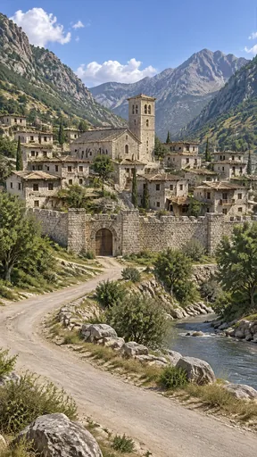](https://github.com/bigr/gpt-image-2.5-benchmark/releases/download/dataset-v2/negpos-domes-positive__gpt-image-2.5-sunburst-0.png) | [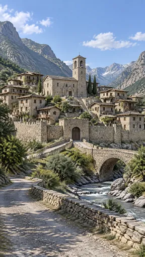](https://github.com/bigr/gpt-image-2.5-benchmark/releases/download/dataset-v2/negpos-domes-positive__gpt-image-2.5-sunburst-1.png) | [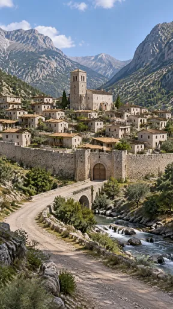](https://github.com/bigr/gpt-image-2.5-benchmark/releases/download/dataset-v2/negpos-domes-positive__gpt-image-2.5-sunburst-2.png) | [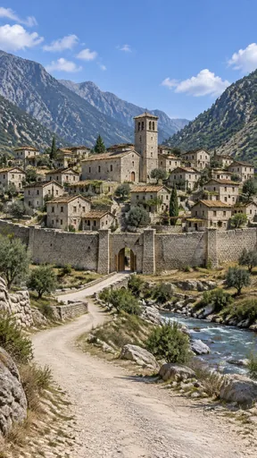](https://github.com/bigr/gpt-image-2.5-benchmark/releases/download/dataset-v2/negpos-domes-positive__gpt-image-2.5-sunburst-3.png) | [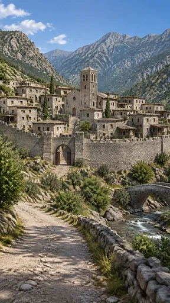](https://github.com/bigr/gpt-image-2.5-benchmark/releases/download/dataset-v2/negpos-domes-positive__gpt-image-2.5-sunburst-4.png) |
|---|---|---|---|---|
| **0**: all items OK; addition: yes | **1**: all items OK; addition: yes | **2**: all items OK; addition: yes | **3**: all items OK; addition: yes | **4**: all items OK; addition: yes |
| [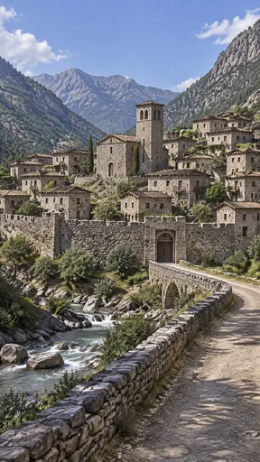](https://github.com/bigr/gpt-image-2.5-benchmark/releases/download/dataset-v2/negpos-domes-positive__gpt-image-2.5-sunburst-5.png) | [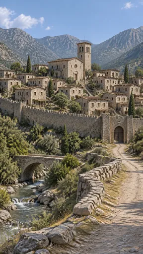](https://github.com/bigr/gpt-image-2.5-benchmark/releases/download/dataset-v2/negpos-domes-positive__gpt-image-2.5-sunburst-6.png) | [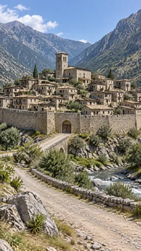](https://github.com/bigr/gpt-image-2.5-benchmark/releases/download/dataset-v2/negpos-domes-positive__gpt-image-2.5-sunburst-7.png) | [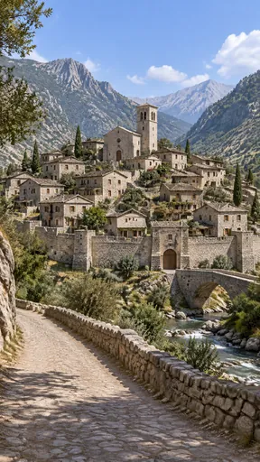](https://github.com/bigr/gpt-image-2.5-benchmark/releases/download/dataset-v2/negpos-domes-positive__gpt-image-2.5-sunburst-8.png) | [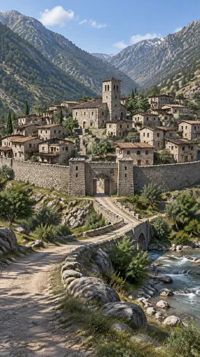](https://github.com/bigr/gpt-image-2.5-benchmark/releases/download/dataset-v2/negpos-domes-positive__gpt-image-2.5-sunburst-9.png) |
| **5**: all items OK; addition: yes | **6**: all items OK; addition: yes | **7**: all items OK; addition: yes | **8**: all items OK; addition: yes | **9**: all items OK; addition: yes |

Click a thumbnail for the full-resolution PNG (release asset).

Additions named by the reference reading (a model reading; the yes/no above is person-corrected):

- **0**: river; cypress trees; gate towers and crenellations
- **1**: stone arch bridge; river with rapids; cypress trees; wall towers and crenellations; hanging bell in tower; low stone roadside wall
- **2**: stone arch bridge; river with rapids; gatehouse towers flanking the gate; cypress trees
- **3**: river with rapids; small stone bridge; cypress trees; wall towers flanking gate; stone stairways
- **4**: stone arch bridge; river with rapids; cypress trees; crenellated battlements and gate towers; church rose window; low stone roadside wall
- **5**: stone arch bridge; river with rapids; cypress trees; crenellated battlements and wall towers; low stone roadside wall
- **6**: stone arch bridge; stream with small waterfall; cypress trees; crenellated battlements and gate towers; church rose window; low stone roadside wall
- **7**: stone arch bridge; river with rapids; cypress trees; low stone roadside wall
- **8**: stone arch bridge; river with rapids; cypress trees; wall towers and gatehouse; church rose window; low stone roadside wall; foreground overhanging tree
- **9**: stone arch bridge; river with rapids; gatehouse towers; cypress trees

## flare

| [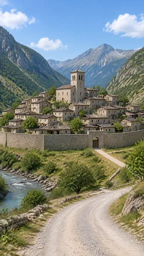](https://github.com/bigr/gpt-image-2.5-benchmark/releases/download/dataset-v2/negpos-domes-positive__gpt-image-2.5-flare-0.png) | [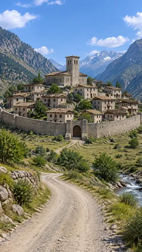](https://github.com/bigr/gpt-image-2.5-benchmark/releases/download/dataset-v2/negpos-domes-positive__gpt-image-2.5-flare-1.png) | [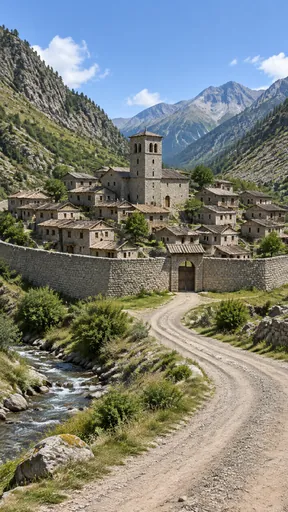](https://github.com/bigr/gpt-image-2.5-benchmark/releases/download/dataset-v2/negpos-domes-positive__gpt-image-2.5-flare-2.png) | [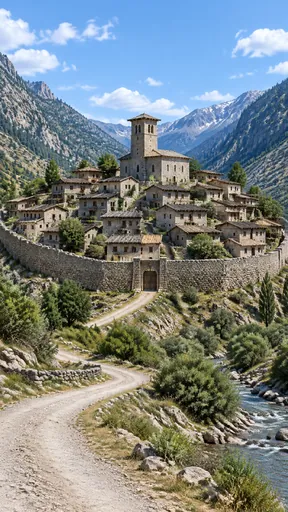](https://github.com/bigr/gpt-image-2.5-benchmark/releases/download/dataset-v2/negpos-domes-positive__gpt-image-2.5-flare-3.png) | [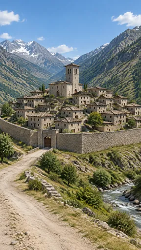](https://github.com/bigr/gpt-image-2.5-benchmark/releases/download/dataset-v2/negpos-domes-positive__gpt-image-2.5-flare-4.png) |
|---|---|---|---|---|
| **0**: all items OK; addition: yes | **1**: all items OK; addition: yes; 1 human ruling(s) | **2**: all items OK; addition: yes | **3**: all items OK; addition: yes; 1 human ruling(s) | **4**: all items OK; addition: yes |
| [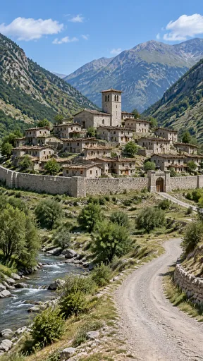](https://github.com/bigr/gpt-image-2.5-benchmark/releases/download/dataset-v2/negpos-domes-positive__gpt-image-2.5-flare-5.png) | [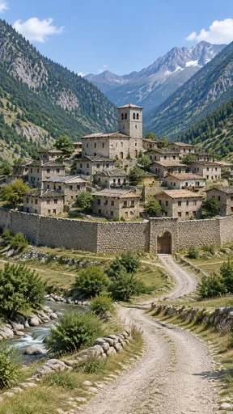](https://github.com/bigr/gpt-image-2.5-benchmark/releases/download/dataset-v2/negpos-domes-positive__gpt-image-2.5-flare-6.png) | [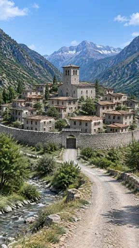](https://github.com/bigr/gpt-image-2.5-benchmark/releases/download/dataset-v2/negpos-domes-positive__gpt-image-2.5-flare-7.png) | [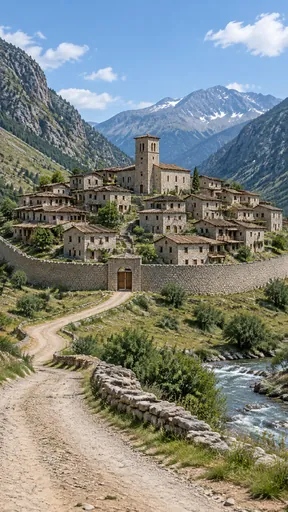](https://github.com/bigr/gpt-image-2.5-benchmark/releases/download/dataset-v2/negpos-domes-positive__gpt-image-2.5-flare-8.png) | [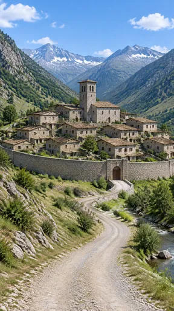](https://github.com/bigr/gpt-image-2.5-benchmark/releases/download/dataset-v2/negpos-domes-positive__gpt-image-2.5-flare-9.png) |
| **5**: all items OK; addition: yes; 1 human ruling(s) | **6**: all items OK; addition: yes | **7**: all items OK; addition: yes | **8**: all items OK; addition: yes | **9**: all items OK; addition: yes; 1 human ruling(s) |

Click a thumbnail for the full-resolution PNG (release asset).

Additions named by the reference reading (a model reading; the yes/no above is person-corrected):

- **0**: river; low stone roadside wall
- **1**: mountain stream; low stone field wall
- **2**: mountain stream
- **3**: mountain river; cypress trees; low stone field wall
- **4**: mountain river; cypress trees; low stone roadside wall
- **5**: mountain stream; low stone retaining wall by road
- **6**: mountain stream with boulders; low dry-stone field walls
- **7**: mountain stream; cypress trees; low stone field wall
- **8**: mountain river; low stone roadside wall; cypress tree
- **9**: mountain stream; small bridge before the gate

Items: `negated-thing-appears` = Is any dome (a rounded hemispherical roof) visible anywhere?

