# negpos-flywheel-negative

[Gallery index](README.md) | test: **saying-no**

<details><summary>Prompt</summary>

```text
Scene: A beam engine in a brick engine house, 1840s, interior.
Subject: The engine from the side.
Details:
1. A large iron beam rocks on a central pillar.
2. The steam cylinder stands at one end.
3. A brick wall and an arched window are behind the engine.
Constraints:
- No text, no lettering, no captions.
- No flywheel.
```

</details>

Checklist (the person-corrected answers below refer to these item ids):

- `negated-thing-appears` (must NOT be visible): Is any flywheel (a large heavy wheel on a shaft) visible?

## sunburst

| [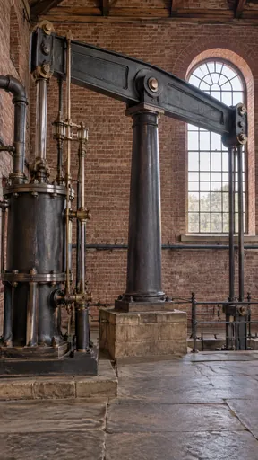](https://github.com/bigr/gpt-image-2.5-benchmark/releases/download/dataset-v2/negpos-flywheel-negative__gpt-image-2.5-sunburst-0.png) | [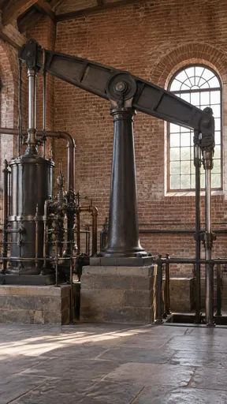](https://github.com/bigr/gpt-image-2.5-benchmark/releases/download/dataset-v2/negpos-flywheel-negative__gpt-image-2.5-sunburst-1.png) | [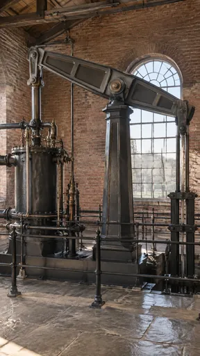](https://github.com/bigr/gpt-image-2.5-benchmark/releases/download/dataset-v2/negpos-flywheel-negative__gpt-image-2.5-sunburst-2.png) | [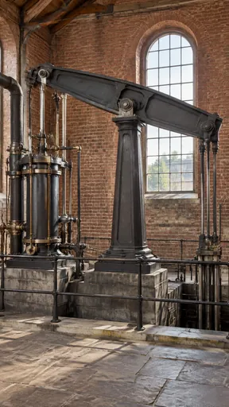](https://github.com/bigr/gpt-image-2.5-benchmark/releases/download/dataset-v2/negpos-flywheel-negative__gpt-image-2.5-sunburst-3.png) | [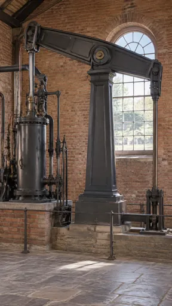](https://github.com/bigr/gpt-image-2.5-benchmark/releases/download/dataset-v2/negpos-flywheel-negative__gpt-image-2.5-sunburst-4.png) |
|---|---|---|---|---|
| **0**: all items OK; addition: yes; 1 human ruling(s) | **1**: all items OK; addition: yes; 1 human ruling(s) | **2**: all items OK; addition: yes; 1 human ruling(s) | **3**: all items OK; addition: yes | **4**: all items OK; addition: yes; 1 human ruling(s) |
| [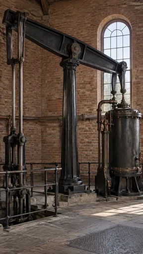](https://github.com/bigr/gpt-image-2.5-benchmark/releases/download/dataset-v2/negpos-flywheel-negative__gpt-image-2.5-sunburst-5.png) | [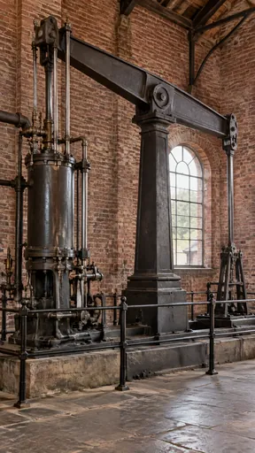](https://github.com/bigr/gpt-image-2.5-benchmark/releases/download/dataset-v2/negpos-flywheel-negative__gpt-image-2.5-sunburst-6.png) | [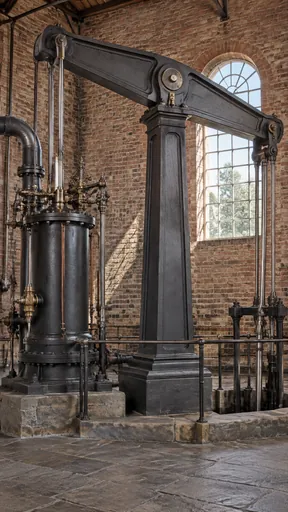](https://github.com/bigr/gpt-image-2.5-benchmark/releases/download/dataset-v2/negpos-flywheel-negative__gpt-image-2.5-sunburst-7.png) | [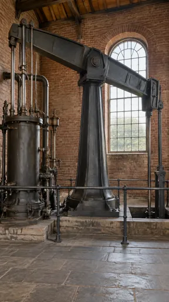](https://github.com/bigr/gpt-image-2.5-benchmark/releases/download/dataset-v2/negpos-flywheel-negative__gpt-image-2.5-sunburst-8.png) | [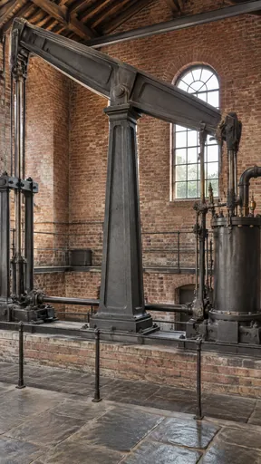](https://github.com/bigr/gpt-image-2.5-benchmark/releases/download/dataset-v2/negpos-flywheel-negative__gpt-image-2.5-sunburst-9.png) |
| **5**: all items OK; addition: yes; 1 human ruling(s) | **6**: all items OK; addition: yes | **7**: all items OK; addition: yes | **8**: all items OK; addition: yes | **9**: all items OK; addition: yes; 1 human ruling(s) |

Click a thumbnail for the full-resolution PNG (release asset).

Additions named by the reference reading (a model reading; the yes/no above is person-corrected):

- **0**: iron railing around pit at right; trees visible through window
- **1**: iron railing around pit at right; second arched window/arch at left edge
- **2**: iron railing; pump frame and pit at right; trees visible through window; rod/pulley hanging from roof beam
- **3**: iron railing; pit with pump rods at right; building and trees visible through window; second arched window at left edge
- **4**: iron railing; pump frame at right; trees visible through window
- **5**: iron railing around pit at left; floor pit with pump frame; iron floor grating/plate; trees visible through window
- **6**: iron safety railing around engine; trees and building visible through window
- **7**: iron railing; pump frame and pit at right; trees visible through window
- **8**: iron railing; floor pit at right; trees visible through window
- **9**: iron railing; upper gallery/walkway with railing along back wall; iron box/chest on gallery; arched doorway in back wall; horizontal shaft running along base between pillar and machinery; trees visible through window

## flare

| [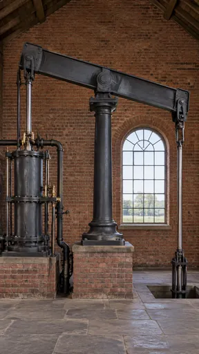](https://github.com/bigr/gpt-image-2.5-benchmark/releases/download/dataset-v2/negpos-flywheel-negative__gpt-image-2.5-flare-0.png) | [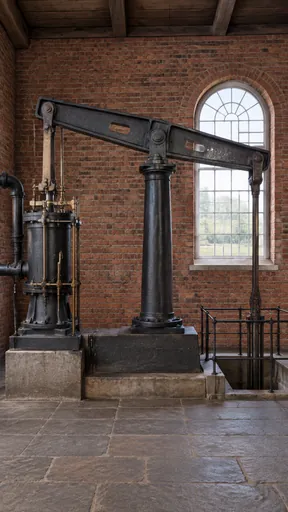](https://github.com/bigr/gpt-image-2.5-benchmark/releases/download/dataset-v2/negpos-flywheel-negative__gpt-image-2.5-flare-1.png) | [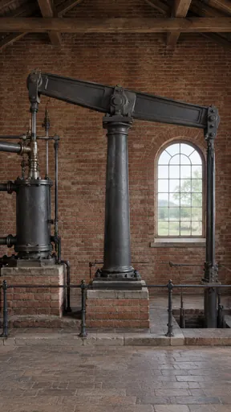](https://github.com/bigr/gpt-image-2.5-benchmark/releases/download/dataset-v2/negpos-flywheel-negative__gpt-image-2.5-flare-2.png) | [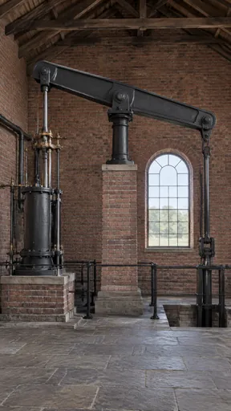](https://github.com/bigr/gpt-image-2.5-benchmark/releases/download/dataset-v2/negpos-flywheel-negative__gpt-image-2.5-flare-3.png) | [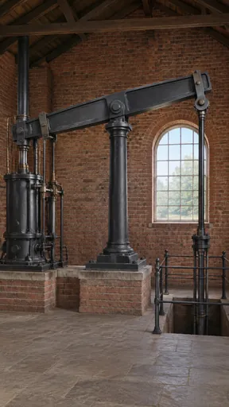](https://github.com/bigr/gpt-image-2.5-benchmark/releases/download/dataset-v2/negpos-flywheel-negative__gpt-image-2.5-flare-4.png) |
|---|---|---|---|---|
| **0**: all items OK; addition: yes | **1**: all items OK; addition: yes | **2**: all items OK; addition: yes | **3**: all items OK; addition: yes | **4**: all items OK; addition: yes |
| [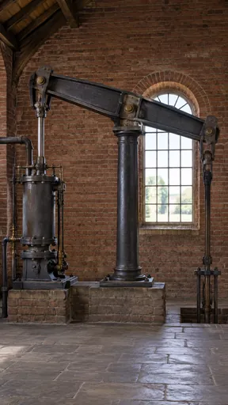](https://github.com/bigr/gpt-image-2.5-benchmark/releases/download/dataset-v2/negpos-flywheel-negative__gpt-image-2.5-flare-5.png) | [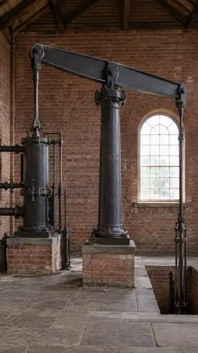](https://github.com/bigr/gpt-image-2.5-benchmark/releases/download/dataset-v2/negpos-flywheel-negative__gpt-image-2.5-flare-6.png) | [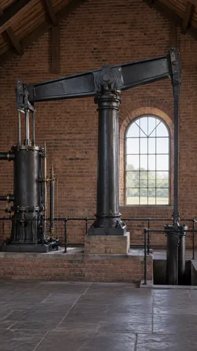](https://github.com/bigr/gpt-image-2.5-benchmark/releases/download/dataset-v2/negpos-flywheel-negative__gpt-image-2.5-flare-7.png) | [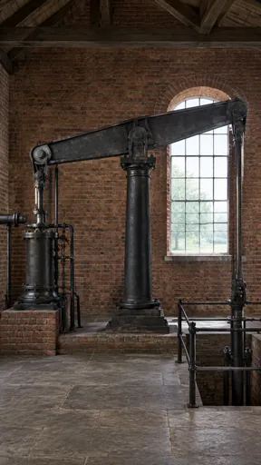](https://github.com/bigr/gpt-image-2.5-benchmark/releases/download/dataset-v2/negpos-flywheel-negative__gpt-image-2.5-flare-8.png) | [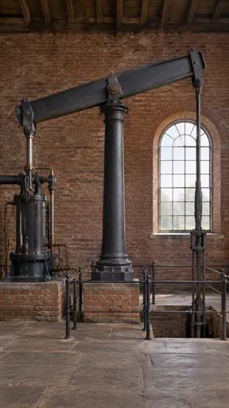](https://github.com/bigr/gpt-image-2.5-benchmark/releases/download/dataset-v2/negpos-flywheel-negative__gpt-image-2.5-flare-9.png) |
| **5**: all items OK; addition: yes; 1 human ruling(s) | **6**: all items OK; addition: yes; 1 human ruling(s) | **7**: all items OK; addition: yes; 1 human ruling(s) | **8**: all items OK; addition: yes | **9**: all items OK; addition: yes |

Click a thumbnail for the full-resolution PNG (release asset).

Additions named by the reference reading (a model reading; the yes/no above is person-corrected):

- **0**: floor pit at right; trees and field visible through window
- **1**: iron railing around a pump-shaft pit in the floor; trees and field visible through window
- **2**: iron railing; floor pit at right; trees and field visible through window
- **3**: iron railing; floor pit at right; trees and field visible through window
- **4**: iron railing around a floor pit; trees visible through window
- **5**: floor pit with pump rod guide frame; trees and field visible through window
- **6**: floor pit at right; trees visible through window
- **7**: iron railing; floor pit at right; trees and field visible through window
- **8**: iron railing around a floor pit; trees visible through window
- **9**: iron railing around floor pit; trees visible through window

Items: `negated-thing-appears` = Is any flywheel (a large heavy wheel on a shaft) visible?

