# negpos-flywheel-positive

[Gallery index](README.md) | test: **saying-no**

<details><summary>Prompt</summary>

```text
Scene: A beam engine in a brick engine house, 1840s, interior.
Subject: The engine from the side.
Details:
1. A large iron beam rocks on a central pillar.
2. The steam cylinder stands at one end.
3. A brick wall and an arched window are behind the engine.
4. The rotation is carried by a bare crank and a straight shaft, which end in a plain bearing block.
Constraints:
- No text, no lettering, no captions.
```

</details>

Checklist (the person-corrected answers below refer to these item ids):

- `negated-thing-appears` (must NOT be visible): Is any flywheel (a large heavy wheel on a shaft) visible? (excluded from every score)

## sunburst

| [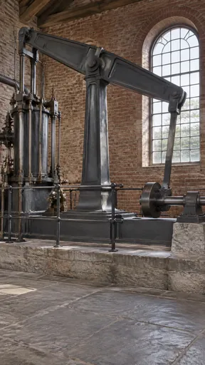](https://github.com/bigr/gpt-image-2.5-benchmark/releases/download/dataset-v2/negpos-flywheel-positive__gpt-image-2.5-sunburst-0.png) | [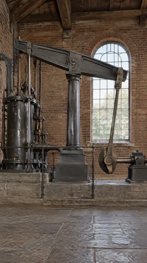](https://github.com/bigr/gpt-image-2.5-benchmark/releases/download/dataset-v2/negpos-flywheel-positive__gpt-image-2.5-sunburst-1.png) | [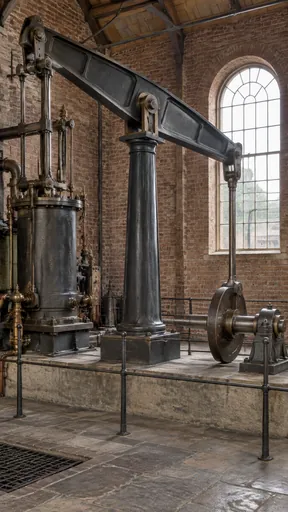](https://github.com/bigr/gpt-image-2.5-benchmark/releases/download/dataset-v2/negpos-flywheel-positive__gpt-image-2.5-sunburst-2.png) | [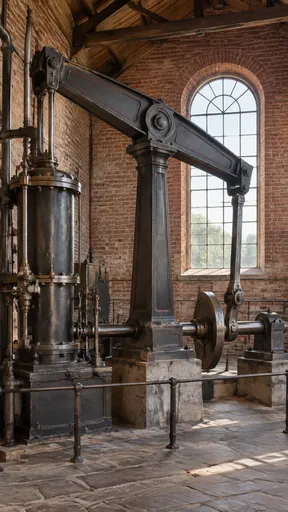](https://github.com/bigr/gpt-image-2.5-benchmark/releases/download/dataset-v2/negpos-flywheel-positive__gpt-image-2.5-sunburst-3.png) | [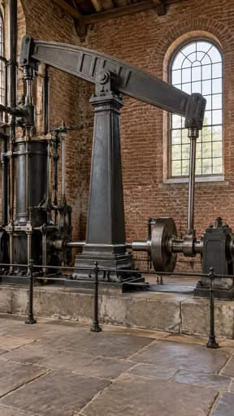](https://github.com/bigr/gpt-image-2.5-benchmark/releases/download/dataset-v2/negpos-flywheel-positive__gpt-image-2.5-sunburst-4.png) |
|---|---|---|---|---|
| **0**: all items OK; addition: yes | **1**: all items OK; addition: yes; 1 human ruling(s) | **2**: all items OK; addition: yes; 1 human ruling(s) | **3**: all items OK; addition: yes | **4**: all items OK; addition: yes |
| [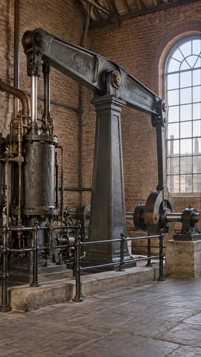](https://github.com/bigr/gpt-image-2.5-benchmark/releases/download/dataset-v2/negpos-flywheel-positive__gpt-image-2.5-sunburst-5.png) | [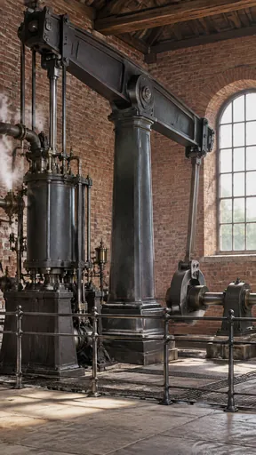](https://github.com/bigr/gpt-image-2.5-benchmark/releases/download/dataset-v2/negpos-flywheel-positive__gpt-image-2.5-sunburst-6.png) | [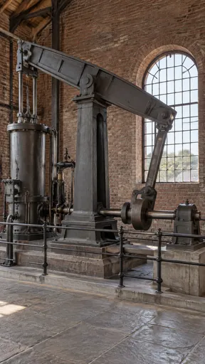](https://github.com/bigr/gpt-image-2.5-benchmark/releases/download/dataset-v2/negpos-flywheel-positive__gpt-image-2.5-sunburst-7.png) | [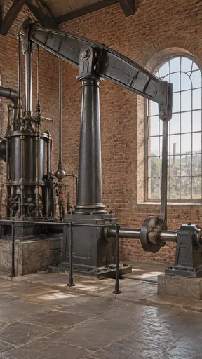](https://github.com/bigr/gpt-image-2.5-benchmark/releases/download/dataset-v2/negpos-flywheel-positive__gpt-image-2.5-sunburst-8.png) | [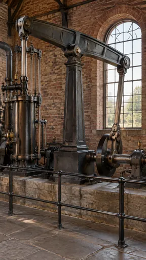](https://github.com/bigr/gpt-image-2.5-benchmark/releases/download/dataset-v2/negpos-flywheel-positive__gpt-image-2.5-sunburst-9.png) |
| **5**: all items OK; addition: yes | **6**: all items OK; addition: yes; 1 human ruling(s) | **7**: all items OK; addition: yes; 2 human ruling(s) | **8**: all items OK; addition: yes; 2 human ruling(s) | **9**: all items OK; addition: yes; 1 human ruling(s) |

Click a thumbnail for the full-resolution PNG (release asset).

Additions named by the reference reading (a model reading; the yes/no above is person-corrected):

- **0**: iron railing; trees visible through window; roof timbers; pipework
- **1**: iron railing; trees visible through window; roof timbers; pipework and valve gear at left
- **2**: iron railings; floor grating; buildings/trees visible through window; roof trusses; extra brass pipework and valve gear
- **3**: iron railing; trees visible through window; roof timbers; valve chest box and extra pipework
- **4**: iron railing; second window at far left; trees visible through window; roof timbers; extra pipework/columns at left
- **5**: iron railing; factory chimneys/buildings visible through window; roof timbers; extra pipework and valve gear
- **6**: iron railing; floor gratings; steam clouds; trees visible through window; roof timbers; brass lubricators and pipework
- **7**: iron railing; trees and a roof visible through window; roof timbers; extra pipework/valve chest and second vertical column at left
- **8**: iron safety railing; town with chimneys/factory stacks visible through window; roof timbers; extra pipework and valve gear at left
- **9**: iron safety railing in foreground; trees/landscape visible through window; roof trusses; extra pipework and second cylinder at left; brass lubricator cups

## flare

| [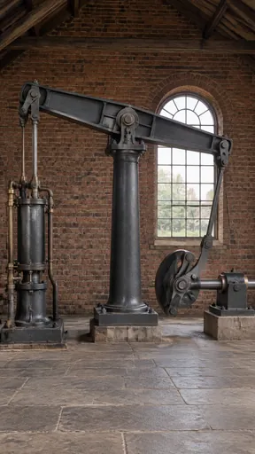](https://github.com/bigr/gpt-image-2.5-benchmark/releases/download/dataset-v2/negpos-flywheel-positive__gpt-image-2.5-flare-0.png) | [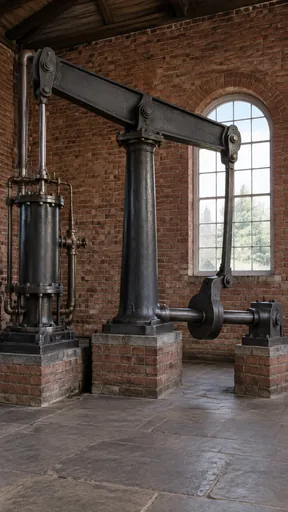](https://github.com/bigr/gpt-image-2.5-benchmark/releases/download/dataset-v2/negpos-flywheel-positive__gpt-image-2.5-flare-1.png) | [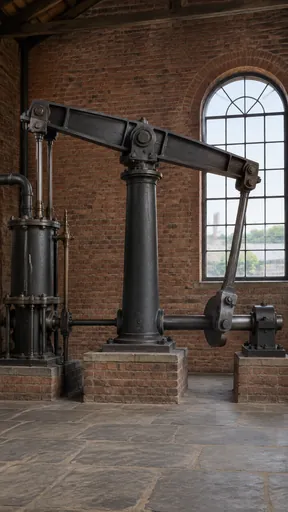](https://github.com/bigr/gpt-image-2.5-benchmark/releases/download/dataset-v2/negpos-flywheel-positive__gpt-image-2.5-flare-2.png) | [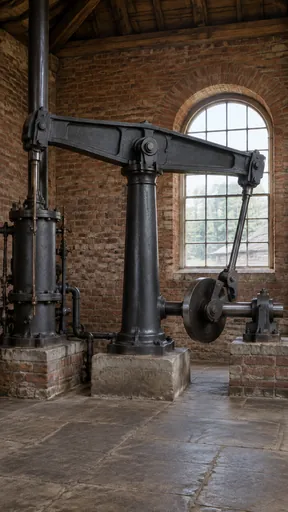](https://github.com/bigr/gpt-image-2.5-benchmark/releases/download/dataset-v2/negpos-flywheel-positive__gpt-image-2.5-flare-3.png) | [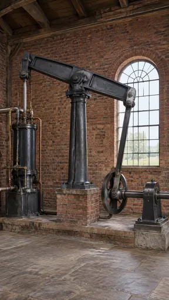](https://github.com/bigr/gpt-image-2.5-benchmark/releases/download/dataset-v2/negpos-flywheel-positive__gpt-image-2.5-flare-4.png) |
|---|---|---|---|---|
| **0**: all items OK; addition: yes; 1 human ruling(s) | **1**: all items OK; addition: yes; 2 human ruling(s) | **2**: all items OK; addition: yes; 2 human ruling(s) | **3**: all items OK; addition: yes | **4**: all items OK; addition: yes; 1 human ruling(s) |
| [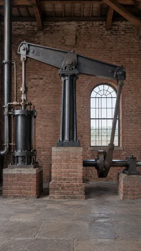](https://github.com/bigr/gpt-image-2.5-benchmark/releases/download/dataset-v2/negpos-flywheel-positive__gpt-image-2.5-flare-5.png) | [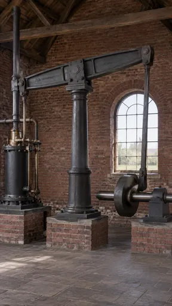](https://github.com/bigr/gpt-image-2.5-benchmark/releases/download/dataset-v2/negpos-flywheel-positive__gpt-image-2.5-flare-6.png) | [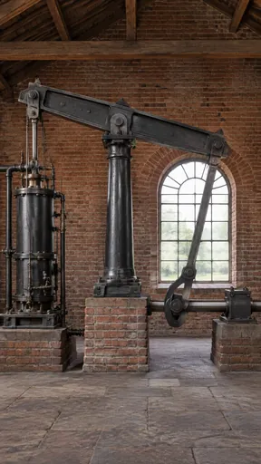](https://github.com/bigr/gpt-image-2.5-benchmark/releases/download/dataset-v2/negpos-flywheel-positive__gpt-image-2.5-flare-7.png) | [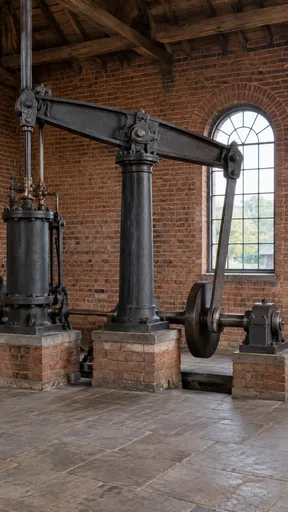](https://github.com/bigr/gpt-image-2.5-benchmark/releases/download/dataset-v2/negpos-flywheel-positive__gpt-image-2.5-flare-8.png) | [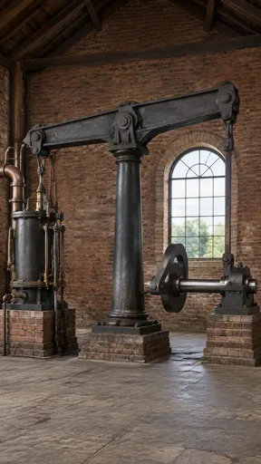](https://github.com/bigr/gpt-image-2.5-benchmark/releases/download/dataset-v2/negpos-flywheel-positive__gpt-image-2.5-flare-9.png) |
| **5**: all items OK; addition: yes; 2 human ruling(s) | **6**: all items OK; addition: yes | **7**: all items OK; addition: yes; 1 human ruling(s) | **8**: all items OK; addition: yes; 1 human ruling(s) | **9**: all items OK; addition: yes; 1 human ruling(s) |

Click a thumbnail for the full-resolution PNG (release asset).

Additions named by the reference reading (a model reading; the yes/no above is person-corrected):

- **0**: trees visible through window; roof timbers; brass/copper pipework
- **1**: trees visible through window; roof timbers; copper/iron pipework; brick plinths
- **2**: chimney and trees visible through window; roof timbers; pipework; brick plinths
- **3**: trees and a barn roof visible through window; roof timbers; tall vertical pipe and pipework; brick plinths
- **4**: trees/meadow visible through window; roof timbers; copper pipework; brick plinth/platform
- **5**: fields/trees visible through window; roof timbers; tall vertical pipe and pipework at left; brick plinths
- **6**: trees/field visible through window; roof timbers; brick plinths; vertical exhaust pipe and horizontal pipework
- **7**: trees visible through window; roof timbers; pipework; brick plinths
- **8**: trees and a building visible through window; roof timbers; brick plinths; vertical pipe above beam
- **9**: trees visible through window; roof timbers; copper pipework; brick plinths

Items: `negated-thing-appears` = Is any flywheel (a large heavy wheel on a shaft) visible?

