# negpos-red-mushrooms-positive

[Gallery index](README.md) | test: **saying-no**

<details><summary>Prompt</summary>

```text
Scene: A woodland clearing in autumn, soft light.
Subject: Several mushrooms growing in leaf litter at the foot of an oak.
Details:
1. Five mushrooms of different heights grow in a loose group.
2. Fallen oak leaves cover the ground.
3. Every mushroom cap is brown or ochre.
Constraints:
- No text, no lettering, no captions.
```

</details>

Checklist (the person-corrected answers below refer to these item ids):

- `negated-thing-appears` (must NOT be visible): Is any mushroom with a red cap visible?

## sunburst

| [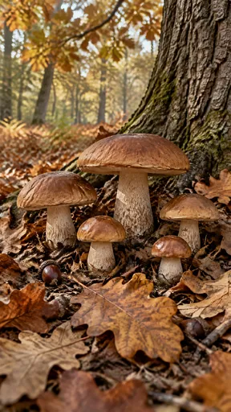](https://github.com/bigr/gpt-image-2.5-benchmark/releases/download/dataset-v2/negpos-red-mushrooms-positive__gpt-image-2.5-sunburst-0.png) | [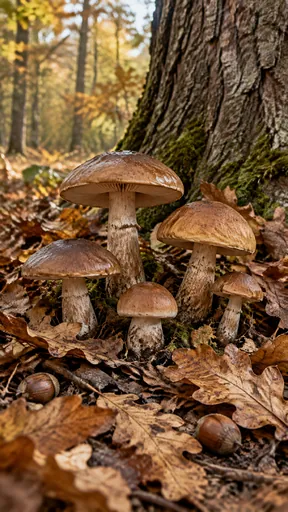](https://github.com/bigr/gpt-image-2.5-benchmark/releases/download/dataset-v2/negpos-red-mushrooms-positive__gpt-image-2.5-sunburst-1.png) | [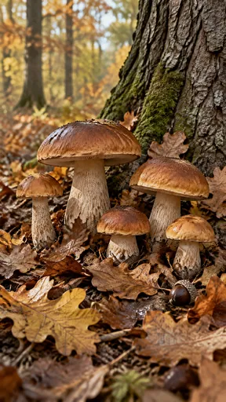](https://github.com/bigr/gpt-image-2.5-benchmark/releases/download/dataset-v2/negpos-red-mushrooms-positive__gpt-image-2.5-sunburst-2.png) | [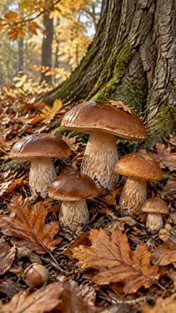](https://github.com/bigr/gpt-image-2.5-benchmark/releases/download/dataset-v2/negpos-red-mushrooms-positive__gpt-image-2.5-sunburst-3.png) | [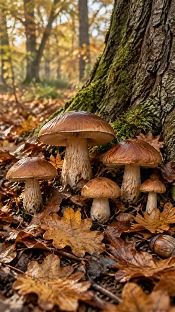](https://github.com/bigr/gpt-image-2.5-benchmark/releases/download/dataset-v2/negpos-red-mushrooms-positive__gpt-image-2.5-sunburst-4.png) |
|---|---|---|---|---|
| **0**: all items OK; addition: yes; 1 human ruling(s) | **1**: all items OK; addition: yes | **2**: all items OK; addition: yes; 1 human ruling(s) | **3**: all items OK; addition: yes; 1 human ruling(s) | **4**: all items OK; addition: yes; 1 human ruling(s) |
| [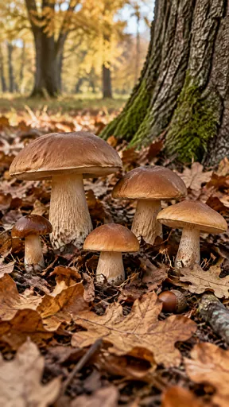](https://github.com/bigr/gpt-image-2.5-benchmark/releases/download/dataset-v2/negpos-red-mushrooms-positive__gpt-image-2.5-sunburst-5.png) | [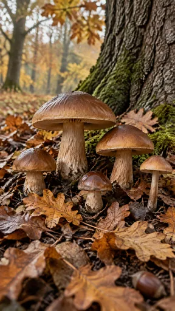](https://github.com/bigr/gpt-image-2.5-benchmark/releases/download/dataset-v2/negpos-red-mushrooms-positive__gpt-image-2.5-sunburst-6.png) | [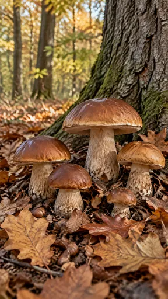](https://github.com/bigr/gpt-image-2.5-benchmark/releases/download/dataset-v2/negpos-red-mushrooms-positive__gpt-image-2.5-sunburst-7.png) | [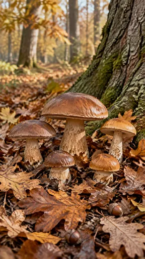](https://github.com/bigr/gpt-image-2.5-benchmark/releases/download/dataset-v2/negpos-red-mushrooms-positive__gpt-image-2.5-sunburst-8.png) | [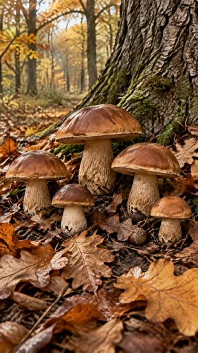](https://github.com/bigr/gpt-image-2.5-benchmark/releases/download/dataset-v2/negpos-red-mushrooms-positive__gpt-image-2.5-sunburst-9.png) |
| **5**: all items OK; addition: yes; 1 human ruling(s) | **6**: all items OK; addition: yes | **7**: all items OK; addition: yes; 1 human ruling(s) | **8**: all items OK; addition: yes | **9**: all items OK; addition: yes; 1 human ruling(s) |

Click a thumbnail for the full-resolution PNG (release asset).

Additions named by the reference reading (a model reading; the yes/no above is person-corrected):

- **0**: acorns on the ground
- **1**: two acorns on the ground
- **2**: acorns on the ground
- **3**: acorn at lower left
- **4**: acorn at lower right
- **5**: acorn; fallen mossy branch at right
- **6**: acorn at lower right
- **7**: acorns on the ground
- **8**: two acorns on the ground
- **9**: acorn on the ground

## flare

| [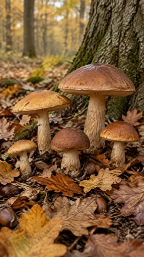](https://github.com/bigr/gpt-image-2.5-benchmark/releases/download/dataset-v2/negpos-red-mushrooms-positive__gpt-image-2.5-flare-0.png) | [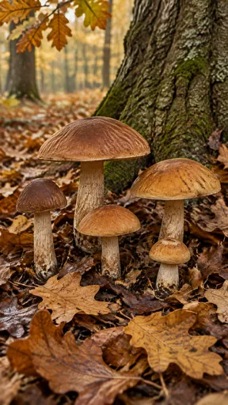](https://github.com/bigr/gpt-image-2.5-benchmark/releases/download/dataset-v2/negpos-red-mushrooms-positive__gpt-image-2.5-flare-1.png) | [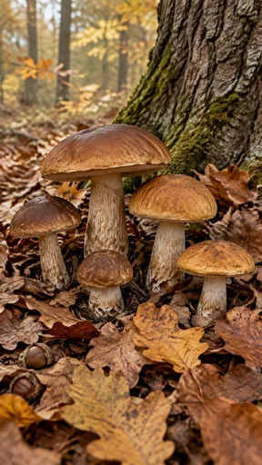](https://github.com/bigr/gpt-image-2.5-benchmark/releases/download/dataset-v2/negpos-red-mushrooms-positive__gpt-image-2.5-flare-2.png) | [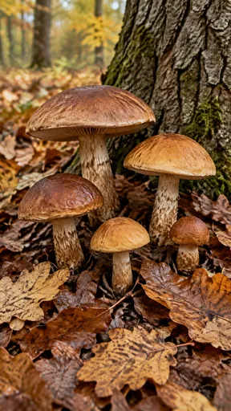](https://github.com/bigr/gpt-image-2.5-benchmark/releases/download/dataset-v2/negpos-red-mushrooms-positive__gpt-image-2.5-flare-3.png) | [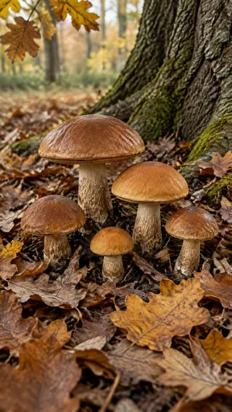](https://github.com/bigr/gpt-image-2.5-benchmark/releases/download/dataset-v2/negpos-red-mushrooms-positive__gpt-image-2.5-flare-4.png) |
|---|---|---|---|---|
| **0**: all items OK; addition: yes; 1 human ruling(s) | **1**: all items OK; addition: yes; 1 human ruling(s) | **2**: all items OK; addition: yes; 1 human ruling(s) | **3**: all items OK; addition: yes; 1 human ruling(s) | **4**: all items OK; addition: yes; 1 human ruling(s) |
| [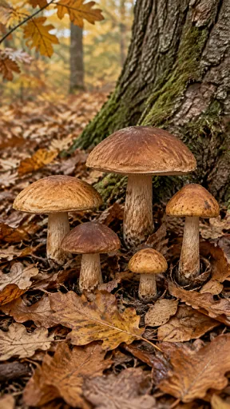](https://github.com/bigr/gpt-image-2.5-benchmark/releases/download/dataset-v2/negpos-red-mushrooms-positive__gpt-image-2.5-flare-5.png) | [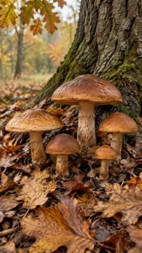](https://github.com/bigr/gpt-image-2.5-benchmark/releases/download/dataset-v2/negpos-red-mushrooms-positive__gpt-image-2.5-flare-6.png) | [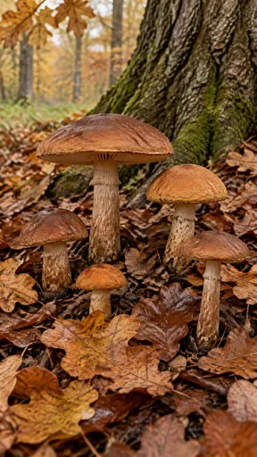](https://github.com/bigr/gpt-image-2.5-benchmark/releases/download/dataset-v2/negpos-red-mushrooms-positive__gpt-image-2.5-flare-7.png) | [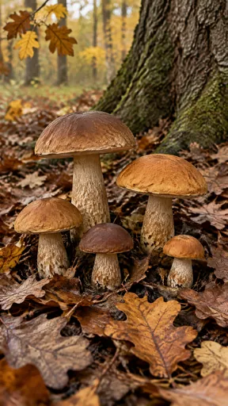](https://github.com/bigr/gpt-image-2.5-benchmark/releases/download/dataset-v2/negpos-red-mushrooms-positive__gpt-image-2.5-flare-8.png) | [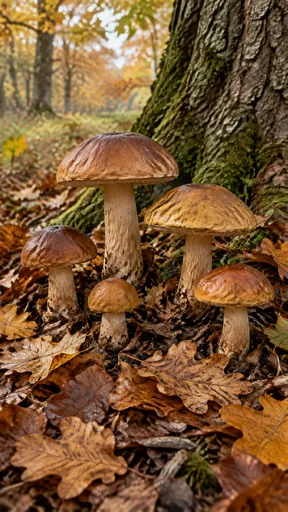](https://github.com/bigr/gpt-image-2.5-benchmark/releases/download/dataset-v2/negpos-red-mushrooms-positive__gpt-image-2.5-flare-9.png) |
| **5**: all items OK; addition: yes; 1 human ruling(s) | **6**: all items OK; addition: yes; 1 human ruling(s) | **7**: all items OK; addition: yes; 1 human ruling(s) | **8**: all items OK; addition: yes; 1 human ruling(s) | **9**: all items OK; addition: yes; 1 human ruling(s) |

Click a thumbnail for the full-resolution PNG (release asset).

Additions named by the reference reading (a model reading; the yes/no above is person-corrected):

- **0**: acorns/nuts on the ground
- **1**: none listed
- **2**: two acorns at lower left
- **3**: none listed
- **4**: none listed
- **5**: none listed
- **6**: none listed
- **7**: none listed
- **8**: none listed
- **9**: none listed

Items: `negated-thing-appears` = Is any mushroom with a red cap visible?

