# period-bronze-harbour

[Gallery index](README.md) | test: **specific-details**

<details><summary>Prompt</summary>

```text
Scene: A small Bronze Age harbour on a Mediterranean coast around 1300 BCE, morning.
Subject: The quay and the moored boats seen from the water.
Details:
1. Three sewn-plank boats with a single square linen sail and a steering oar are drawn up on the shingle.
2. Men wear short wrapped kilts of undyed wool; some carry large clay jars with two handles.
3. A quay of piled rough stones with wooden mooring posts runs along the shore.
4. Behind the quay stand a few flat-roofed mud-brick houses with no windows on the street side.
5. Stacked copper ingots in an ox-hide shape lie beside a woven mat.
Constraints:
- No text, no lettering, no captions.
```

</details>

Checklist (the person-corrected answers below refer to these item ids):

- `sewn-boats` (must be visible): The boats are plank boats with a single square sail.
- `kilts` (must be visible): People wear short wool wraps or kilts, not tunics with sleeves or togas.
- `rough-quay` (must be visible): The quay is piled rough stone with wooden posts, not cut marble.
- `mudbrick` (must be visible): Houses are flat-roofed mud-brick.
- `ingots` (must be visible): Copper ingots (ox-hide shaped) are visible.
- `landmark-substituted` (must NOT be visible): A famous landmark is substituted (for example the Parthenon, a Greek marble temple with columns, or a Roman lighthouse)

## sunburst

| [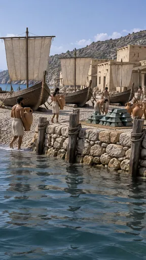](https://github.com/bigr/gpt-image-2.5-benchmark/releases/download/dataset-v2/period-bronze-harbour__gpt-image-2.5-sunburst-0.png) | [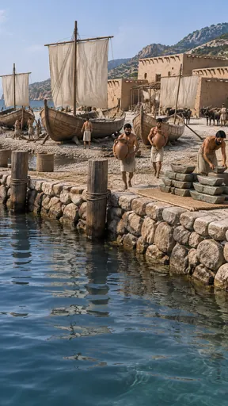](https://github.com/bigr/gpt-image-2.5-benchmark/releases/download/dataset-v2/period-bronze-harbour__gpt-image-2.5-sunburst-1.png) | [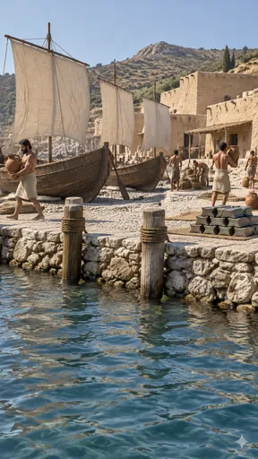](https://github.com/bigr/gpt-image-2.5-benchmark/releases/download/dataset-v2/period-bronze-harbour__gpt-image-2.5-sunburst-2.png) | [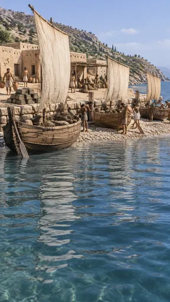](https://github.com/bigr/gpt-image-2.5-benchmark/releases/download/dataset-v2/period-bronze-harbour__gpt-image-2.5-sunburst-3.png) | [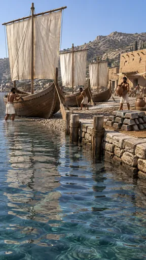](https://github.com/bigr/gpt-image-2.5-benchmark/releases/download/dataset-v2/period-bronze-harbour__gpt-image-2.5-sunburst-4.png) |
|---|---|---|---|---|
| **0**: failed: `ingots`; addition: yes; 2 human ruling(s) | **1**: failed: `ingots`; addition: yes; 1 human ruling(s) | **2**: all items OK; addition: yes | **3**: failed: `ingots`; addition: yes; 2 human ruling(s) | **4**: failed: `ingots`; addition: yes |
| [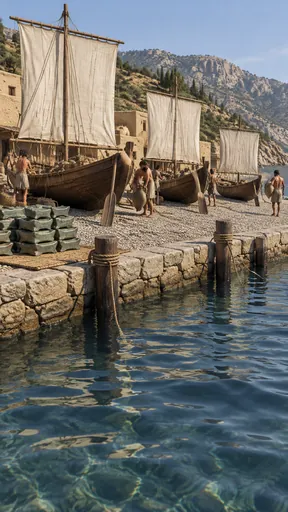](https://github.com/bigr/gpt-image-2.5-benchmark/releases/download/dataset-v2/period-bronze-harbour__gpt-image-2.5-sunburst-5.png) | [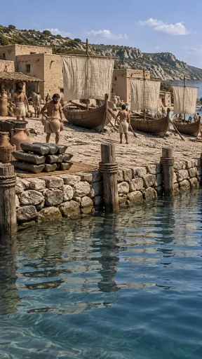](https://github.com/bigr/gpt-image-2.5-benchmark/releases/download/dataset-v2/period-bronze-harbour__gpt-image-2.5-sunburst-6.png) | [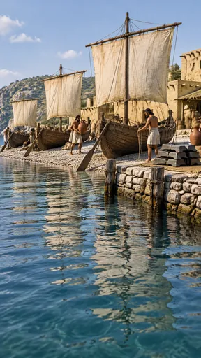](https://github.com/bigr/gpt-image-2.5-benchmark/releases/download/dataset-v2/period-bronze-harbour__gpt-image-2.5-sunburst-7.png) | [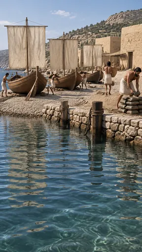](https://github.com/bigr/gpt-image-2.5-benchmark/releases/download/dataset-v2/period-bronze-harbour__gpt-image-2.5-sunburst-8.png) | [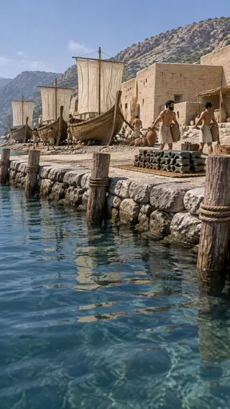](https://github.com/bigr/gpt-image-2.5-benchmark/releases/download/dataset-v2/period-bronze-harbour__gpt-image-2.5-sunburst-9.png) |
| **5**: all items OK; addition: yes; 1 human ruling(s) | **6**: failed: `ingots`; addition: yes; 1 human ruling(s) | **7**: failed: `ingots`; addition: yes; 1 human ruling(s) | **8**: failed: `ingots`; addition: yes; 1 human ruling(s) | **9**: all items OK; addition: yes; 1 human ruling(s) |

Click a thumbnail for the full-resolution PNG (release asset).

Additions named by the reference reading (a model reading; the yes/no above is person-corrected):

- **0**: mountains; thatched awning; log rollers under boats; small distant boat
- **1**: herd of oxen/cattle; wooden pergola structure; woven baskets; mountains
- **2**: hills; cypress trees; thatched awning; baskets; sparkle watermark logo
- **3**: wooded hills; cypress trees; wooden pergola; baskets; cargo sacks in boats
- **4**: hilltop fortress/ruins; cypress trees; mountains; awnings; distant town
- **5**: mountains; cypress trees; baskets
- **6**: hills; thatched pergola; baskets
- **7**: wooded hills; thatched awning; baskets
- **8**: hills; trees; awning; log rollers under boats
- **9**: mountains; thatched awning; baskets; trees

## flare

| [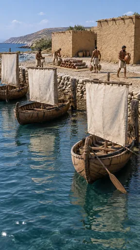](https://github.com/bigr/gpt-image-2.5-benchmark/releases/download/dataset-v2/period-bronze-harbour__gpt-image-2.5-flare-0.png) | [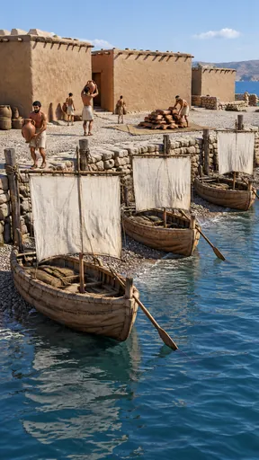](https://github.com/bigr/gpt-image-2.5-benchmark/releases/download/dataset-v2/period-bronze-harbour__gpt-image-2.5-flare-1.png) | [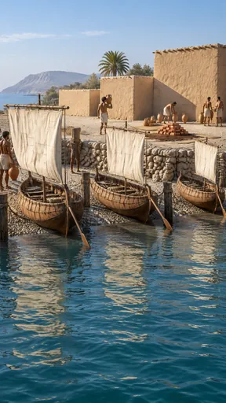](https://github.com/bigr/gpt-image-2.5-benchmark/releases/download/dataset-v2/period-bronze-harbour__gpt-image-2.5-flare-2.png) | [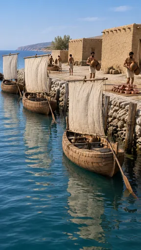](https://github.com/bigr/gpt-image-2.5-benchmark/releases/download/dataset-v2/period-bronze-harbour__gpt-image-2.5-flare-3.png) | [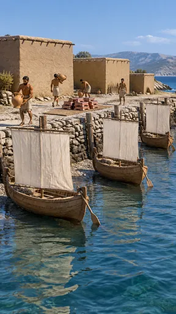](https://github.com/bigr/gpt-image-2.5-benchmark/releases/download/dataset-v2/period-bronze-harbour__gpt-image-2.5-flare-4.png) |
|---|---|---|---|---|
| **0**: all items OK; addition: yes; 1 human ruling(s) | **1**: all items OK; addition: yes; 3 human ruling(s) | **2**: failed: `ingots`; addition: yes | **3**: all items OK; addition: yes; 1 human ruling(s) | **4**: all items OK; addition: yes |
| [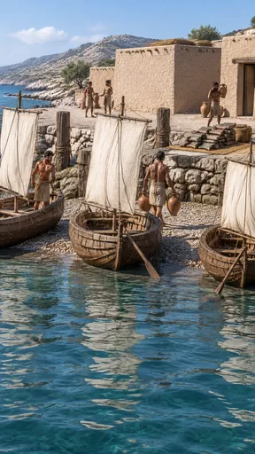](https://github.com/bigr/gpt-image-2.5-benchmark/releases/download/dataset-v2/period-bronze-harbour__gpt-image-2.5-flare-5.png) | [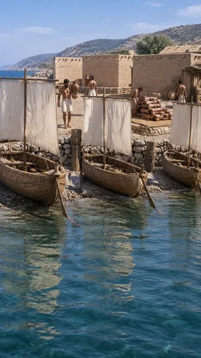](https://github.com/bigr/gpt-image-2.5-benchmark/releases/download/dataset-v2/period-bronze-harbour__gpt-image-2.5-flare-6.png) | [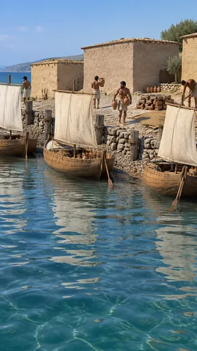](https://github.com/bigr/gpt-image-2.5-benchmark/releases/download/dataset-v2/period-bronze-harbour__gpt-image-2.5-flare-7.png) | [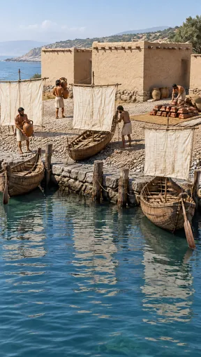](https://github.com/bigr/gpt-image-2.5-benchmark/releases/download/dataset-v2/period-bronze-harbour__gpt-image-2.5-flare-8.png) | [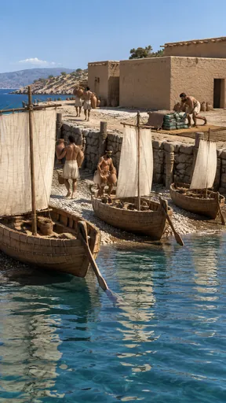](https://github.com/bigr/gpt-image-2.5-benchmark/releases/download/dataset-v2/period-bronze-harbour__gpt-image-2.5-flare-9.png) |
| **5**: failed: `ingots`; addition: yes; 1 human ruling(s) | **6**: all items OK; addition: yes; 2 human ruling(s) | **7**: all items OK; addition: yes; 1 human ruling(s) | **8**: failed: `ingots`; addition: yes; 1 human ruling(s) | **9**: failed: `ingots`; addition: yes; 1 human ruling(s) |

Click a thumbnail for the full-resolution PNG (release asset).

Additions named by the reference reading (a model reading; the yes/no above is person-corrected):

- **0**: hills; shrubs; basket
- **1**: woven baskets; distant hills; cargo bundles in boats
- **2**: palm tree; trees; mountainous headland
- **3**: tree; headland; baskets
- **4**: hills; trees and shrubs; reed fence
- **5**: hills; olive tree; basket; brushwood bundle on roof
- **6**: hills; tree; brushwood lean-to shed; ladder
- **7**: olive trees; reed fence; headland; low stone wall
- **8**: hills; tree; woven baskets
- **9**: hills; trees; reed fence; draped hide/cloth; distant posts in water

Items: `sewn-boats` = The boats are plank boats with a single square sail.; `kilts` = People wear short wool wraps or kilts, not tunics with sleeves or togas.; `rough-quay` = The quay is piled rough stone with wooden posts, not cut marble.; `mudbrick` = Houses are flat-roofed mud-brick.; `ingots` = Copper ingots (ox-hide shaped) are visible.; `landmark-substituted` = A famous landmark is substituted (for example the Parthenon, a Greek marble temple with c…

