# period-cumulonimbus-plain

[Gallery index](README.md) | test: **specific-details**

<details><summary>Prompt</summary>

```text
Scene: A cumulonimbus cloud over a flat agricultural plain, late afternoon.
Subject: The storm cloud and the plain beneath it, seen from ground level.
Details:
1. A single towering cumulonimbus with a flat anvil top spreading at the top, bright white and sunlit on the upper right side.
2. The cloud base is dark grey and level, with a curtain of rain falling below it on the left.
3. The plain is flat with ploughed fields in brown and green stripes and a straight dirt road to the horizon.
4. No hills or mountains appear anywhere on the horizon.
5. A few small low cumulus clouds sit far to the right.
Constraints:
- No text, no lettering, no captions.
```

</details>

Checklist (the person-corrected answers below refer to these item ids):

- `anvil` (must be visible): A towering cloud with a flat anvil top.
- `rain-curtain` (must be visible): A rain curtain falls below a dark level base.
- `striped-fields` (must be visible): Striped ploughed fields on a flat plain.
- `flat-horizon` (must be visible): The horizon is flat with no hills or mountains.
- `straight-road` (must be visible): A straight dirt road runs to the horizon.
- `landmark-substituted` (must NOT be visible): A stereotype scene is substituted (for example a tornado funnel or Monument Valley buttes)

## sunburst

| [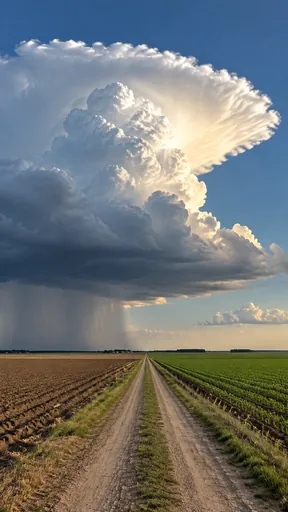](https://github.com/bigr/gpt-image-2.5-benchmark/releases/download/dataset-v2/period-cumulonimbus-plain__gpt-image-2.5-sunburst-0.png) | [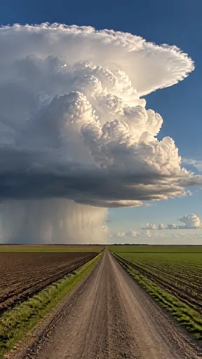](https://github.com/bigr/gpt-image-2.5-benchmark/releases/download/dataset-v2/period-cumulonimbus-plain__gpt-image-2.5-sunburst-1.png) | [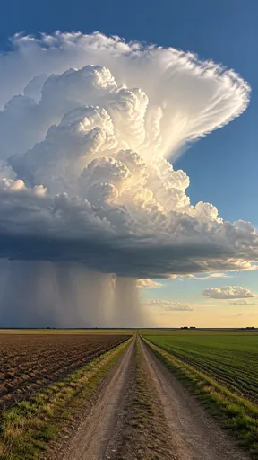](https://github.com/bigr/gpt-image-2.5-benchmark/releases/download/dataset-v2/period-cumulonimbus-plain__gpt-image-2.5-sunburst-2.png) | [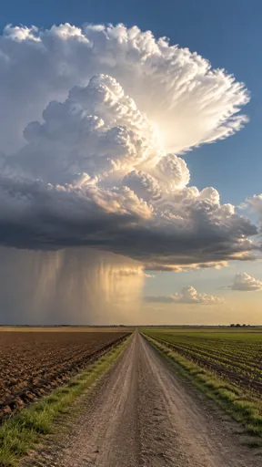](https://github.com/bigr/gpt-image-2.5-benchmark/releases/download/dataset-v2/period-cumulonimbus-plain__gpt-image-2.5-sunburst-3.png) | [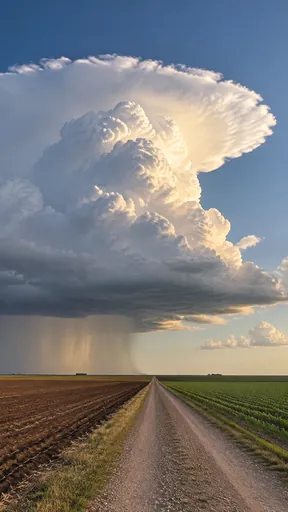](https://github.com/bigr/gpt-image-2.5-benchmark/releases/download/dataset-v2/period-cumulonimbus-plain__gpt-image-2.5-sunburst-4.png) |
|---|---|---|---|---|
| **0**: all items OK; addition: yes; 1 human ruling(s) | **1**: all items OK; addition: yes; 1 human ruling(s) | **2**: all items OK; addition: yes; 1 human ruling(s) | **3**: all items OK; addition: yes; 2 human ruling(s) | **4**: all items OK; addition: yes; 1 human ruling(s) |
| [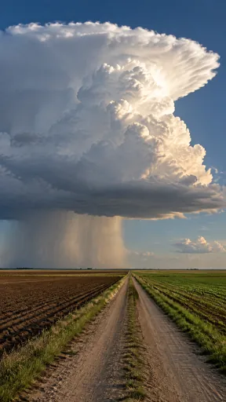](https://github.com/bigr/gpt-image-2.5-benchmark/releases/download/dataset-v2/period-cumulonimbus-plain__gpt-image-2.5-sunburst-5.png) | [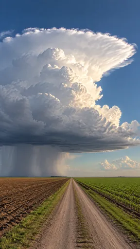](https://github.com/bigr/gpt-image-2.5-benchmark/releases/download/dataset-v2/period-cumulonimbus-plain__gpt-image-2.5-sunburst-6.png) | [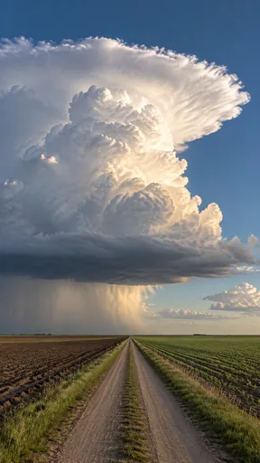](https://github.com/bigr/gpt-image-2.5-benchmark/releases/download/dataset-v2/period-cumulonimbus-plain__gpt-image-2.5-sunburst-7.png) | [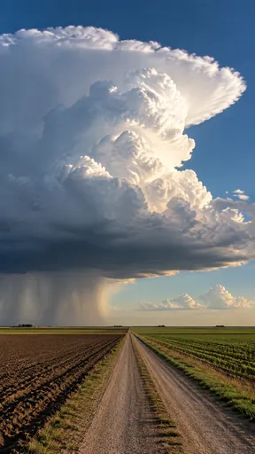](https://github.com/bigr/gpt-image-2.5-benchmark/releases/download/dataset-v2/period-cumulonimbus-plain__gpt-image-2.5-sunburst-8.png) | [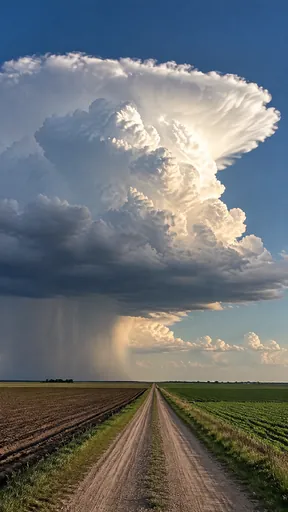](https://github.com/bigr/gpt-image-2.5-benchmark/releases/download/dataset-v2/period-cumulonimbus-plain__gpt-image-2.5-sunburst-9.png) |
| **5**: all items OK; addition: yes; 1 human ruling(s) | **6**: all items OK; addition: yes; 1 human ruling(s) | **7**: all items OK; addition: yes; 1 human ruling(s) | **8**: all items OK; addition: yes; 1 human ruling(s) | **9**: all items OK; addition: yes; 1 human ruling(s) |

Click a thumbnail for the full-resolution PNG (release asset).

Additions named by the reference reading (a model reading; the yes/no above is person-corrected):

- **0**: distant tree clumps/farm buildings on horizon
- **1**: none listed
- **2**: distant tree clumps/farm buildings on horizon
- **3**: distant tree clumps/farm buildings on horizon
- **4**: distant tree clumps on horizon
- **5**: distant tree clumps/structures on horizon
- **6**: distant tree clump on horizon
- **7**: none listed
- **8**: distant tree clumps/farm buildings on horizon
- **9**: distant tree clumps/farm buildings on horizon

## flare

| [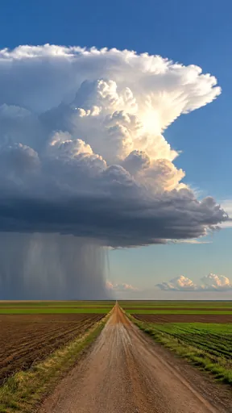](https://github.com/bigr/gpt-image-2.5-benchmark/releases/download/dataset-v2/period-cumulonimbus-plain__gpt-image-2.5-flare-0.png) | [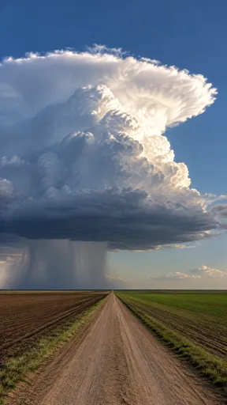](https://github.com/bigr/gpt-image-2.5-benchmark/releases/download/dataset-v2/period-cumulonimbus-plain__gpt-image-2.5-flare-1.png) | [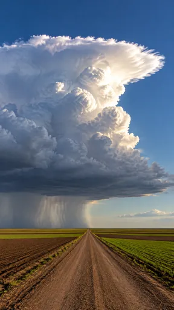](https://github.com/bigr/gpt-image-2.5-benchmark/releases/download/dataset-v2/period-cumulonimbus-plain__gpt-image-2.5-flare-2.png) | [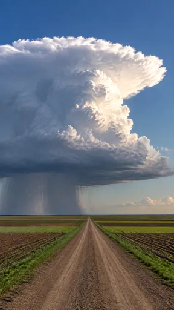](https://github.com/bigr/gpt-image-2.5-benchmark/releases/download/dataset-v2/period-cumulonimbus-plain__gpt-image-2.5-flare-3.png) | [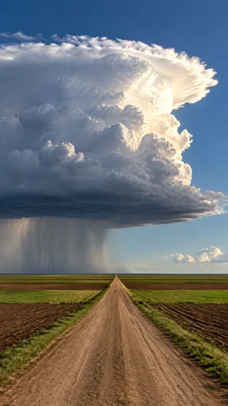](https://github.com/bigr/gpt-image-2.5-benchmark/releases/download/dataset-v2/period-cumulonimbus-plain__gpt-image-2.5-flare-4.png) |
|---|---|---|---|---|
| **0**: all items OK; addition: none | **1**: all items OK; addition: yes; 1 human ruling(s) | **2**: all items OK; addition: none | **3**: all items OK; addition: none | **4**: all items OK; addition: none |
| [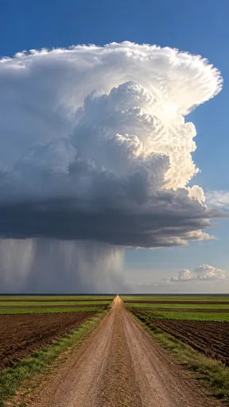](https://github.com/bigr/gpt-image-2.5-benchmark/releases/download/dataset-v2/period-cumulonimbus-plain__gpt-image-2.5-flare-5.png) | [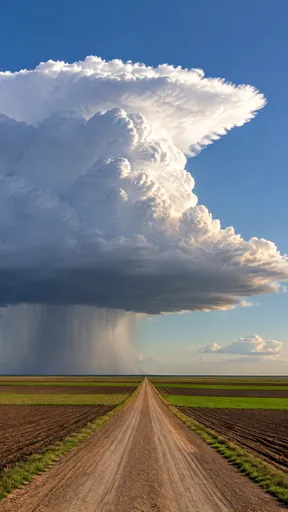](https://github.com/bigr/gpt-image-2.5-benchmark/releases/download/dataset-v2/period-cumulonimbus-plain__gpt-image-2.5-flare-6.png) | [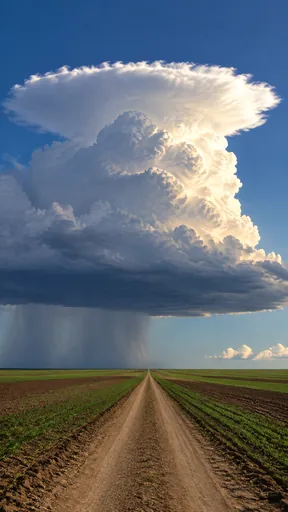](https://github.com/bigr/gpt-image-2.5-benchmark/releases/download/dataset-v2/period-cumulonimbus-plain__gpt-image-2.5-flare-7.png) | [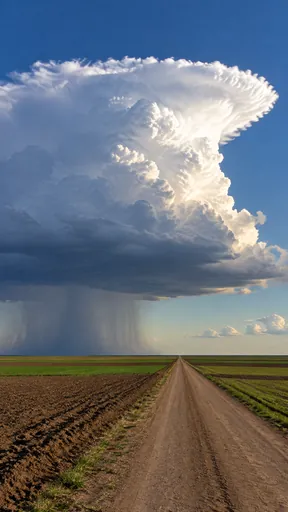](https://github.com/bigr/gpt-image-2.5-benchmark/releases/download/dataset-v2/period-cumulonimbus-plain__gpt-image-2.5-flare-8.png) | [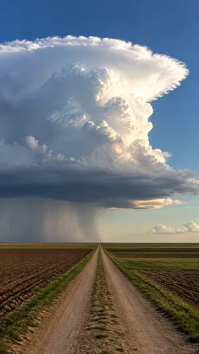](https://github.com/bigr/gpt-image-2.5-benchmark/releases/download/dataset-v2/period-cumulonimbus-plain__gpt-image-2.5-flare-9.png) |
| **5**: all items OK; addition: none | **6**: all items OK; addition: yes; 1 human ruling(s) | **7**: all items OK; addition: none | **8**: all items OK; addition: none | **9**: all items OK; addition: none |

Click a thumbnail for the full-resolution PNG (release asset).

Additions named by the reference reading (a model reading; the yes/no above is person-corrected):

- **0**: none listed
- **1**: none listed
- **2**: none listed
- **3**: none listed
- **4**: none listed
- **5**: none listed
- **6**: none listed
- **7**: none listed
- **8**: none listed
- **9**: none listed

Items: `anvil` = A towering cloud with a flat anvil top.; `rain-curtain` = A rain curtain falls below a dark level base.; `striped-fields` = Striped ploughed fields on a flat plain.; `flat-horizon` = The horizon is flat with no hills or mountains.; `straight-road` = A straight dirt road runs to the horizon.; `landmark-substituted` = A stereotype scene is substituted (for example a tornado funnel or Monument Valley buttes)

