# period-fungus-beech

[Gallery index](README.md) | test: **specific-details**

<details><summary>Prompt</summary>

```text
Scene: Close-up of a temperate beech forest floor in October, soft diffuse light.
Subject: A cluster of honey fungus on a rotting beech stump.
Details:
1. The cluster is about a dozen honey-brown caps, each with a few darker scales at the centre, on yellowish-tan stems with a ring.
2. The stump is grey, with peeling bark, and sits among fallen copper-coloured beech leaves.
3. Two smooth grey beech trunks rise in the background, out of focus.
4. A little green moss grows on the stump's north side.
5. The mushrooms are drawn clearly and anatomically accurately, with visible gills under one tilted cap.
Constraints:
- No text, no lettering, no captions.
```

</details>

Checklist (the person-corrected answers below refer to these item ids):

- `honey-brown-cluster` (must be visible): A cluster of honey-brown, scaly-centred caps on a stump.
- `ringed-stems` (must be visible): The stems are tan and carry a ring.
- `beech-leaves` (must be visible): Fallen copper beech leaves cover the ground.
- `beech-trunks` (must be visible): Smooth grey beech trunks in the background.
- `gills` (must be visible): Gills are visible under at least one cap.
- `landmark-substituted` (must NOT be visible): The stereotype toadstool is substituted (red cap with white spots, fly agaric) in place of honey-brown caps

## sunburst

| [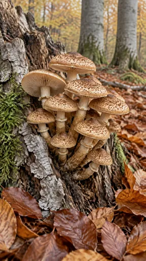](https://github.com/bigr/gpt-image-2.5-benchmark/releases/download/dataset-v2/period-fungus-beech__gpt-image-2.5-sunburst-0.png) | [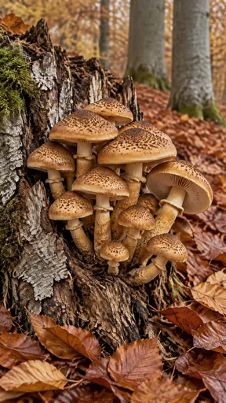](https://github.com/bigr/gpt-image-2.5-benchmark/releases/download/dataset-v2/period-fungus-beech__gpt-image-2.5-sunburst-1.png) | [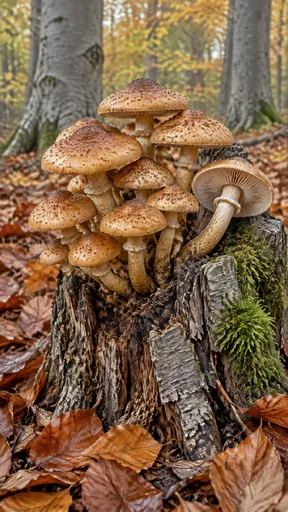](https://github.com/bigr/gpt-image-2.5-benchmark/releases/download/dataset-v2/period-fungus-beech__gpt-image-2.5-sunburst-2.png) | [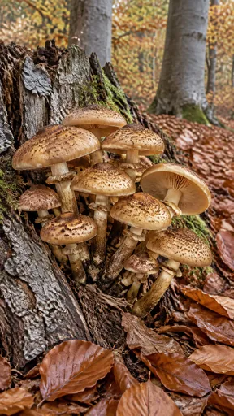](https://github.com/bigr/gpt-image-2.5-benchmark/releases/download/dataset-v2/period-fungus-beech__gpt-image-2.5-sunburst-3.png) | [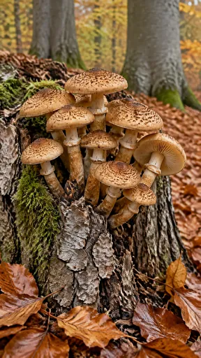](https://github.com/bigr/gpt-image-2.5-benchmark/releases/download/dataset-v2/period-fungus-beech__gpt-image-2.5-sunburst-4.png) |
|---|---|---|---|---|
| **0**: all items OK; addition: yes; 1 human ruling(s) | **1**: all items OK; addition: yes; 1 human ruling(s) | **2**: all items OK; addition: yes; 1 human ruling(s) | **3**: all items OK; addition: none | **4**: all items OK; addition: none |
| [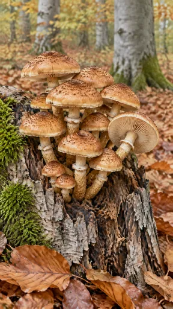](https://github.com/bigr/gpt-image-2.5-benchmark/releases/download/dataset-v2/period-fungus-beech__gpt-image-2.5-sunburst-5.png) | [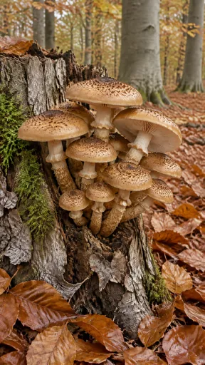](https://github.com/bigr/gpt-image-2.5-benchmark/releases/download/dataset-v2/period-fungus-beech__gpt-image-2.5-sunburst-6.png) | [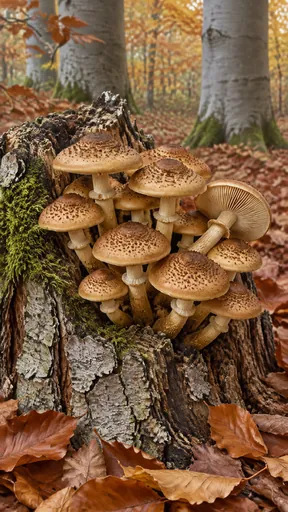](https://github.com/bigr/gpt-image-2.5-benchmark/releases/download/dataset-v2/period-fungus-beech__gpt-image-2.5-sunburst-7.png) | [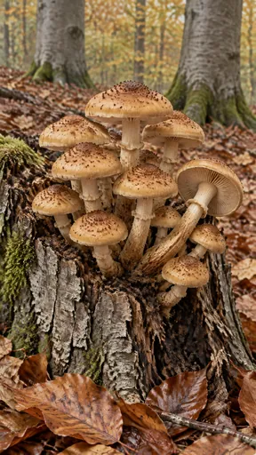](https://github.com/bigr/gpt-image-2.5-benchmark/releases/download/dataset-v2/period-fungus-beech__gpt-image-2.5-sunburst-8.png) | [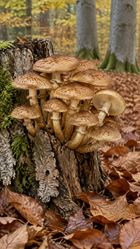](https://github.com/bigr/gpt-image-2.5-benchmark/releases/download/dataset-v2/period-fungus-beech__gpt-image-2.5-sunburst-9.png) |
| **5**: all items OK; addition: none | **6**: all items OK; addition: none | **7**: all items OK; addition: none | **8**: all items OK; addition: yes; 1 human ruling(s) | **9**: all items OK; addition: none |

Click a thumbnail for the full-resolution PNG (release asset).

Additions named by the reference reading (a model reading; the yes/no above is person-corrected):

- **0**: fallen branch on forest floor
- **1**: none listed
- **2**: fallen branch on forest floor behind stump
- **3**: none listed
- **4**: none listed
- **5**: none listed
- **6**: none listed
- **7**: none listed
- **8**: fallen twig/branch in foreground leaves
- **9**: none listed

## flare

| [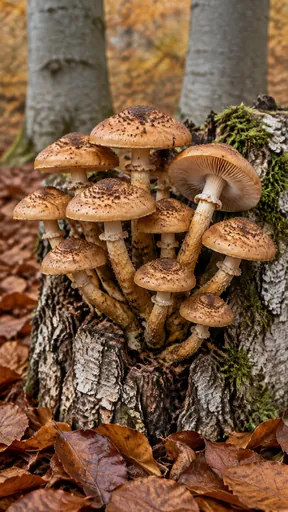](https://github.com/bigr/gpt-image-2.5-benchmark/releases/download/dataset-v2/period-fungus-beech__gpt-image-2.5-flare-0.png) | [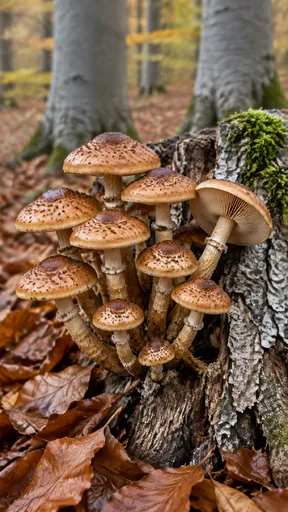](https://github.com/bigr/gpt-image-2.5-benchmark/releases/download/dataset-v2/period-fungus-beech__gpt-image-2.5-flare-1.png) | [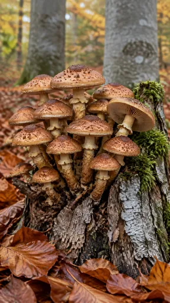](https://github.com/bigr/gpt-image-2.5-benchmark/releases/download/dataset-v2/period-fungus-beech__gpt-image-2.5-flare-2.png) | [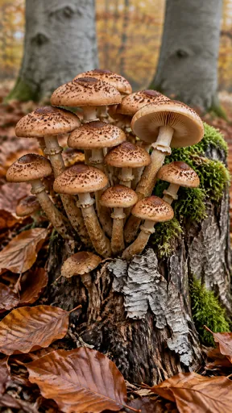](https://github.com/bigr/gpt-image-2.5-benchmark/releases/download/dataset-v2/period-fungus-beech__gpt-image-2.5-flare-3.png) | [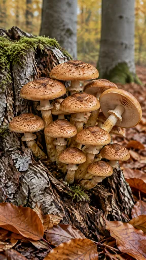](https://github.com/bigr/gpt-image-2.5-benchmark/releases/download/dataset-v2/period-fungus-beech__gpt-image-2.5-flare-4.png) |
|---|---|---|---|---|
| **0**: all items OK; addition: none | **1**: all items OK; addition: none | **2**: all items OK; addition: none | **3**: all items OK; addition: none | **4**: all items OK; addition: none; 1 human ruling(s) |
| [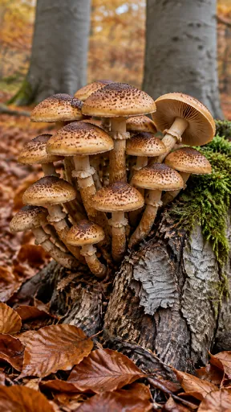](https://github.com/bigr/gpt-image-2.5-benchmark/releases/download/dataset-v2/period-fungus-beech__gpt-image-2.5-flare-5.png) | [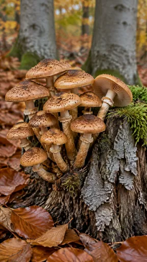](https://github.com/bigr/gpt-image-2.5-benchmark/releases/download/dataset-v2/period-fungus-beech__gpt-image-2.5-flare-6.png) | [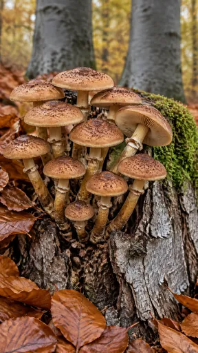](https://github.com/bigr/gpt-image-2.5-benchmark/releases/download/dataset-v2/period-fungus-beech__gpt-image-2.5-flare-7.png) | [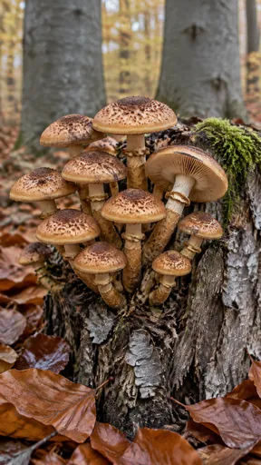](https://github.com/bigr/gpt-image-2.5-benchmark/releases/download/dataset-v2/period-fungus-beech__gpt-image-2.5-flare-8.png) | [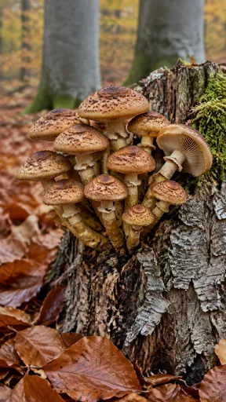](https://github.com/bigr/gpt-image-2.5-benchmark/releases/download/dataset-v2/period-fungus-beech__gpt-image-2.5-flare-9.png) |
| **5**: all items OK; addition: yes; 1 human ruling(s) | **6**: all items OK; addition: yes; 1 human ruling(s) | **7**: all items OK; addition: none | **8**: all items OK; addition: yes; 1 human ruling(s) | **9**: all items OK; addition: none; 1 human ruling(s) |

Click a thumbnail for the full-resolution PNG (release asset).

Additions named by the reference reading (a model reading; the yes/no above is person-corrected):

- **0**: none listed
- **1**: none listed
- **2**: none listed
- **3**: none listed
- **4**: fallen twig among foreground leaves
- **5**: fallen twig among foreground leaves
- **6**: none listed
- **7**: none listed
- **8**: none listed
- **9**: none listed

Items: `honey-brown-cluster` = A cluster of honey-brown, scaly-centred caps on a stump.; `ringed-stems` = The stems are tan and carry a ring.; `beech-leaves` = Fallen copper beech leaves cover the ground.; `beech-trunks` = Smooth grey beech trunks in the background.; `gills` = Gills are visible under at least one cap.; `landmark-substituted` = The stereotype toadstool is substituted (red cap with white spots, fly agaric) in place o…

