# period-italian-town-10c

[Gallery index](README.md) | test: **specific-details**

<details><summary>Prompt</summary>

```text
Scene: A small market town square in northern Italy around the year 950, early afternoon.
Subject: The square, seen from one corner, with the townspeople and their buildings.
Details:
1. Buildings are two-storey timber-framed houses with steep thatched roofs and a few plain rubble-stone houses with small round-arched windows.
2. One low stone church with a single squat square bell tower and no dome stands on the right.
3. People wear coarse undyed wool tunics, belted at the waist; women wear linen head cloths.
4. The square is bare packed earth with a wooden well and plank market stalls selling grain and pottery.
5. A wooden palisade and a plain gate tower close the far end.
Constraints:
- No text, no lettering, no captions.
```

</details>

Checklist (the person-corrected answers below refer to these item ids):

- `timber-houses` (must be visible): Most houses are timber-framed with thatched roofs.
- `squat-tower` (must be visible): The church has a low, squat square bell tower. (excluded from every score)
- `wool-tunics` (must be visible): People wear plain wool tunics (no tailored doublets, no hats of a later era).
- `earth-square` (must be visible): The square is bare earth with a well and plank stalls, not paved with decorative stone.
- `palisade` (must be visible): A wooden palisade or plain gate tower closes the far end.
- `landmark-substituted` (must NOT be visible): A famous landmark is substituted (for example the Leaning Tower of Pisa, the Colosseum or a Renaissance dome)

## sunburst

| [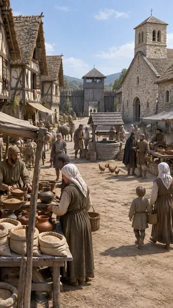](https://github.com/bigr/gpt-image-2.5-benchmark/releases/download/dataset-v2/period-italian-town-10c__gpt-image-2.5-sunburst-0.png) | [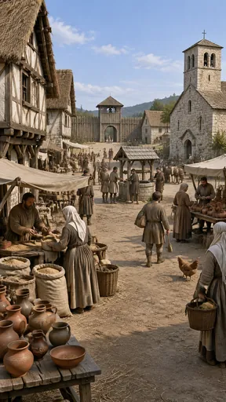](https://github.com/bigr/gpt-image-2.5-benchmark/releases/download/dataset-v2/period-italian-town-10c__gpt-image-2.5-sunburst-1.png) | [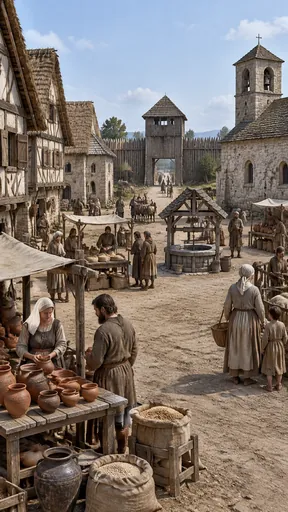](https://github.com/bigr/gpt-image-2.5-benchmark/releases/download/dataset-v2/period-italian-town-10c__gpt-image-2.5-sunburst-2.png) | [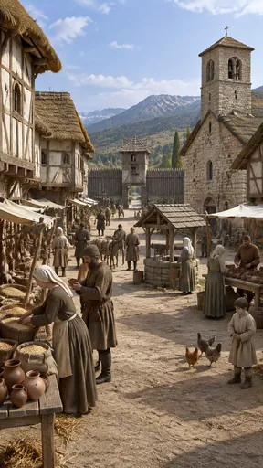](https://github.com/bigr/gpt-image-2.5-benchmark/releases/download/dataset-v2/period-italian-town-10c__gpt-image-2.5-sunburst-3.png) | [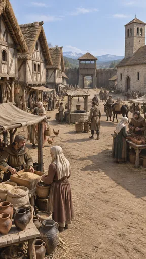](https://github.com/bigr/gpt-image-2.5-benchmark/releases/download/dataset-v2/period-italian-town-10c__gpt-image-2.5-sunburst-4.png) |
|---|---|---|---|---|
| **0**: all items OK; addition: yes; 1 human ruling(s) | **1**: all items OK; addition: yes; 1 human ruling(s) | **2**: all items OK; addition: yes; 2 human ruling(s) | **3**: all items OK; addition: yes; 1 human ruling(s) | **4**: all items OK; addition: yes |
| [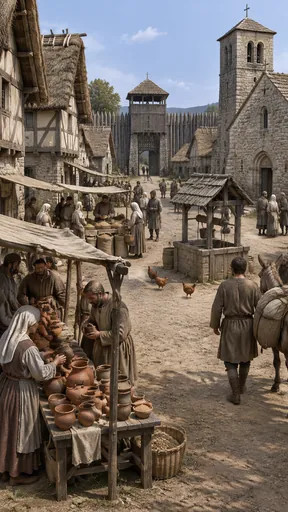](https://github.com/bigr/gpt-image-2.5-benchmark/releases/download/dataset-v2/period-italian-town-10c__gpt-image-2.5-sunburst-5.png) | [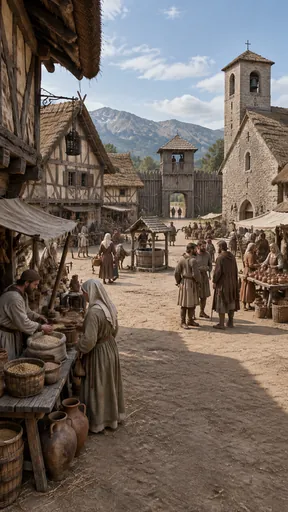](https://github.com/bigr/gpt-image-2.5-benchmark/releases/download/dataset-v2/period-italian-town-10c__gpt-image-2.5-sunburst-6.png) | [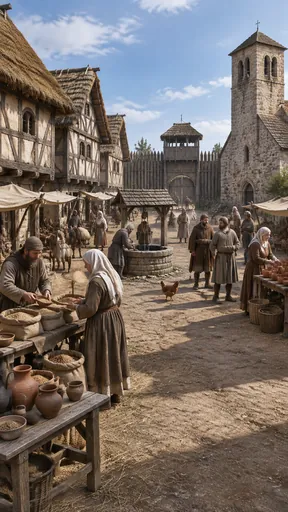](https://github.com/bigr/gpt-image-2.5-benchmark/releases/download/dataset-v2/period-italian-town-10c__gpt-image-2.5-sunburst-7.png) | [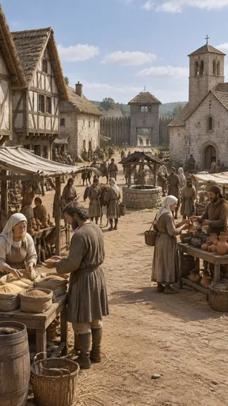](https://github.com/bigr/gpt-image-2.5-benchmark/releases/download/dataset-v2/period-italian-town-10c__gpt-image-2.5-sunburst-8.png) | [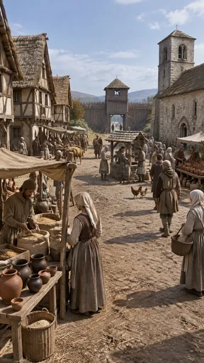](https://github.com/bigr/gpt-image-2.5-benchmark/releases/download/dataset-v2/period-italian-town-10c__gpt-image-2.5-sunburst-9.png) |
| **5**: all items OK; addition: yes | **6**: all items OK; addition: yes | **7**: all items OK; addition: yes; 1 human ruling(s) | **8**: all items OK; addition: yes; 2 human ruling(s) | **9**: all items OK; addition: yes; 1 human ruling(s) |

Click a thumbnail for the full-resolution PNG (release asset).

Additions named by the reference reading (a model reading; the yes/no above is person-corrected):

- **0**: chickens; pack horses; barrels; wooded hills; cloth awnings over stalls; cross atop gate tower
- **1**: chicken; pack horses; wooded hills; cloth awnings over stalls
- **2**: sheep in a wooden pen; horses with cart; barrels; cloth awnings over stalls
- **3**: chickens; pack horse; snow-capped mountains; cypress tree; cloth awnings over stalls
- **4**: chickens; pack horse/mule; buckets/barrels; snow-capped mountains; cloth awnings over stalls; cross atop gate tower
- **5**: chickens; pack donkey; portcullis on the gate tower; cloth awnings over stalls; cross atop the gate tower
- **6**: wrought-iron hanging lantern on bracket; mountain range; donkey; cloth awnings over stalls; crosses on church facade
- **7**: chicken; horses/donkeys with packs; cloth awnings over stalls; cross atop the gate tower
- **8**: pack horses/donkeys; brick chimney on stone house; barrel; cloth awnings over stalls; wooded hills
- **9**: chickens; pack horse/ox; hills in background; cloth awnings over stalls; cross atop the gate tower

## flare

| [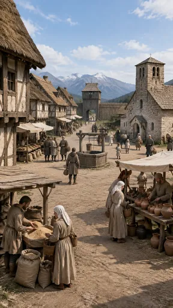](https://github.com/bigr/gpt-image-2.5-benchmark/releases/download/dataset-v2/period-italian-town-10c__gpt-image-2.5-flare-0.png) | [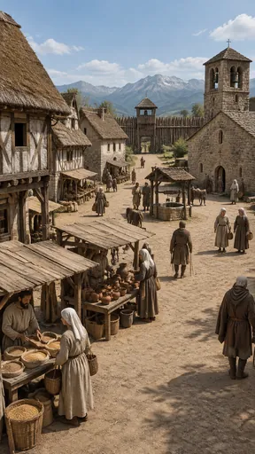](https://github.com/bigr/gpt-image-2.5-benchmark/releases/download/dataset-v2/period-italian-town-10c__gpt-image-2.5-flare-1.png) | [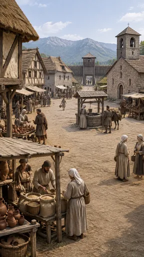](https://github.com/bigr/gpt-image-2.5-benchmark/releases/download/dataset-v2/period-italian-town-10c__gpt-image-2.5-flare-2.png) | [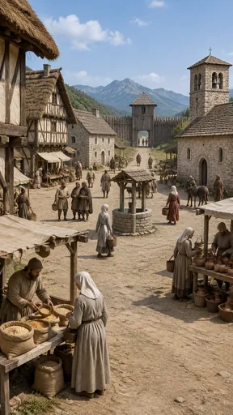](https://github.com/bigr/gpt-image-2.5-benchmark/releases/download/dataset-v2/period-italian-town-10c__gpt-image-2.5-flare-3.png) | [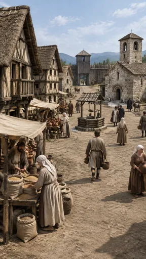](https://github.com/bigr/gpt-image-2.5-benchmark/releases/download/dataset-v2/period-italian-town-10c__gpt-image-2.5-flare-4.png) |
|---|---|---|---|---|
| **0**: all items OK; addition: yes; 1 human ruling(s) | **1**: all items OK; addition: yes; 1 human ruling(s) | **2**: all items OK; addition: yes; 2 human ruling(s) | **3**: all items OK; addition: yes; 2 human ruling(s) | **4**: all items OK; addition: yes; 1 human ruling(s) |
| [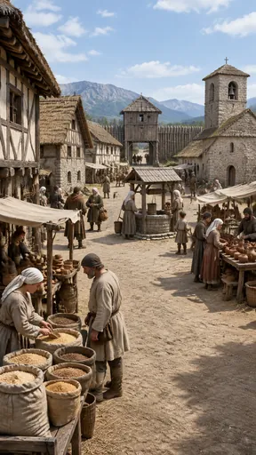](https://github.com/bigr/gpt-image-2.5-benchmark/releases/download/dataset-v2/period-italian-town-10c__gpt-image-2.5-flare-5.png) | [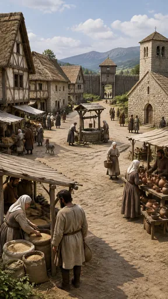](https://github.com/bigr/gpt-image-2.5-benchmark/releases/download/dataset-v2/period-italian-town-10c__gpt-image-2.5-flare-6.png) | [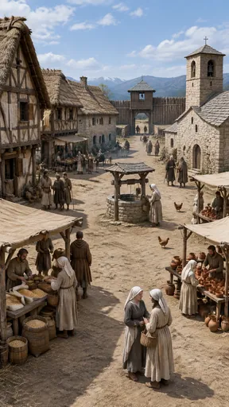](https://github.com/bigr/gpt-image-2.5-benchmark/releases/download/dataset-v2/period-italian-town-10c__gpt-image-2.5-flare-7.png) | [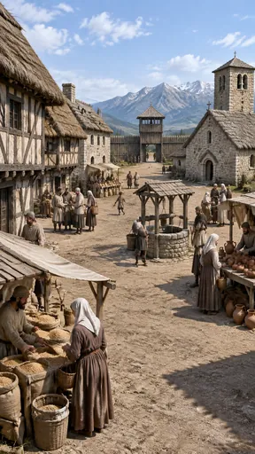](https://github.com/bigr/gpt-image-2.5-benchmark/releases/download/dataset-v2/period-italian-town-10c__gpt-image-2.5-flare-8.png) | [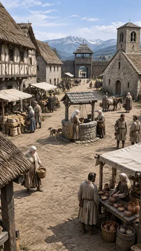](https://github.com/bigr/gpt-image-2.5-benchmark/releases/download/dataset-v2/period-italian-town-10c__gpt-image-2.5-flare-9.png) |
| **5**: all items OK; addition: yes; 1 human ruling(s) | **6**: all items OK; addition: yes; 1 human ruling(s) | **7**: all items OK; addition: yes; 1 human ruling(s) | **8**: all items OK; addition: yes; 2 human ruling(s) | **9**: all items OK; addition: yes; 3 human ruling(s) |

Click a thumbnail for the full-resolution PNG (release asset).

Additions named by the reference reading (a model reading; the yes/no above is person-corrected):

- **0**: snow-capped mountain range; pack horses; chimneys on houses; cloth awnings over stalls; statuette-like figure on pottery stall
- **1**: cattle/pack animals; snow-capped mountain range; cross atop gate tower
- **2**: pack mule/horse; mountain range; cloth awnings over stalls; cross atop gate tower
- **3**: pack horses/mules; mountain range; chimneys on houses; cloth awnings over stalls
- **4**: pack donkeys/horses; mountain range; cloth awnings over stalls; cross atop gate tower
- **5**: mountain range in background; cloth awnings over stalls; cross atop the bell tower
- **6**: dog; mountain range; cross atop gate tower
- **7**: chickens; snow-capped mountains; chimney on stone house; cloth awnings over stalls; pack horses
- **8**: snow-capped mountain range; chimney on stone house; cloth awnings over stalls; cross on church gable
- **9**: dog; pack mule/horse; snow-capped mountain range; cloth awnings over stalls; cross atop the gate tower

Items: `timber-houses` = Most houses are timber-framed with thatched roofs.; `squat-tower` = The church has a low, squat square bell tower.; `wool-tunics` = People wear plain wool tunics (no tailored doublets, no hats of a later era).; `earth-square` = The square is bare earth with a well and plank stalls, not paved with decorative stone.; `palisade` = A wooden palisade or plain gate tower closes the far end.; `landmark-substituted` = A famous landmark is substituted (for example the Leaning Tower of Pisa, the Colosseum or…

