# period-lab-1930s

[Gallery index](README.md) | test: **specific-details**

<details><summary>Prompt</summary>

```text
Scene: A university chemistry laboratory in the 1930s, interior, afternoon.
Subject: One long laboratory bench with two researchers.
Details:
1. Two men in knee-length white cotton coats; one wears round wire-rimmed glasses.
2. The bench carries glass retorts, a Bunsen burner with a rubber gas hose, a brass balance in a glass case and rows of brown glass reagent bottles with cork stoppers.
3. A wall chart of the periodic table hangs on a green-painted plaster wall behind.
4. A tall window shows an ordinary overcast sky and the roofs of plain brick buildings.
5. Lighting is by a pendant shaded lamp.
Constraints:
- No text, no lettering, no captions.
```

</details>

Checklist (the person-corrected answers below refer to these item ids):

- `white-coats` (must be visible): Two researchers in long white coats.
- `bunsen-glass` (must be visible): Bunsen burner with a rubber hose and glass retorts on the bench.
- `brass-balance` (must be visible): A brass balance in a glass case.
- `no-modern-kit` (must be visible): No computer screens, plastic wash bottles, digital readouts or modern safety goggles.
- `plain-window` (must be visible): The window shows plain brick roofs and sky.
- `landmark-substituted` (must NOT be visible): A famous landmark is substituted (for example the Eiffel Tower or Big Ben visible through the window)

## sunburst

| [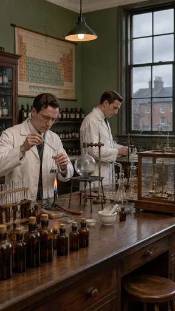](https://github.com/bigr/gpt-image-2.5-benchmark/releases/download/dataset-v2/period-lab-1930s__gpt-image-2.5-sunburst-0.png) | [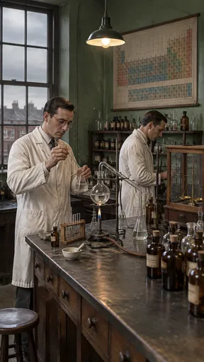](https://github.com/bigr/gpt-image-2.5-benchmark/releases/download/dataset-v2/period-lab-1930s__gpt-image-2.5-sunburst-1.png) | [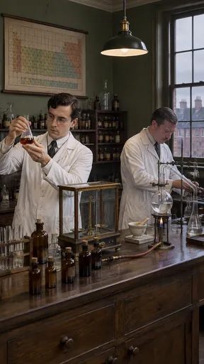](https://github.com/bigr/gpt-image-2.5-benchmark/releases/download/dataset-v2/period-lab-1930s__gpt-image-2.5-sunburst-2.png) | [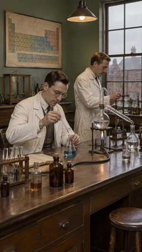](https://github.com/bigr/gpt-image-2.5-benchmark/releases/download/dataset-v2/period-lab-1930s__gpt-image-2.5-sunburst-3.png) | [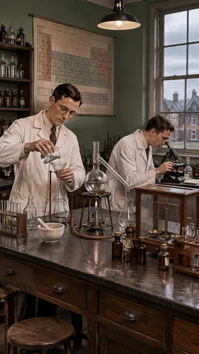](https://github.com/bigr/gpt-image-2.5-benchmark/releases/download/dataset-v2/period-lab-1930s__gpt-image-2.5-sunburst-4.png) |
|---|---|---|---|---|
| **0**: all items OK; addition: yes | **1**: all items OK; addition: yes | **2**: all items OK; addition: yes | **3**: all items OK; addition: yes | **4**: all items OK; addition: yes |
| [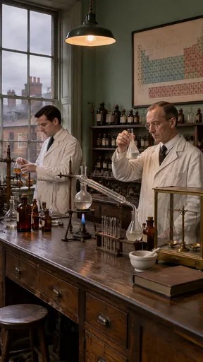](https://github.com/bigr/gpt-image-2.5-benchmark/releases/download/dataset-v2/period-lab-1930s__gpt-image-2.5-sunburst-5.png) | [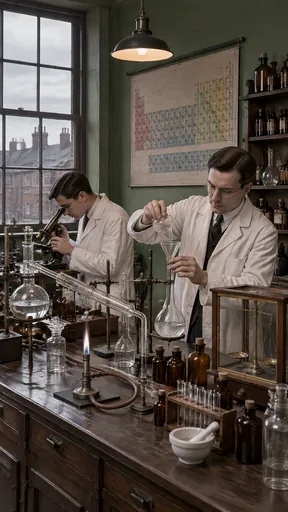](https://github.com/bigr/gpt-image-2.5-benchmark/releases/download/dataset-v2/period-lab-1930s__gpt-image-2.5-sunburst-6.png) | [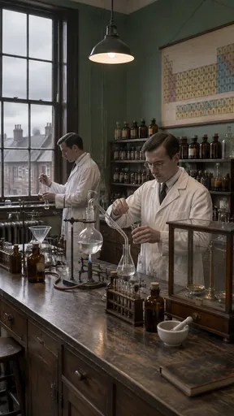](https://github.com/bigr/gpt-image-2.5-benchmark/releases/download/dataset-v2/period-lab-1930s__gpt-image-2.5-sunburst-7.png) | [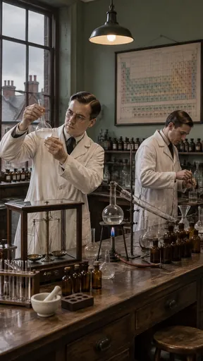](https://github.com/bigr/gpt-image-2.5-benchmark/releases/download/dataset-v2/period-lab-1930s__gpt-image-2.5-sunburst-8.png) | [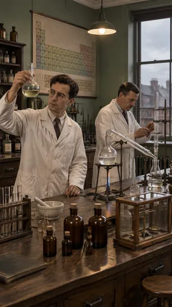](https://github.com/bigr/gpt-image-2.5-benchmark/releases/download/dataset-v2/period-lab-1930s__gpt-image-2.5-sunburst-9.png) |
| **5**: all items OK; addition: yes; 1 human ruling(s) | **6**: all items OK; addition: yes | **7**: all items OK; addition: yes | **8**: all items OK; addition: yes | **9**: all items OK; addition: yes |

Click a thumbnail for the full-resolution PNG (release asset).

Additions named by the reference reading (a model reading; the yes/no above is person-corrected):

- **0**: test-tube rack; mortar and pestle; evaporating dish; stool; glass-fronted cabinet
- **1**: test-tube rack; mortar and pestle; stool; shelves of bottles
- **2**: mortar and pestle; test-tube rack; shelves of bottles
- **3**: open book; test-tube rack; stool; ring stands
- **4**: microscope; mortar and pestle; funnel; test-tube racks; stools; notebook; shelves
- **5**: book; mortar and pestle; test-tube rack; stool; shelves of bottles
- **6**: microscope; mortar and pestle; funnel; test-tube rack; shelves of bottles
- **7**: radiator; funnel; mortar and pestle; book; test-tube racks; stool
- **8**: mortar and pestle; test-tube rack; funnels; stool; shelves of bottles; wooden block
- **9**: mortar and pestle; test-tube rack; book; stool; shelves of bottles; radiator; ring stands

## flare

| [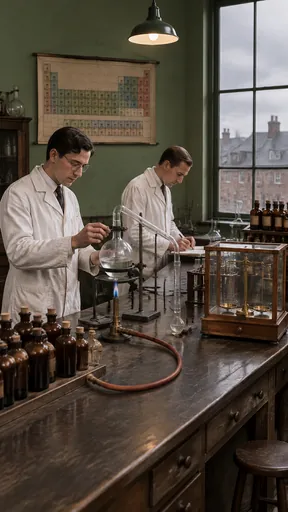](https://github.com/bigr/gpt-image-2.5-benchmark/releases/download/dataset-v2/period-lab-1930s__gpt-image-2.5-flare-0.png) | [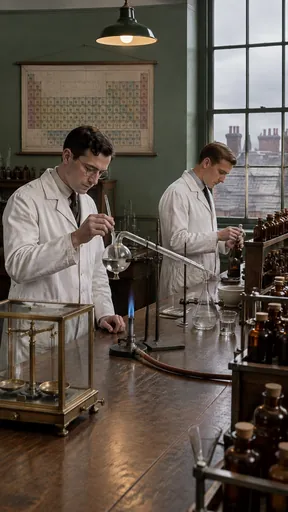](https://github.com/bigr/gpt-image-2.5-benchmark/releases/download/dataset-v2/period-lab-1930s__gpt-image-2.5-flare-1.png) | [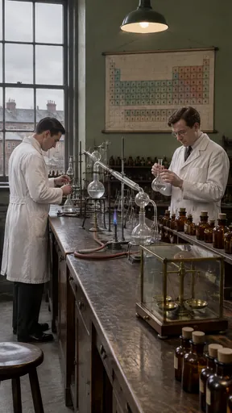](https://github.com/bigr/gpt-image-2.5-benchmark/releases/download/dataset-v2/period-lab-1930s__gpt-image-2.5-flare-2.png) | [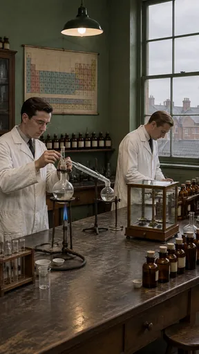](https://github.com/bigr/gpt-image-2.5-benchmark/releases/download/dataset-v2/period-lab-1930s__gpt-image-2.5-flare-3.png) | [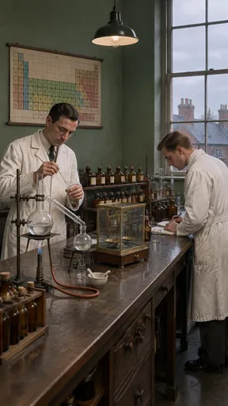](https://github.com/bigr/gpt-image-2.5-benchmark/releases/download/dataset-v2/period-lab-1930s__gpt-image-2.5-flare-4.png) |
|---|---|---|---|---|
| **0**: all items OK; addition: yes | **1**: all items OK; addition: yes | **2**: all items OK; addition: yes | **3**: all items OK; addition: yes | **4**: all items OK; addition: yes |
| [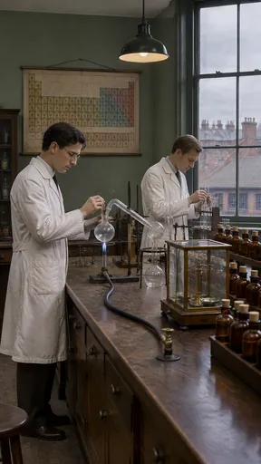](https://github.com/bigr/gpt-image-2.5-benchmark/releases/download/dataset-v2/period-lab-1930s__gpt-image-2.5-flare-5.png) | [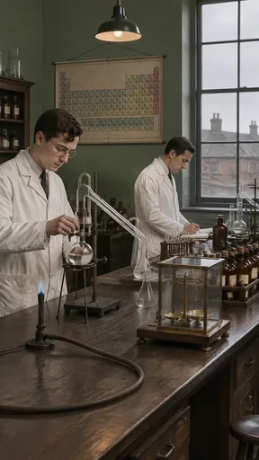](https://github.com/bigr/gpt-image-2.5-benchmark/releases/download/dataset-v2/period-lab-1930s__gpt-image-2.5-flare-6.png) | [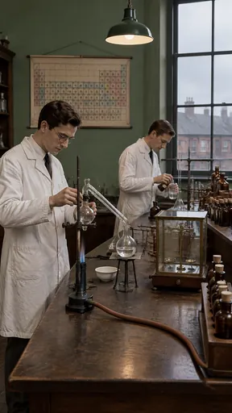](https://github.com/bigr/gpt-image-2.5-benchmark/releases/download/dataset-v2/period-lab-1930s__gpt-image-2.5-flare-7.png) | [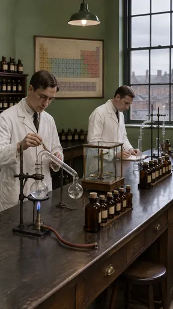](https://github.com/bigr/gpt-image-2.5-benchmark/releases/download/dataset-v2/period-lab-1930s__gpt-image-2.5-flare-8.png) | [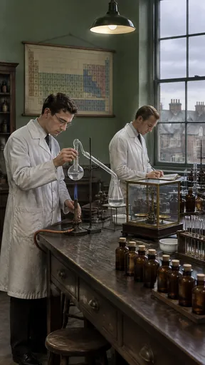](https://github.com/bigr/gpt-image-2.5-benchmark/releases/download/dataset-v2/period-lab-1930s__gpt-image-2.5-flare-9.png) |
| **5**: all items OK; addition: yes | **6**: all items OK; addition: yes; 1 human ruling(s) | **7**: all items OK; addition: yes; 1 human ruling(s) | **8**: all items OK; addition: yes; 1 human ruling(s) | **9**: all items OK; addition: yes; 1 human ruling(s) |

Click a thumbnail for the full-resolution PNG (release asset).

Additions named by the reference reading (a model reading; the yes/no above is person-corrected):

- **0**: notebook and pen; stool; test-tube rack; glass-fronted cabinet
- **1**: mortar; beaker; funnel; bottle racks; shelves
- **2**: stool; ring stands; shelves of bottles
- **3**: test-tube rack; evaporating dishes; beakers; stool; glass-fronted cabinet; ring stands
- **4**: notebook and pen; mortar and pestle; beakers; bottle shelf; ring stand
- **5**: brass gas tap; test-tube rack; stool; cabinet
- **6**: test-tube rack; notebook and pen; stool; bottle cabinet; ring stand
- **7**: evaporating dish; tripod with wire gauze; ring stands; cabinet
- **8**: notebook and pen; stool; shelves of bottles; ring stands
- **9**: notebook; test-tube rack; mortar; stool; tripod

Items: `white-coats` = Two researchers in long white coats.; `bunsen-glass` = Bunsen burner with a rubber hose and glass retorts on the bench.; `brass-balance` = A brass balance in a glass case.; `no-modern-kit` = No computer screens, plastic wash bottles, digital readouts or modern safety goggles.; `plain-window` = The window shows plain brick roofs and sky.; `landmark-substituted` = A famous landmark is substituted (for example the Eiffel Tower or Big Ben visible through…

