# period-steam-workshop-1850s

[Gallery index](README.md) | test: **specific-details**

<details><summary>Prompt</summary>

```text
Scene: An engineering workshop in an English industrial town in the 1850s, interior, grey daylight through high windows.
Subject: A single belt-driven workshop floor with workmen and machinery.
Details:
1. A tall single-cylinder steam engine stands at one end, its crank turning a large iron flywheel that drives a leather belt up to an overhead line shaft.
2. Leather belts run from the line shaft down to a lathe and a drilling machine.
3. Four workmen in flat caps, waistcoats and rolled sleeves work at the machines; one wears a leather apron.
4. The floor is rough brick; the walls are whitewashed brick with iron-framed windows.
5. Lighting is by hanging gas lamps.
Constraints:
- No text, no lettering, no captions.
```

</details>

Checklist (the person-corrected answers below refer to these item ids):

- `overhead-shaft` (must be visible): Belts run from an overhead line shaft to the machines.
- `flywheel-engine` (must be visible): A steam engine with a large flywheel is visible.
- `flat-caps` (must be visible): Workmen wear flat caps and waistcoats (no modern clothing, no hard hats).
- `brick-iron` (must be visible): Brick walls and iron-framed windows.
- `gas-lamps` (must be visible): Lighting is by gas lamps, with no electric bulbs or fluorescent tubes.
- `landmark-substituted` (must NOT be visible): A famous landmark is substituted (for example the Crystal Palace glazed hall or a Big Ben clock tower)

## sunburst

| [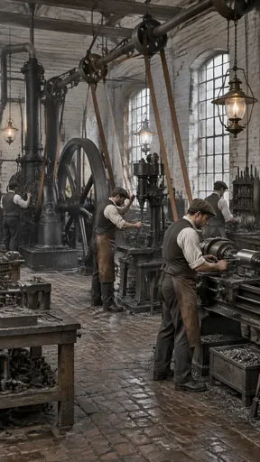](https://github.com/bigr/gpt-image-2.5-benchmark/releases/download/dataset-v2/period-steam-workshop-1850s__gpt-image-2.5-sunburst-0.png) | [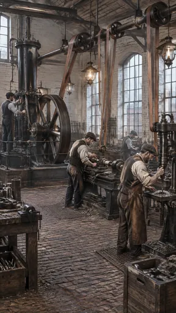](https://github.com/bigr/gpt-image-2.5-benchmark/releases/download/dataset-v2/period-steam-workshop-1850s__gpt-image-2.5-sunburst-1.png) | [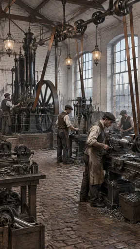](https://github.com/bigr/gpt-image-2.5-benchmark/releases/download/dataset-v2/period-steam-workshop-1850s__gpt-image-2.5-sunburst-2.png) | [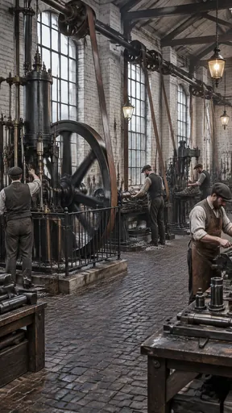](https://github.com/bigr/gpt-image-2.5-benchmark/releases/download/dataset-v2/period-steam-workshop-1850s__gpt-image-2.5-sunburst-3.png) | [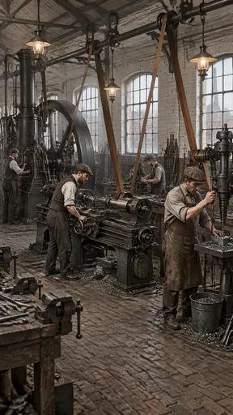](https://github.com/bigr/gpt-image-2.5-benchmark/releases/download/dataset-v2/period-steam-workshop-1850s__gpt-image-2.5-sunburst-4.png) |
|---|---|---|---|---|
| **0**: all items OK; addition: yes; 1 human ruling(s) | **1**: all items OK; addition: yes | **2**: all items OK; addition: yes | **3**: all items OK; addition: yes; 2 human ruling(s) | **4**: all items OK; addition: yes |
| [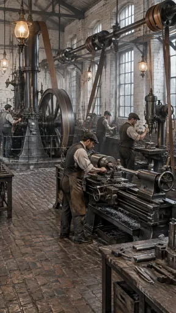](https://github.com/bigr/gpt-image-2.5-benchmark/releases/download/dataset-v2/period-steam-workshop-1850s__gpt-image-2.5-sunburst-5.png) | [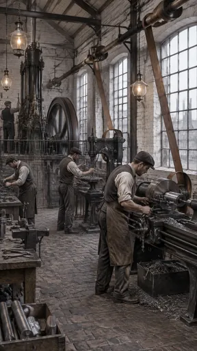](https://github.com/bigr/gpt-image-2.5-benchmark/releases/download/dataset-v2/period-steam-workshop-1850s__gpt-image-2.5-sunburst-6.png) | [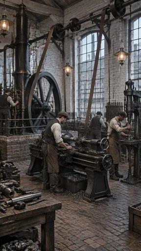](https://github.com/bigr/gpt-image-2.5-benchmark/releases/download/dataset-v2/period-steam-workshop-1850s__gpt-image-2.5-sunburst-7.png) | [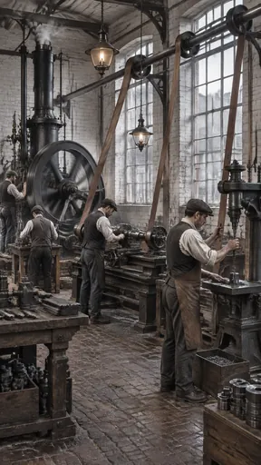](https://github.com/bigr/gpt-image-2.5-benchmark/releases/download/dataset-v2/period-steam-workshop-1850s__gpt-image-2.5-sunburst-8.png) | [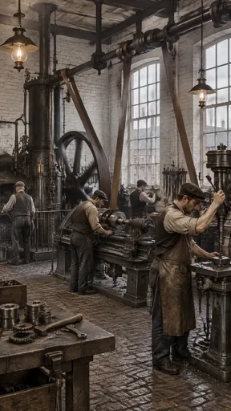](https://github.com/bigr/gpt-image-2.5-benchmark/releases/download/dataset-v2/period-steam-workshop-1850s__gpt-image-2.5-sunburst-9.png) |
| **5**: all items OK; addition: yes; 1 human ruling(s) | **6**: all items OK; addition: yes; 1 human ruling(s) | **7**: all items OK; addition: yes; 1 human ruling(s) | **8**: all items OK; addition: yes; 1 human ruling(s) | **9**: all items OK; addition: yes; 1 human ruling(s) |

Click a thumbnail for the full-resolution PNG (release asset).

Additions named by the reference reading (a model reading; the yes/no above is person-corrected):

- **0**: workbench piled with machine parts; shelving with tools; bin of swarf
- **1**: workbench with vise and parts; wooden crates of gears and parts; iron floor gratings; wall tool racks; railing around engine
- **2**: workbench with machine parts; crates of gears and bar stock; bin of swarf; brick engine plinth with railing; factory chimneys through windows
- **3**: workbenches with machined parts; iron railing around engine; wall tool racks
- **4**: workbench with vises; metal bucket of swarf; wall tool racks; factory chimney and brick buildings through window
- **5**: workbenches with tools; railing around engine; crate under bench
- **6**: workbenches with vises and tools; crate of steel bar stock; factory chimneys and townscape through windows; raised engine platform with railing; box of swarf
- **7**: workbench with machine parts; brick engine plinth with railing; wall tool rack; crates of swarf; townscape buildings through windows
- **8**: workbenches with tools and parts; crates of machined parts; townscape buildings through windows
- **9**: boiler firebox/furnace opening beside engine; workbench with gears, hammer and wrench; wall tool rack; crate; brick buildings through windows

## flare

| [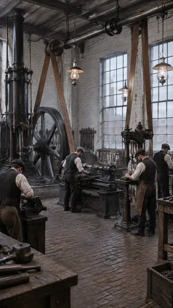](https://github.com/bigr/gpt-image-2.5-benchmark/releases/download/dataset-v2/period-steam-workshop-1850s__gpt-image-2.5-flare-0.png) | [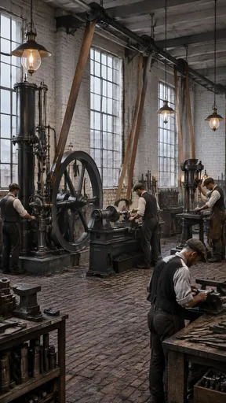](https://github.com/bigr/gpt-image-2.5-benchmark/releases/download/dataset-v2/period-steam-workshop-1850s__gpt-image-2.5-flare-1.png) | [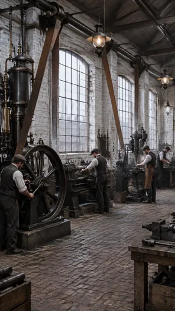](https://github.com/bigr/gpt-image-2.5-benchmark/releases/download/dataset-v2/period-steam-workshop-1850s__gpt-image-2.5-flare-2.png) | [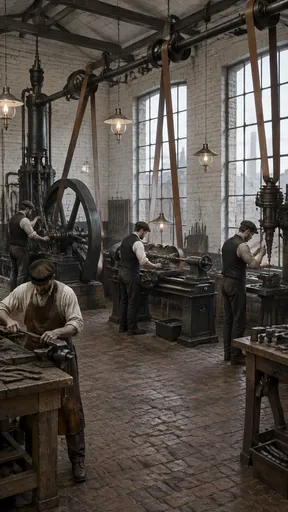](https://github.com/bigr/gpt-image-2.5-benchmark/releases/download/dataset-v2/period-steam-workshop-1850s__gpt-image-2.5-flare-3.png) | [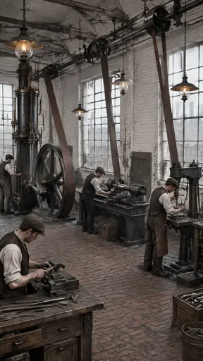](https://github.com/bigr/gpt-image-2.5-benchmark/releases/download/dataset-v2/period-steam-workshop-1850s__gpt-image-2.5-flare-4.png) |
|---|---|---|---|---|
| **0**: all items OK; addition: yes; 1 human ruling(s) | **1**: all items OK; addition: yes; 1 human ruling(s) | **2**: all items OK; addition: yes | **3**: all items OK; addition: yes; 1 human ruling(s) | **4**: all items OK; addition: yes; 1 human ruling(s) |
| [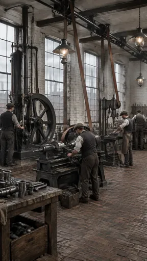](https://github.com/bigr/gpt-image-2.5-benchmark/releases/download/dataset-v2/period-steam-workshop-1850s__gpt-image-2.5-flare-5.png) | [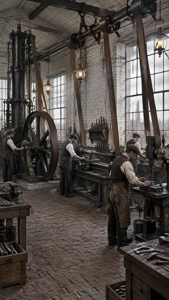](https://github.com/bigr/gpt-image-2.5-benchmark/releases/download/dataset-v2/period-steam-workshop-1850s__gpt-image-2.5-flare-6.png) | [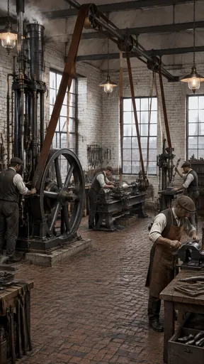](https://github.com/bigr/gpt-image-2.5-benchmark/releases/download/dataset-v2/period-steam-workshop-1850s__gpt-image-2.5-flare-7.png) | [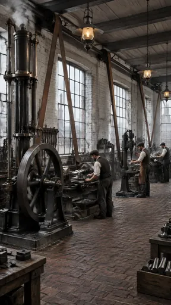](https://github.com/bigr/gpt-image-2.5-benchmark/releases/download/dataset-v2/period-steam-workshop-1850s__gpt-image-2.5-flare-8.png) | [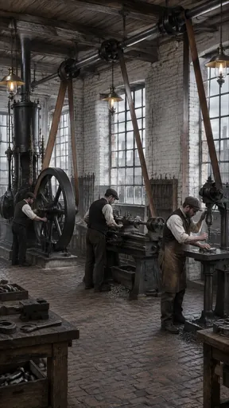](https://github.com/bigr/gpt-image-2.5-benchmark/releases/download/dataset-v2/period-steam-workshop-1850s__gpt-image-2.5-flare-9.png) |
| **5**: all items OK; addition: yes | **6**: all items OK; addition: yes; 2 human ruling(s) | **7**: all items OK; addition: yes; 1 human ruling(s) | **8**: all items OK; addition: yes | **9**: all items OK; addition: yes; 1 human ruling(s) |

Click a thumbnail for the full-resolution PNG (release asset).

Additions named by the reference reading (a model reading; the yes/no above is person-corrected):

- **0**: workbenches with vise and tools; wall tool racks; crate of swarf; factory chimney and brick buildings through windows
- **1**: workbenches with vise and tools; shelving with metal parts; wall tool racks; anvil-like block on bench; small wall-mounted lamp
- **2**: workbench with vise; crates of bar stock; wall tool racks; factory chimneys through windows
- **3**: workbenches with vise and tools; wall tool racks; factory chimney and brick townscape through windows; wall-mounted lamp sconce
- **4**: workbench with vise and drawers; crates of bar stock; wooden bucket of parts; wall tool rack; factory chimneys and townscape through windows
- **5**: workbench with machined parts; crates of parts and swarf; wall tool rack; factory chimneys and brick townscape through windows
- **6**: workbenches with vise and tools; wall tool shelf; crates of bar stock; bucket; factory chimney and townscape through windows
- **7**: workbenches with vise; wall tool racks and shelving; factory chimneys and townscape through windows; crate of parts
- **8**: workbenches; crate of bar stock; wall tool rack and shelving; factory chimneys and townscape through windows; third lathe-like machine at far end
- **9**: workbenches with vise and tools; wall tool racks; factory chimneys and townscape through windows; crates of parts

Items: `overhead-shaft` = Belts run from an overhead line shaft to the machines.; `flywheel-engine` = A steam engine with a large flywheel is visible.; `flat-caps` = Workmen wear flat caps and waistcoats (no modern clothing, no hard hats).; `brick-iron` = Brick walls and iron-framed windows.; `gas-lamps` = Lighting is by gas lamps, with no electric bulbs or fluorescent tubes.; `landmark-substituted` = A famous landmark is substituted (for example the Crystal Palace glazed hall or a Big Ben…

