# retention-08

[Gallery index](README.md) | test: **how-much-it-keeps**

<details><summary>Prompt</summary>

```text
Scene: A rural watermill yard on a river bank, late morning, in the style of a flat-colour storybook illustration.
Subject: The mill yard with the mill building as the focal point; every required element below is drawn once, clearly visible and separate from the others.
Details:
1. a timber water wheel on the mill's left wall, turning in a stone race
2. a stone mill building with a slate roof
3. a red wooden door with black iron hinges
4. three flour sacks stacked beside the door
5. a donkey harnessed to a two-wheeled cart
6. a miller in a white floured apron standing at the door
7. a wooden footbridge crossing the river
8. a grey heron standing in the shallows
Constraints:
- Draw each required element exactly once.
- No text, no lettering, no captions.
```

</details>

Checklist (the person-corrected answers below refer to these item ids):

- `e01` (must be visible): a timber water wheel on the mill's left wall, turning in a stone race
- `e02` (must be visible): a stone mill building with a slate roof
- `e03` (must be visible): a red wooden door with black iron hinges
- `e04` (must be visible): three flour sacks stacked beside the door
- `e05` (must be visible): a donkey harnessed to a two-wheeled cart
- `e06` (must be visible): a miller in a white floured apron standing at the door
- `e07` (must be visible): a wooden footbridge crossing the river
- `e08` (must be visible): a grey heron standing in the shallows

## sunburst

| [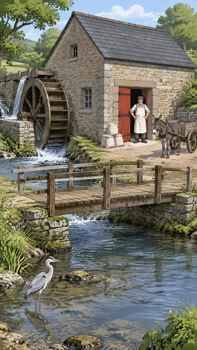](https://github.com/bigr/gpt-image-2.5-benchmark/releases/download/dataset-v2/retention-08__gpt-image-2.5-sunburst-0.png) | [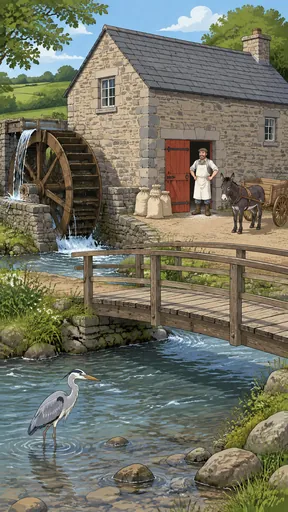](https://github.com/bigr/gpt-image-2.5-benchmark/releases/download/dataset-v2/retention-08__gpt-image-2.5-sunburst-1.png) | [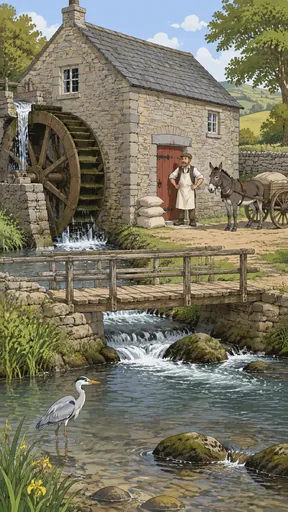](https://github.com/bigr/gpt-image-2.5-benchmark/releases/download/dataset-v2/retention-08__gpt-image-2.5-sunburst-2.png) | [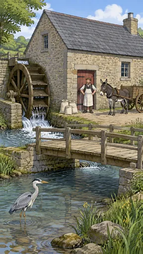](https://github.com/bigr/gpt-image-2.5-benchmark/releases/download/dataset-v2/retention-08__gpt-image-2.5-sunburst-3.png) | [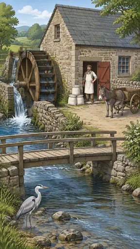](https://github.com/bigr/gpt-image-2.5-benchmark/releases/download/dataset-v2/retention-08__gpt-image-2.5-sunburst-4.png) |
|---|---|---|---|---|
| **0**: failed: `e04`; addition: yes; 2 human ruling(s) | **1**: failed: `e04`; addition: yes; 1 human ruling(s) | **2**: all items OK; addition: yes; 1 human ruling(s) | **3**: failed: `e04`; addition: yes; 2 human ruling(s) | **4**: all items OK; addition: yes; 1 human ruling(s) |
| [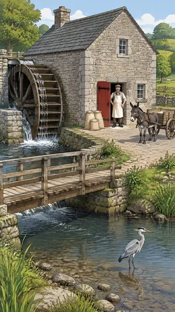](https://github.com/bigr/gpt-image-2.5-benchmark/releases/download/dataset-v2/retention-08__gpt-image-2.5-sunburst-5.png) | [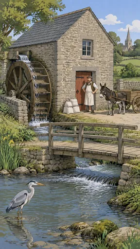](https://github.com/bigr/gpt-image-2.5-benchmark/releases/download/dataset-v2/retention-08__gpt-image-2.5-sunburst-6.png) | [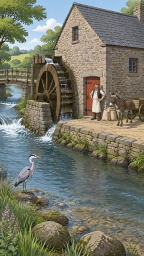](https://github.com/bigr/gpt-image-2.5-benchmark/releases/download/dataset-v2/retention-08__gpt-image-2.5-sunburst-7.png) | [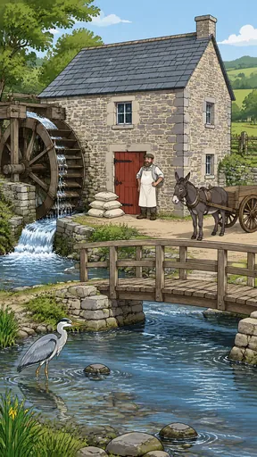](https://github.com/bigr/gpt-image-2.5-benchmark/releases/download/dataset-v2/retention-08__gpt-image-2.5-sunburst-8.png) | [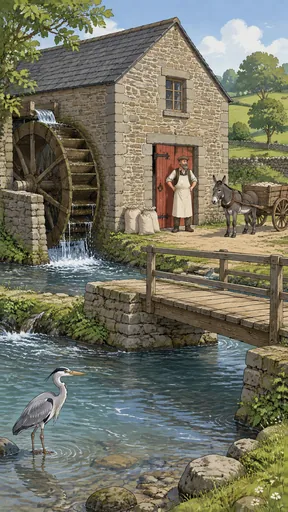](https://github.com/bigr/gpt-image-2.5-benchmark/releases/download/dataset-v2/retention-08__gpt-image-2.5-sunburst-9.png) |
| **5**: failed: `e04`; addition: yes; 2 human ruling(s) | **6**: failed: `e04`; addition: yes; 1 human ruling(s) | **7**: failed: `e04`, `e08`; addition: yes; 4 human ruling(s) | **8**: failed: `e04`; addition: yes; 2 human ruling(s) | **9**: failed: `e04`; addition: yes; 1 human ruling(s) |

Click a thumbnail for the full-resolution PNG (release asset).

Additions named by the reference reading (a model reading; the yes/no above is person-corrected):

- **0**: trees; elevated wooden flume/leat; dry-stone walls; distant hills/fields; river rocks; reeds
- **1**: trees; chimney; distant fields/hills; river boulders; wildflowers
- **2**: trees; chimney; dry-stone wall; distant hills; river boulders; yellow iris flowers; reeds; load of sacks in the cart
- **3**: trees; chimney; wooden fence; distant hills; river boulders; yellow iris flowers; reeds
- **4**: trees; wooden fence; dry-stone walls; distant hills/fields; river rocks; flowering bush; reeds
- **5**: trees; chimney; wooden fence; dry-stone walls; distant hills; river stones; reeds; load in the cart
- **6**: trees; church with spire; dry-stone walls; wooden gate; distant fields; river rocks; yellow iris flowers; reeds
- **7**: trees; chimney; distant hills; river boulders; purple wildflowers; reeds
- **8**: trees; chimney; wooden fence; distant fields/hills; river stones; yellow iris flowers; reeds
- **9**: trees; dry-stone walls; distant fields/hills; river boulders; wildflowers; load of flour sacks in the cart

## flare

| [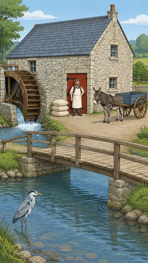](https://github.com/bigr/gpt-image-2.5-benchmark/releases/download/dataset-v2/retention-08__gpt-image-2.5-flare-0.png) | [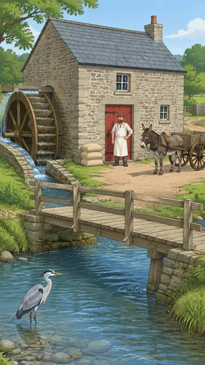](https://github.com/bigr/gpt-image-2.5-benchmark/releases/download/dataset-v2/retention-08__gpt-image-2.5-flare-1.png) | [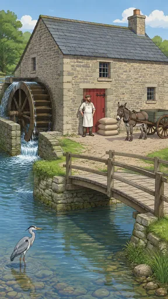](https://github.com/bigr/gpt-image-2.5-benchmark/releases/download/dataset-v2/retention-08__gpt-image-2.5-flare-2.png) | [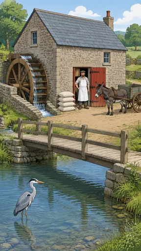](https://github.com/bigr/gpt-image-2.5-benchmark/releases/download/dataset-v2/retention-08__gpt-image-2.5-flare-3.png) | [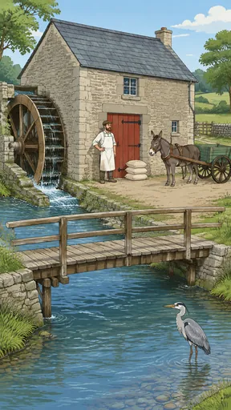](https://github.com/bigr/gpt-image-2.5-benchmark/releases/download/dataset-v2/retention-08__gpt-image-2.5-flare-4.png) |
|---|---|---|---|---|
| **0**: all items OK; addition: yes; 1 human ruling(s) | **1**: all items OK; addition: yes; 2 human ruling(s) | **2**: all items OK; addition: yes; 1 human ruling(s) | **3**: failed: `e04`; addition: yes; 1 human ruling(s) | **4**: all items OK; addition: yes; 1 human ruling(s) |
| [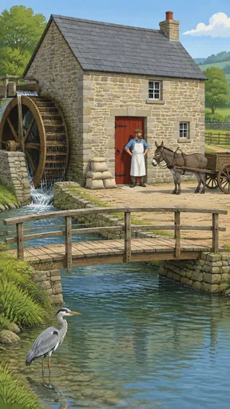](https://github.com/bigr/gpt-image-2.5-benchmark/releases/download/dataset-v2/retention-08__gpt-image-2.5-flare-5.png) | [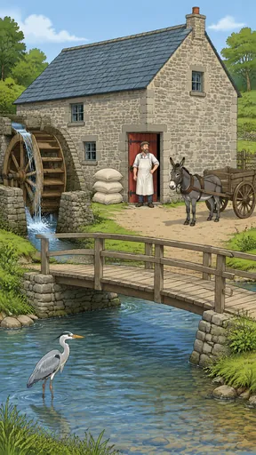](https://github.com/bigr/gpt-image-2.5-benchmark/releases/download/dataset-v2/retention-08__gpt-image-2.5-flare-6.png) | [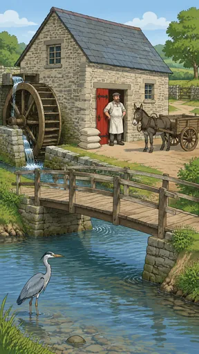](https://github.com/bigr/gpt-image-2.5-benchmark/releases/download/dataset-v2/retention-08__gpt-image-2.5-flare-7.png) | [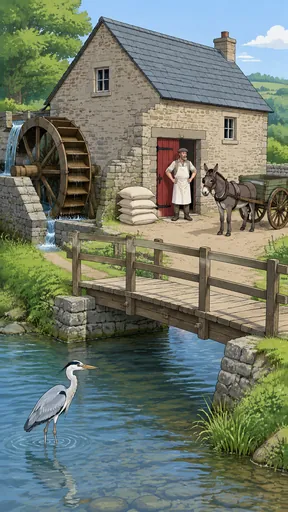](https://github.com/bigr/gpt-image-2.5-benchmark/releases/download/dataset-v2/retention-08__gpt-image-2.5-flare-8.png) | [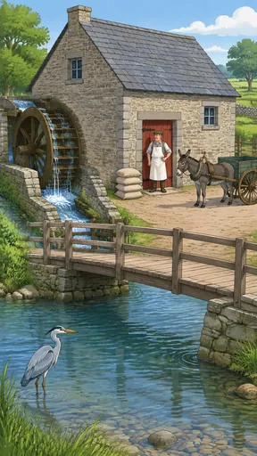](https://github.com/bigr/gpt-image-2.5-benchmark/releases/download/dataset-v2/retention-08__gpt-image-2.5-flare-9.png) |
| **5**: failed: `e04`; addition: yes; 2 human ruling(s) | **6**: all items OK; addition: yes; 2 human ruling(s) | **7**: all items OK; addition: yes; 2 human ruling(s) | **8**: failed: `e04`; addition: yes; 2 human ruling(s) | **9**: failed: `e04`; addition: yes; 3 human ruling(s) |

Click a thumbnail for the full-resolution PNG (release asset).

Additions named by the reference reading (a model reading; the yes/no above is person-corrected):

- **0**: trees; chimney; wooden fence; dry-stone wall; distant fields/hills; river stones; reeds
- **1**: trees; chimney; wooden gate/fence; dry-stone wall; distant fields; river stones
- **2**: trees; chimney; river stones; reeds
- **3**: trees; chimney; wooden gates/fences; dry-stone walls; distant fields; river stones
- **4**: trees; chimney; drainpipe; wooden fence/gate; dry-stone wall; distant fields
- **5**: trees; chimney; wooden fence; dry-stone wall; distant hills; river stones; reeds
- **6**: trees; chimney; wooden fence/gate; dry-stone walls; distant hills; river stones; reeds
- **7**: trees; dry-stone walls; wooden gate; distant fields; river stones; shrubs
- **8**: trees; chimney; dry-stone wall; distant hills; reeds
- **9**: trees; chimney; dry-stone wall; wooden fence; distant fields; river stones; reeds

Items: `e01` = a timber water wheel on the mill's left wall, turning in a stone race; `e02` = a stone mill building with a slate roof; `e03` = a red wooden door with black iron hinges; `e04` = three flour sacks stacked beside the door; `e05` = a donkey harnessed to a two-wheeled cart; `e06` = a miller in a white floured apron standing at the door; `e07` = a wooden footbridge crossing the river; `e08` = a grey heron standing in the shallows

