# retention-15

[Gallery index](README.md) | test: **how-much-it-keeps**

<details><summary>Prompt</summary>

```text
Scene: A rural watermill yard on a river bank, late morning, in the style of a flat-colour storybook illustration.
Subject: The mill yard with the mill building as the focal point; every required element below is drawn once, clearly visible and separate from the others.
Details:
1. a timber water wheel on the mill's left wall, turning in a stone race
2. a stone mill building with a slate roof
3. a red wooden door with black iron hinges
4. three flour sacks stacked beside the door
5. a donkey harnessed to a two-wheeled cart
6. a miller in a white floured apron standing at the door
7. a wooden footbridge crossing the river
8. a grey heron standing in the shallows
9. a stack of split firewood under a lean-to
10. a black cat sitting on a ground-floor window sill
11. an iron lantern hanging above the door
12. a wooden rain barrel at the downpipe
13. a woman carrying a wicker basket of eggs
14. a round stone well with a wooden bucket
15. two white geese beside the well
Constraints:
- Draw each required element exactly once.
- No text, no lettering, no captions.
```

</details>

Checklist (the person-corrected answers below refer to these item ids):

- `e01` (must be visible): a timber water wheel on the mill's left wall, turning in a stone race
- `e02` (must be visible): a stone mill building with a slate roof
- `e03` (must be visible): a red wooden door with black iron hinges
- `e04` (must be visible): three flour sacks stacked beside the door
- `e05` (must be visible): a donkey harnessed to a two-wheeled cart
- `e06` (must be visible): a miller in a white floured apron standing at the door
- `e07` (must be visible): a wooden footbridge crossing the river
- `e08` (must be visible): a grey heron standing in the shallows
- `e09` (must be visible): a stack of split firewood under a lean-to
- `e10` (must be visible): a black cat sitting on a ground-floor window sill
- `e11` (must be visible): an iron lantern hanging above the door
- `e12` (must be visible): a wooden rain barrel at the downpipe
- `e13` (must be visible): a woman carrying a wicker basket of eggs
- `e14` (must be visible): a round stone well with a wooden bucket
- `e15` (must be visible): two white geese beside the well

## sunburst

| [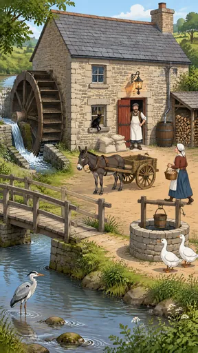](https://github.com/bigr/gpt-image-2.5-benchmark/releases/download/dataset-v2/retention-15__gpt-image-2.5-sunburst-0.png) | [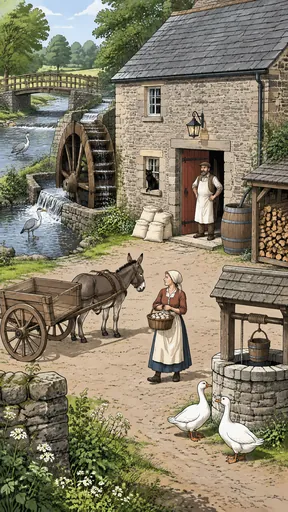](https://github.com/bigr/gpt-image-2.5-benchmark/releases/download/dataset-v2/retention-15__gpt-image-2.5-sunburst-1.png) | [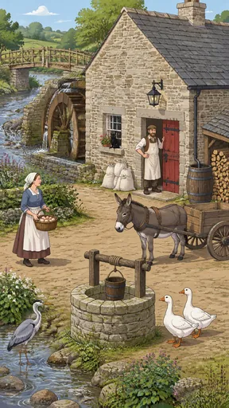](https://github.com/bigr/gpt-image-2.5-benchmark/releases/download/dataset-v2/retention-15__gpt-image-2.5-sunburst-2.png) | [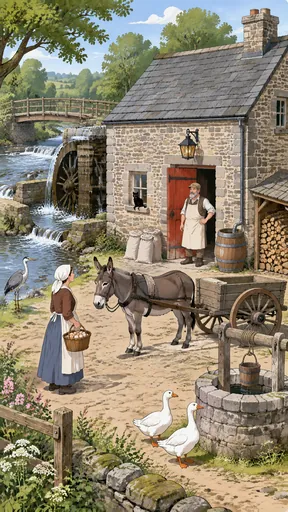](https://github.com/bigr/gpt-image-2.5-benchmark/releases/download/dataset-v2/retention-15__gpt-image-2.5-sunburst-3.png) | [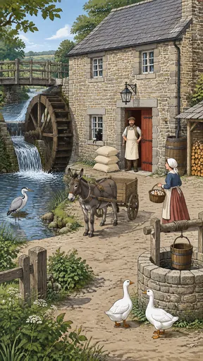](https://github.com/bigr/gpt-image-2.5-benchmark/releases/download/dataset-v2/retention-15__gpt-image-2.5-sunburst-4.png) |
|---|---|---|---|---|
| **0**: failed: `e04`; addition: yes; 2 human ruling(s) | **1**: failed: `e04`; addition: yes; 1 human ruling(s) | **2**: failed: `e04`; addition: yes; 1 human ruling(s) | **3**: failed: `e04`, `e08`; addition: yes; 3 human ruling(s) | **4**: all items OK; addition: yes; 1 human ruling(s) |
| [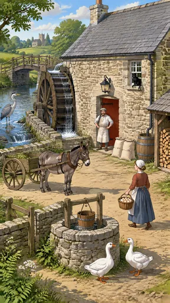](https://github.com/bigr/gpt-image-2.5-benchmark/releases/download/dataset-v2/retention-15__gpt-image-2.5-sunburst-5.png) | [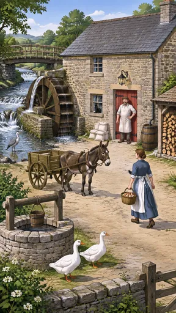](https://github.com/bigr/gpt-image-2.5-benchmark/releases/download/dataset-v2/retention-15__gpt-image-2.5-sunburst-6.png) | [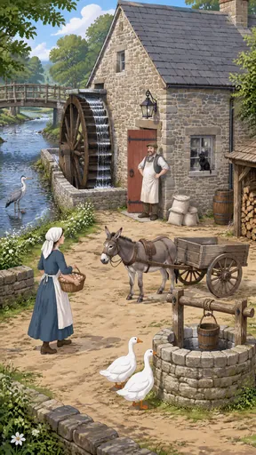](https://github.com/bigr/gpt-image-2.5-benchmark/releases/download/dataset-v2/retention-15__gpt-image-2.5-sunburst-7.png) | [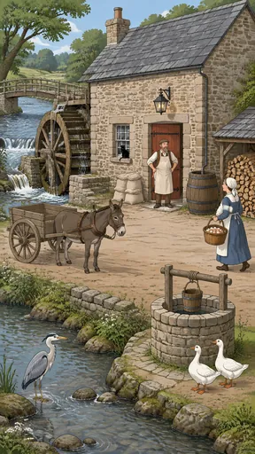](https://github.com/bigr/gpt-image-2.5-benchmark/releases/download/dataset-v2/retention-15__gpt-image-2.5-sunburst-8.png) | [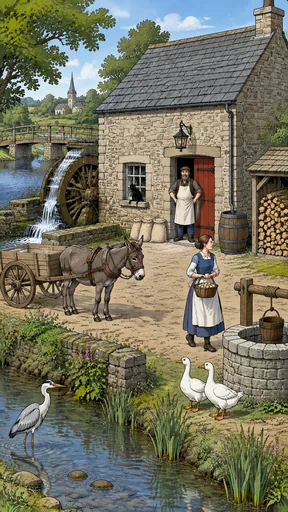](https://github.com/bigr/gpt-image-2.5-benchmark/releases/download/dataset-v2/retention-15__gpt-image-2.5-sunburst-9.png) |
| **5**: failed: `e04`; addition: yes; 2 human ruling(s) | **6**: failed: `e04`; addition: yes; 1 human ruling(s) | **7**: all items OK; addition: yes; 1 human ruling(s) | **8**: failed: `e04`; addition: yes; 2 human ruling(s) | **9**: failed: `e04`; addition: yes; 2 human ruling(s) |

Click a thumbnail for the full-resolution PNG (release asset).

Additions named by the reference reading (a model reading; the yes/no above is person-corrected):

- **0**: trees; distant hills; white wildflowers
- **1**: second grey heron; weir/waterfall cascade; foreground stone wall; trees; distant hills; white wildflowers
- **2**: flower pot with red flowers on the window sill; low stone garden wall; trees; distant hills; wildflowers
- **3**: foreground wooden fence; foreground stone wall; trees; distant hills; pink and white wildflowers
- **4**: foreground wooden fence; trees; distant hills; white wildflowers
- **5**: distant church with tower; stone walls; wooden gate/fence; greenery load in the cart; trees; distant hills; white wildflowers
- **6**: foreground stone wall; wooden gate; trees; distant hills; white wildflowers
- **7**: low stone walls; trees; distant hills; white wildflowers
- **8**: trees; distant hills; low stone wall along the river; weir/waterfall cascade; wildflowers
- **9**: distant church with spire; low stone wall along the river; reeds; trees; distant hills

## flare

| [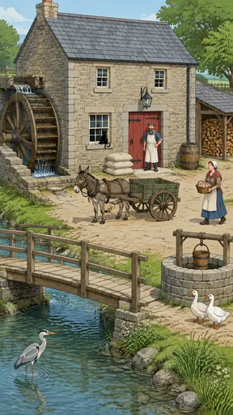](https://github.com/bigr/gpt-image-2.5-benchmark/releases/download/dataset-v2/retention-15__gpt-image-2.5-flare-0.png) | [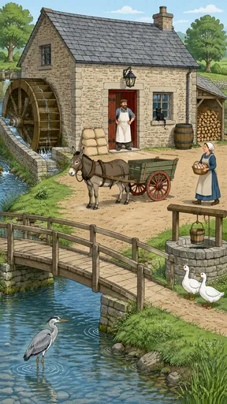](https://github.com/bigr/gpt-image-2.5-benchmark/releases/download/dataset-v2/retention-15__gpt-image-2.5-flare-1.png) | [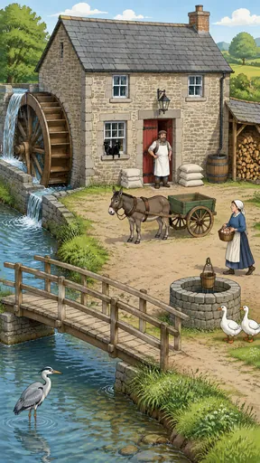](https://github.com/bigr/gpt-image-2.5-benchmark/releases/download/dataset-v2/retention-15__gpt-image-2.5-flare-2.png) | [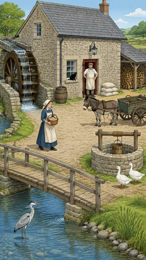](https://github.com/bigr/gpt-image-2.5-benchmark/releases/download/dataset-v2/retention-15__gpt-image-2.5-flare-3.png) | [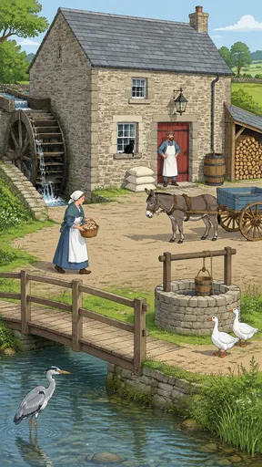](https://github.com/bigr/gpt-image-2.5-benchmark/releases/download/dataset-v2/retention-15__gpt-image-2.5-flare-4.png) |
|---|---|---|---|---|
| **0**: all items OK; addition: yes; 1 human ruling(s) | **1**: failed: `e04`; addition: yes; 2 human ruling(s) | **2**: failed: `e04`; addition: yes; 2 human ruling(s) | **3**: failed: `e04`; addition: yes; 2 human ruling(s) | **4**: all items OK; addition: yes; 2 human ruling(s) |
| [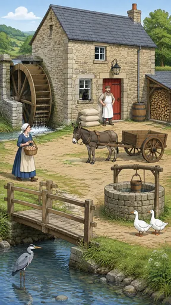](https://github.com/bigr/gpt-image-2.5-benchmark/releases/download/dataset-v2/retention-15__gpt-image-2.5-flare-5.png) | [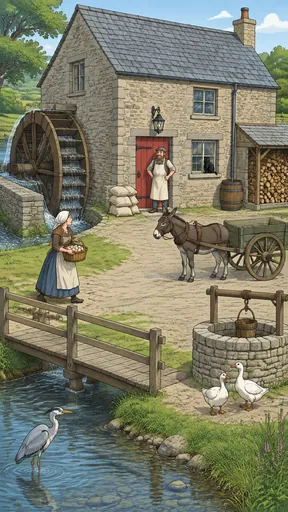](https://github.com/bigr/gpt-image-2.5-benchmark/releases/download/dataset-v2/retention-15__gpt-image-2.5-flare-6.png) | [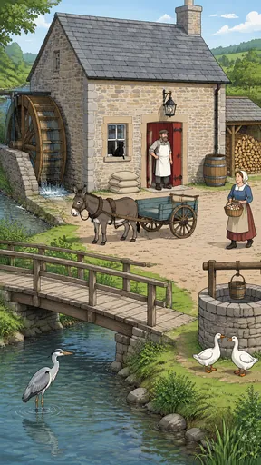](https://github.com/bigr/gpt-image-2.5-benchmark/releases/download/dataset-v2/retention-15__gpt-image-2.5-flare-7.png) | [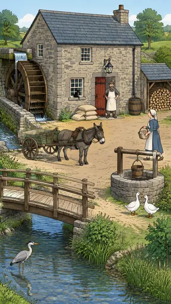](https://github.com/bigr/gpt-image-2.5-benchmark/releases/download/dataset-v2/retention-15__gpt-image-2.5-flare-8.png) | [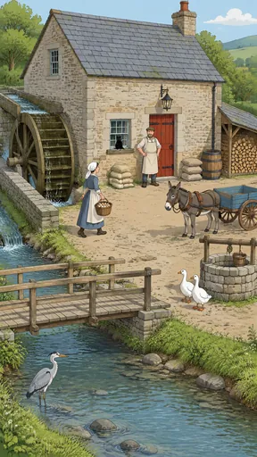](https://github.com/bigr/gpt-image-2.5-benchmark/releases/download/dataset-v2/retention-15__gpt-image-2.5-flare-9.png) |
| **5**: all items OK; addition: yes; 1 human ruling(s) | **6**: failed: `e04`; addition: yes; 2 human ruling(s) | **7**: all items OK; addition: yes; 2 human ruling(s) | **8**: failed: `e04`; addition: yes; 1 human ruling(s) | **9**: failed: `e04`; addition: yes; 2 human ruling(s) |

Click a thumbnail for the full-resolution PNG (release asset).

Additions named by the reference reading (a model reading; the yes/no above is person-corrected):

- **0**: background wooden fences; trees; white wildflowers
- **1**: background stone wall; trees; distant hills
- **2**: second black cat on the window sill; second stack of flour sacks; trees; distant hills; white wildflowers
- **3**: logs loaded in the cart; background wooden fences; trees; distant hills
- **4**: background stone wall; trees; distant fields/hills; wildflowers
- **5**: trees; distant hills; white wildflowers
- **6**: trees; distant hills
- **7**: items loaded in the cart; trees; distant hills
- **8**: trees; distant hills; reeds and bushes
- **9**: second stack of flour sacks; trees; distant hills

Items: `e01` = a timber water wheel on the mill's left wall, turning in a stone race; `e02` = a stone mill building with a slate roof; `e03` = a red wooden door with black iron hinges; `e04` = three flour sacks stacked beside the door; `e05` = a donkey harnessed to a two-wheeled cart; `e06` = a miller in a white floured apron standing at the door; `e07` = a wooden footbridge crossing the river; `e08` = a grey heron standing in the shallows; `e09` = a stack of split firewood under a lean-to; `e10` = a black cat sitting on a ground-floor window sill; `e11` = an iron lantern hanging above the door; `e12` = a wooden rain barrel at the downpipe; `e13` = a woman carrying a wicker basket of eggs; `e14` = a round stone well with a wooden bucket; `e15` = two white geese beside the well

