# retention-25

[Gallery index](README.md) | test: **how-much-it-keeps**

<details><summary>Prompt</summary>

```text
Scene: A rural watermill yard on a river bank, late morning, in the style of a flat-colour storybook illustration.
Subject: The mill yard with the mill building as the focal point; every required element below is drawn once, clearly visible and separate from the others.
Details:
1. a timber water wheel on the mill's left wall, turning in a stone race
2. a stone mill building with a slate roof
3. a red wooden door with black iron hinges
4. three flour sacks stacked beside the door
5. a donkey harnessed to a two-wheeled cart
6. a miller in a white floured apron standing at the door
7. a wooden footbridge crossing the river
8. a grey heron standing in the shallows
9. a stack of split firewood under a lean-to
10. a black cat sitting on a ground-floor window sill
11. an iron lantern hanging above the door
12. a wooden rain barrel at the downpipe
13. a woman carrying a wicker basket of eggs
14. a round stone well with a wooden bucket
15. two white geese beside the well
16. a wooden ladder leaning against the right wall
17. an apple tree bearing red apples
18. a blue-painted shutter on the upper window
19. a scarecrow in a vegetable patch
20. a small brown dog asleep in the sun
21. a hanging bracket sign painted with a loaf of bread
22. a millstone propped upright against the wall
23. a boy fishing with a long rod from the bank
24. a moss-covered low stone wall along the yard edge
25. smoke rising from a brick chimney
Constraints:
- Draw each required element exactly once.
- No text, no lettering, no captions.
```

</details>

Checklist (the person-corrected answers below refer to these item ids):

- `e01` (must be visible): a timber water wheel on the mill's left wall, turning in a stone race
- `e02` (must be visible): a stone mill building with a slate roof
- `e03` (must be visible): a red wooden door with black iron hinges
- `e04` (must be visible): three flour sacks stacked beside the door
- `e05` (must be visible): a donkey harnessed to a two-wheeled cart
- `e06` (must be visible): a miller in a white floured apron standing at the door
- `e07` (must be visible): a wooden footbridge crossing the river
- `e08` (must be visible): a grey heron standing in the shallows
- `e09` (must be visible): a stack of split firewood under a lean-to
- `e10` (must be visible): a black cat sitting on a ground-floor window sill
- `e11` (must be visible): an iron lantern hanging above the door
- `e12` (must be visible): a wooden rain barrel at the downpipe
- `e13` (must be visible): a woman carrying a wicker basket of eggs
- `e14` (must be visible): a round stone well with a wooden bucket
- `e15` (must be visible): two white geese beside the well
- `e16` (must be visible): a wooden ladder leaning against the right wall
- `e17` (must be visible): an apple tree bearing red apples
- `e18` (must be visible): a blue-painted shutter on the upper window
- `e19` (must be visible): a scarecrow in a vegetable patch
- `e20` (must be visible): a small brown dog asleep in the sun
- `e21` (must be visible): a hanging bracket sign painted with a loaf of bread
- `e22` (must be visible): a millstone propped upright against the wall
- `e23` (must be visible): a boy fishing with a long rod from the bank
- `e24` (must be visible): a moss-covered low stone wall along the yard edge
- `e25` (must be visible): smoke rising from a brick chimney

## sunburst

| [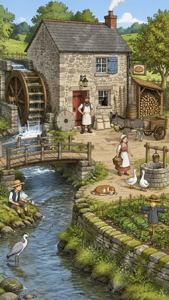](https://github.com/bigr/gpt-image-2.5-benchmark/releases/download/dataset-v2/retention-25__gpt-image-2.5-sunburst-0.png) | [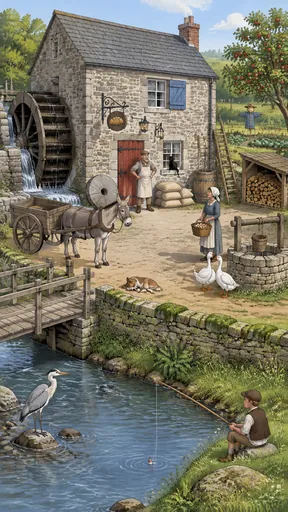](https://github.com/bigr/gpt-image-2.5-benchmark/releases/download/dataset-v2/retention-25__gpt-image-2.5-sunburst-1.png) | [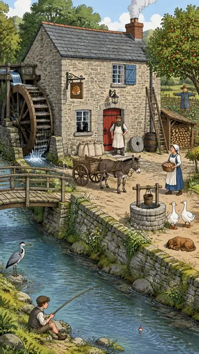](https://github.com/bigr/gpt-image-2.5-benchmark/releases/download/dataset-v2/retention-25__gpt-image-2.5-sunburst-2.png) | [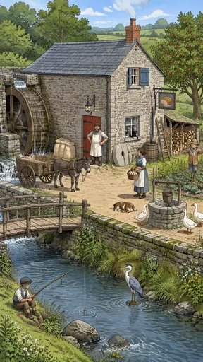](https://github.com/bigr/gpt-image-2.5-benchmark/releases/download/dataset-v2/retention-25__gpt-image-2.5-sunburst-3.png) | [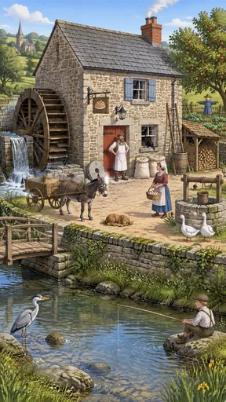](https://github.com/bigr/gpt-image-2.5-benchmark/releases/download/dataset-v2/retention-25__gpt-image-2.5-sunburst-4.png) |
|---|---|---|---|---|
| **0**: failed: `e04`; addition: yes; 2 human ruling(s) | **1**: failed: `e04`, `e08`; addition: yes; 3 human ruling(s) | **2**: failed: `e04`, `e08`; addition: yes; 4 human ruling(s) | **3**: failed: `e04`, `e08`, `e15`; addition: yes; 3 human ruling(s) | **4**: failed: `e04`; addition: yes; 1 human ruling(s) |
| [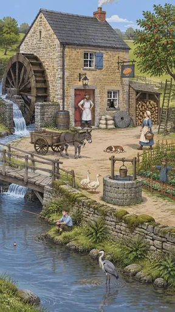](https://github.com/bigr/gpt-image-2.5-benchmark/releases/download/dataset-v2/retention-25__gpt-image-2.5-sunburst-5.png) | [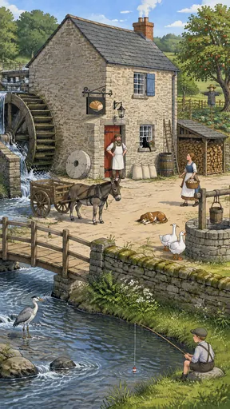](https://github.com/bigr/gpt-image-2.5-benchmark/releases/download/dataset-v2/retention-25__gpt-image-2.5-sunburst-6.png) | [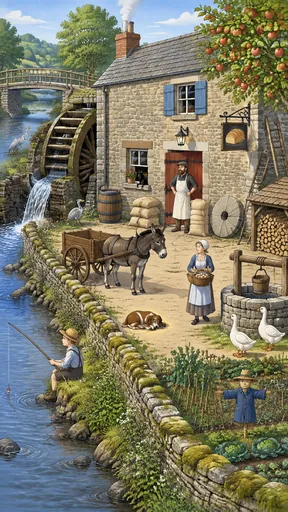](https://github.com/bigr/gpt-image-2.5-benchmark/releases/download/dataset-v2/retention-25__gpt-image-2.5-sunburst-7.png) | [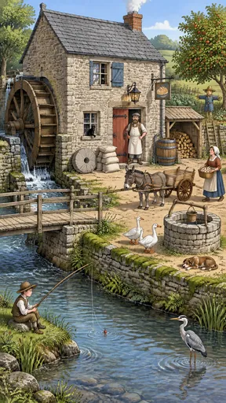](https://github.com/bigr/gpt-image-2.5-benchmark/releases/download/dataset-v2/retention-25__gpt-image-2.5-sunburst-8.png) | [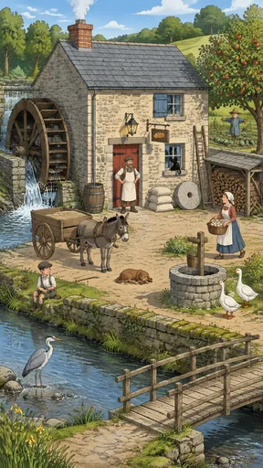](https://github.com/bigr/gpt-image-2.5-benchmark/releases/download/dataset-v2/retention-25__gpt-image-2.5-sunburst-9.png) |
| **5**: failed: `e04`, `e16`; addition: yes; 4 human ruling(s) | **6**: failed: `e04`; addition: yes; 2 human ruling(s) | **7**: failed: `e04`; addition: yes; 2 human ruling(s) | **8**: failed: `e04`, `e16`; addition: yes; 3 human ruling(s) | **9**: all items OK; addition: yes; 3 human ruling(s) |

Click a thumbnail for the full-resolution PNG (release asset).

Additions named by the reference reading (a model reading; the yes/no above is person-corrected):

- **0**: wooden fence on hillside; wooden fence around vegetable patch; distant hills and trees
- **1**: second wall lantern; pitchfork leaning by the rain barrel; distant fields and trees
- **2**: fourth flour sack; second black cat in the window; background trees and rolling fields; rocks in the river; wildflowers on the wall; wooden fence around the vegetable patch
- **3**: third white goose; background trees and rolling fields; rocks in the river; wildflowers on the bank; wooden fence around the vegetable patch
- **4**: church with spire; distant village houses; second blue shutter; wooden fence around vegetable patch; yellow iris flowers; distant hills and trees
- **5**: three extra flour sacks (six in total); background trees and rolling fields; rocks in the river; wooden fence around the vegetable patch
- **6**: flower pot with red flowers on the window sill; background trees and rolling fields; rocks in the river; wooden fence around the vegetable patch; wildflowers on the bank
- **7**: two extra herons; second ladder; second blue shutter; flower pot with red flowers on window sill; distant hills and trees
- **8**: second blue shutter; wooden fence around vegetable patch; distant hills and trees
- **9**: yellow iris flowers; distant hills and trees

## flare

| [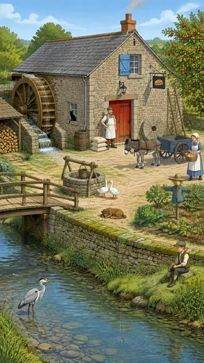](https://github.com/bigr/gpt-image-2.5-benchmark/releases/download/dataset-v2/retention-25__gpt-image-2.5-flare-0.png) | [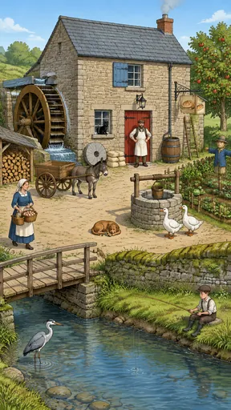](https://github.com/bigr/gpt-image-2.5-benchmark/releases/download/dataset-v2/retention-25__gpt-image-2.5-flare-1.png) | [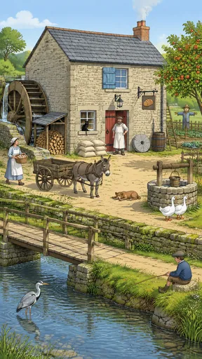](https://github.com/bigr/gpt-image-2.5-benchmark/releases/download/dataset-v2/retention-25__gpt-image-2.5-flare-2.png) | [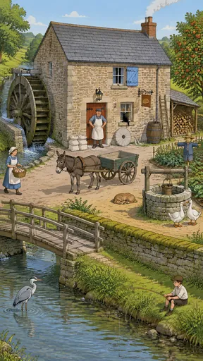](https://github.com/bigr/gpt-image-2.5-benchmark/releases/download/dataset-v2/retention-25__gpt-image-2.5-flare-3.png) | [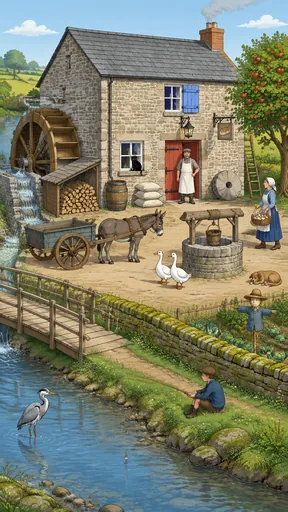](https://github.com/bigr/gpt-image-2.5-benchmark/releases/download/dataset-v2/retention-25__gpt-image-2.5-flare-4.png) |
|---|---|---|---|---|
| **0**: all items OK; addition: yes; 1 human ruling(s) | **1**: failed: `e04`; addition: yes; 2 human ruling(s) | **2**: failed: `e04`; addition: yes; 3 human ruling(s) | **3**: failed: `e04`; addition: yes; 2 human ruling(s) | **4**: all items OK; addition: yes; 2 human ruling(s) |
| [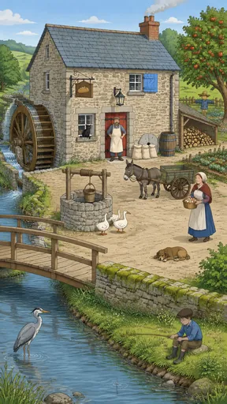](https://github.com/bigr/gpt-image-2.5-benchmark/releases/download/dataset-v2/retention-25__gpt-image-2.5-flare-5.png) | [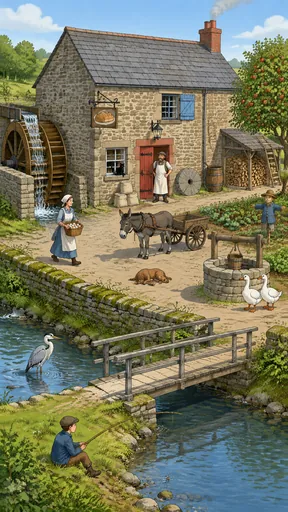](https://github.com/bigr/gpt-image-2.5-benchmark/releases/download/dataset-v2/retention-25__gpt-image-2.5-flare-6.png) | [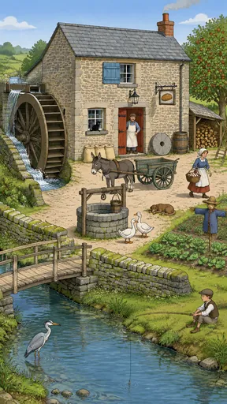](https://github.com/bigr/gpt-image-2.5-benchmark/releases/download/dataset-v2/retention-25__gpt-image-2.5-flare-7.png) | [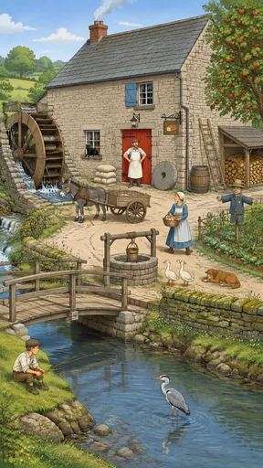](https://github.com/bigr/gpt-image-2.5-benchmark/releases/download/dataset-v2/retention-25__gpt-image-2.5-flare-8.png) | [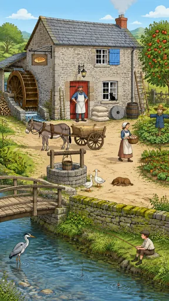](https://github.com/bigr/gpt-image-2.5-benchmark/releases/download/dataset-v2/retention-25__gpt-image-2.5-flare-9.png) |
| **5**: failed: `e04`, `e15`, `e16`; addition: yes; 4 human ruling(s) | **6**: failed: `e16`; addition: yes; 3 human ruling(s) | **7**: failed: `e04`, `e16`; addition: yes; 3 human ruling(s) | **8**: all items OK; addition: yes; 1 human ruling(s) | **9**: failed: `e09`; addition: yes; 2 human ruling(s) |

Click a thumbnail for the full-resolution PNG (release asset).

Additions named by the reference reading (a model reading; the yes/no above is person-corrected):

- **0**: second ladder; distant fields and trees
- **1**: three extra flour sacks (six in total); second wicker basket of eggs carried by the woman; background trees and rolling fields; rocks in the river; wooden fence around the vegetable patch
- **2**: three extra flour sacks (six in total); pitchfork/tool leaning on the wall by the rain barrel; background trees and rolling fields; rocks in the river; wooden fence around the vegetable patch
- **3**: distant hills and trees
- **4**: wooden fence around vegetable patch; distant fields and trees
- **5**: third goose; wooden fence around vegetable patch; distant hills and trees
- **6**: wooden tool/rack hanging on the wall by the downpipe; background trees and rolling fields; rocks in the river
- **7**: background trees and rolling fields; rocks in the river
- **8**: background trees and rolling fields; rocks in the river; wooden fence around the vegetable patch
- **9**: second narrow ladder leaning beside the door; pile of logs at the far left (not under a lean-to); roofed wheel housing; background trees and rolling fields; rocks in the river; wooden garden fence

Items: `e01` = a timber water wheel on the mill's left wall, turning in a stone race; `e02` = a stone mill building with a slate roof; `e03` = a red wooden door with black iron hinges; `e04` = three flour sacks stacked beside the door; `e05` = a donkey harnessed to a two-wheeled cart; `e06` = a miller in a white floured apron standing at the door; `e07` = a wooden footbridge crossing the river; `e08` = a grey heron standing in the shallows; `e09` = a stack of split firewood under a lean-to; `e10` = a black cat sitting on a ground-floor window sill; `e11` = an iron lantern hanging above the door; `e12` = a wooden rain barrel at the downpipe; `e13` = a woman carrying a wicker basket of eggs; `e14` = a round stone well with a wooden bucket; `e15` = two white geese beside the well; `e16` = a wooden ladder leaning against the right wall; `e17` = an apple tree bearing red apples; `e18` = a blue-painted shutter on the upper window; `e19` = a scarecrow in a vegetable patch; `e20` = a small brown dog asleep in the sun; `e21` = a hanging bracket sign painted with a loaf of bread; `e22` = a millstone propped upright against the wall; `e23` = a boy fishing with a long rod from the bank; `e24` = a moss-covered low stone wall along the yard edge; `e25` = smoke rising from a brick chimney

