# Part 2 gallery

240 new illustrations. Full PNGs are available in the [dataset-part2 release](https://github.com/bigr/gpt-image-2.5-benchmark/releases/tag/dataset-part2).

## tally-apples-02-overlap/gpt-image-2.5-flare/0

## tally-apples-02-overlap/gpt-image-2.5-flare/1

## tally-apples-02-separate/gpt-image-2.5-flare/0

## tally-apples-02-separate/gpt-image-2.5-flare/1

## tally-apples-03-overlap/gpt-image-2.5-flare/0

## tally-apples-03-overlap/gpt-image-2.5-flare/1

## tally-apples-03-separate/gpt-image-2.5-flare/0

## tally-apples-03-separate/gpt-image-2.5-flare/1

## tally-apples-05-overlap/gpt-image-2.5-flare/0

## tally-apples-05-overlap/gpt-image-2.5-flare/1

## tally-apples-05-separate/gpt-image-2.5-flare/0

## tally-apples-05-separate/gpt-image-2.5-flare/1

[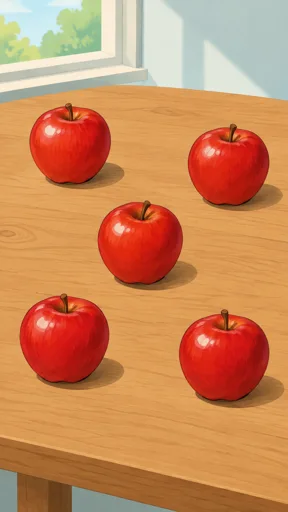](https://github.com/bigr/gpt-image-2.5-benchmark/releases/download/dataset-part2/part2__tally-apples-05-separate__gpt-image-2.5-flare__1.png)

## tally-apples-07-overlap/gpt-image-2.5-flare/0

## tally-apples-07-overlap/gpt-image-2.5-flare/1

## tally-apples-07-separate/gpt-image-2.5-flare/0

[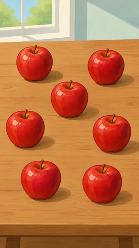](https://github.com/bigr/gpt-image-2.5-benchmark/releases/download/dataset-part2/part2__tally-apples-07-separate__gpt-image-2.5-flare__0.png)

## tally-apples-07-separate/gpt-image-2.5-flare/1

## tally-apples-10-overlap/gpt-image-2.5-flare/0

[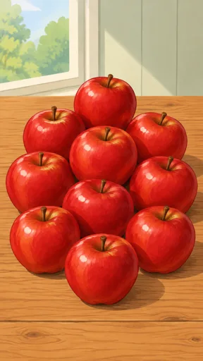](https://github.com/bigr/gpt-image-2.5-benchmark/releases/download/dataset-part2/part2__tally-apples-10-overlap__gpt-image-2.5-flare__0.png)

## tally-apples-10-overlap/gpt-image-2.5-flare/1

[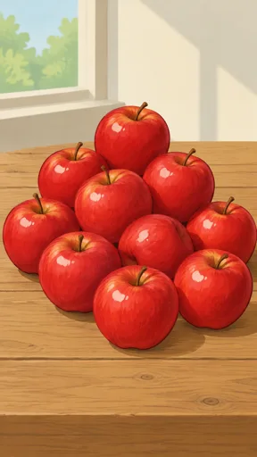](https://github.com/bigr/gpt-image-2.5-benchmark/releases/download/dataset-part2/part2__tally-apples-10-overlap__gpt-image-2.5-flare__1.png)

## tally-apples-10-separate/gpt-image-2.5-flare/0

[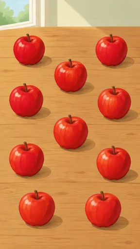](https://github.com/bigr/gpt-image-2.5-benchmark/releases/download/dataset-part2/part2__tally-apples-10-separate__gpt-image-2.5-flare__0.png)

## tally-apples-10-separate/gpt-image-2.5-flare/1

[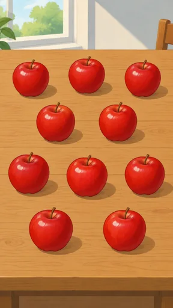](https://github.com/bigr/gpt-image-2.5-benchmark/releases/download/dataset-part2/part2__tally-apples-10-separate__gpt-image-2.5-flare__1.png)

## tally-apples-15-overlap/gpt-image-2.5-flare/0

## tally-apples-15-overlap/gpt-image-2.5-flare/1

## tally-apples-15-separate/gpt-image-2.5-flare/0

## tally-apples-15-separate/gpt-image-2.5-flare/1

## tally-barrels-02-overlap/gpt-image-2.5-flare/0

## tally-barrels-02-overlap/gpt-image-2.5-flare/1

## tally-barrels-02-separate/gpt-image-2.5-flare/0

## tally-barrels-02-separate/gpt-image-2.5-flare/1

## tally-barrels-03-overlap/gpt-image-2.5-flare/0

## tally-barrels-03-overlap/gpt-image-2.5-flare/1

## tally-barrels-03-separate/gpt-image-2.5-flare/0

## tally-barrels-03-separate/gpt-image-2.5-flare/1

## tally-barrels-05-overlap/gpt-image-2.5-flare/0

## tally-barrels-05-overlap/gpt-image-2.5-flare/1

## tally-barrels-05-separate/gpt-image-2.5-flare/0

## tally-barrels-05-separate/gpt-image-2.5-flare/1

## tally-barrels-07-overlap/gpt-image-2.5-flare/0

## tally-barrels-07-overlap/gpt-image-2.5-flare/1

## tally-barrels-07-separate/gpt-image-2.5-flare/0

## tally-barrels-07-separate/gpt-image-2.5-flare/1

## tally-barrels-10-overlap/gpt-image-2.5-flare/0

## tally-barrels-10-overlap/gpt-image-2.5-flare/1

## tally-barrels-10-separate/gpt-image-2.5-flare/0

## tally-barrels-10-separate/gpt-image-2.5-flare/1

[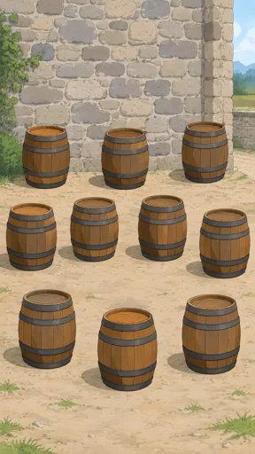](https://github.com/bigr/gpt-image-2.5-benchmark/releases/download/dataset-part2/part2__tally-barrels-10-separate__gpt-image-2.5-flare__1.png)

## tally-barrels-15-overlap/gpt-image-2.5-flare/0

## tally-barrels-15-overlap/gpt-image-2.5-flare/1

## tally-barrels-15-separate/gpt-image-2.5-flare/0

[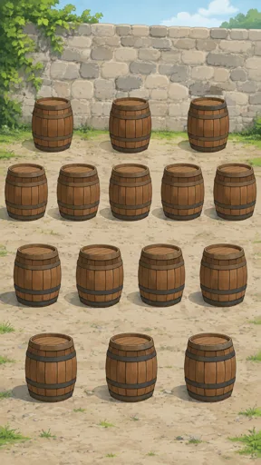](https://github.com/bigr/gpt-image-2.5-benchmark/releases/download/dataset-part2/part2__tally-barrels-15-separate__gpt-image-2.5-flare__0.png)

## tally-barrels-15-separate/gpt-image-2.5-flare/1

## tally-birds-02-overlap/gpt-image-2.5-flare/0

## tally-birds-02-overlap/gpt-image-2.5-flare/1

## tally-birds-02-separate/gpt-image-2.5-flare/0

## tally-birds-02-separate/gpt-image-2.5-flare/1

## tally-birds-03-overlap/gpt-image-2.5-flare/0

## tally-birds-03-overlap/gpt-image-2.5-flare/1

## tally-birds-03-separate/gpt-image-2.5-flare/0

## tally-birds-03-separate/gpt-image-2.5-flare/1

## tally-birds-05-overlap/gpt-image-2.5-flare/0

## tally-birds-05-overlap/gpt-image-2.5-flare/1

## tally-birds-05-separate/gpt-image-2.5-flare/0

## tally-birds-05-separate/gpt-image-2.5-flare/1

## tally-birds-07-overlap/gpt-image-2.5-flare/0

## tally-birds-07-overlap/gpt-image-2.5-flare/1

## tally-birds-07-separate/gpt-image-2.5-flare/0

[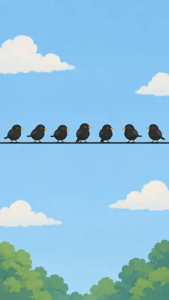](https://github.com/bigr/gpt-image-2.5-benchmark/releases/download/dataset-part2/part2__tally-birds-07-separate__gpt-image-2.5-flare__0.png)

## tally-birds-07-separate/gpt-image-2.5-flare/1

## tally-birds-10-overlap/gpt-image-2.5-flare/0

## tally-birds-10-overlap/gpt-image-2.5-flare/1

## tally-birds-10-separate/gpt-image-2.5-flare/0

## tally-birds-10-separate/gpt-image-2.5-flare/1

## tally-birds-15-overlap/gpt-image-2.5-flare/0

[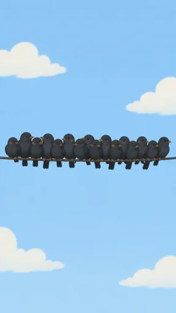](https://github.com/bigr/gpt-image-2.5-benchmark/releases/download/dataset-part2/part2__tally-birds-15-overlap__gpt-image-2.5-flare__0.png)

## tally-birds-15-overlap/gpt-image-2.5-flare/1

## tally-birds-15-separate/gpt-image-2.5-flare/0

## tally-birds-15-separate/gpt-image-2.5-flare/1

## tally-boats-02-overlap/gpt-image-2.5-flare/0

## tally-boats-02-overlap/gpt-image-2.5-flare/1

## tally-boats-02-separate/gpt-image-2.5-flare/0

## tally-boats-02-separate/gpt-image-2.5-flare/1

## tally-boats-03-overlap/gpt-image-2.5-flare/0

## tally-boats-03-overlap/gpt-image-2.5-flare/1

## tally-boats-03-separate/gpt-image-2.5-flare/0

## tally-boats-03-separate/gpt-image-2.5-flare/1

## tally-boats-05-overlap/gpt-image-2.5-flare/0

## tally-boats-05-overlap/gpt-image-2.5-flare/1

## tally-boats-05-separate/gpt-image-2.5-flare/0

## tally-boats-05-separate/gpt-image-2.5-flare/1

## tally-boats-07-overlap/gpt-image-2.5-flare/0

## tally-boats-07-overlap/gpt-image-2.5-flare/1

## tally-boats-07-separate/gpt-image-2.5-flare/0

## tally-boats-07-separate/gpt-image-2.5-flare/1

## tally-boats-10-overlap/gpt-image-2.5-flare/0

## tally-boats-10-overlap/gpt-image-2.5-flare/1

## tally-boats-10-separate/gpt-image-2.5-flare/0

## tally-boats-10-separate/gpt-image-2.5-flare/1

## tally-boats-15-overlap/gpt-image-2.5-flare/0

## tally-boats-15-overlap/gpt-image-2.5-flare/1

## tally-boats-15-separate/gpt-image-2.5-flare/0

## tally-boats-15-separate/gpt-image-2.5-flare/1

## tally-queue-02-overlap/gpt-image-2.5-flare/0

## tally-queue-02-overlap/gpt-image-2.5-flare/1

## tally-queue-02-separate/gpt-image-2.5-flare/0

## tally-queue-02-separate/gpt-image-2.5-flare/1

## tally-queue-03-overlap/gpt-image-2.5-flare/0

## tally-queue-03-overlap/gpt-image-2.5-flare/1

## tally-queue-03-separate/gpt-image-2.5-flare/0

## tally-queue-03-separate/gpt-image-2.5-flare/1

## tally-queue-05-overlap/gpt-image-2.5-flare/0

## tally-queue-05-overlap/gpt-image-2.5-flare/1

## tally-queue-05-separate/gpt-image-2.5-flare/0

## tally-queue-05-separate/gpt-image-2.5-flare/1

## tally-queue-07-overlap/gpt-image-2.5-flare/0

## tally-queue-07-overlap/gpt-image-2.5-flare/1

## tally-queue-07-separate/gpt-image-2.5-flare/0

## tally-queue-07-separate/gpt-image-2.5-flare/1

## tally-queue-10-overlap/gpt-image-2.5-flare/0

## tally-queue-10-overlap/gpt-image-2.5-flare/1

## tally-queue-10-separate/gpt-image-2.5-flare/0

## tally-queue-10-separate/gpt-image-2.5-flare/1

## tally-queue-15-overlap/gpt-image-2.5-flare/0

## tally-queue-15-overlap/gpt-image-2.5-flare/1

## tally-queue-15-separate/gpt-image-2.5-flare/0

## tally-queue-15-separate/gpt-image-2.5-flare/1

## tally-sheep-02-overlap/gpt-image-2.5-flare/0

## tally-sheep-02-overlap/gpt-image-2.5-flare/1

## tally-sheep-02-separate/gpt-image-2.5-flare/0

## tally-sheep-02-separate/gpt-image-2.5-flare/1

## tally-sheep-03-overlap/gpt-image-2.5-flare/0

## tally-sheep-03-overlap/gpt-image-2.5-flare/1

## tally-sheep-03-separate/gpt-image-2.5-flare/0

## tally-sheep-03-separate/gpt-image-2.5-flare/1

## tally-sheep-05-overlap/gpt-image-2.5-flare/0

## tally-sheep-05-overlap/gpt-image-2.5-flare/1

## tally-sheep-05-separate/gpt-image-2.5-flare/0

## tally-sheep-05-separate/gpt-image-2.5-flare/1

[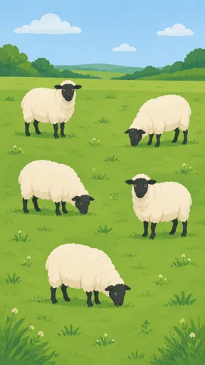](https://github.com/bigr/gpt-image-2.5-benchmark/releases/download/dataset-part2/part2__tally-sheep-05-separate__gpt-image-2.5-flare__1.png)

## tally-sheep-07-overlap/gpt-image-2.5-flare/0

## tally-sheep-07-overlap/gpt-image-2.5-flare/1

## tally-sheep-07-separate/gpt-image-2.5-flare/0

[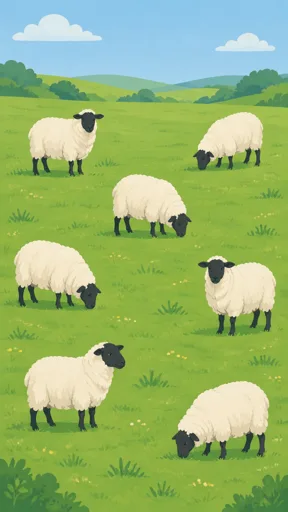](https://github.com/bigr/gpt-image-2.5-benchmark/releases/download/dataset-part2/part2__tally-sheep-07-separate__gpt-image-2.5-flare__0.png)

## tally-sheep-07-separate/gpt-image-2.5-flare/1

[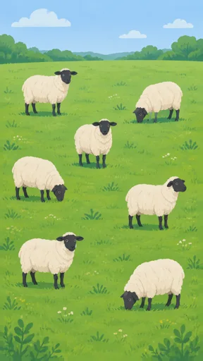](https://github.com/bigr/gpt-image-2.5-benchmark/releases/download/dataset-part2/part2__tally-sheep-07-separate__gpt-image-2.5-flare__1.png)

## tally-sheep-10-overlap/gpt-image-2.5-flare/0

## tally-sheep-10-overlap/gpt-image-2.5-flare/1

## tally-sheep-10-separate/gpt-image-2.5-flare/0

[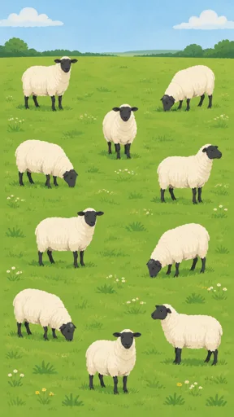](https://github.com/bigr/gpt-image-2.5-benchmark/releases/download/dataset-part2/part2__tally-sheep-10-separate__gpt-image-2.5-flare__0.png)

## tally-sheep-10-separate/gpt-image-2.5-flare/1

[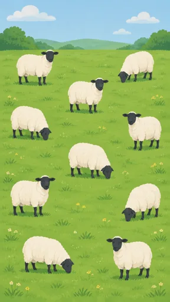](https://github.com/bigr/gpt-image-2.5-benchmark/releases/download/dataset-part2/part2__tally-sheep-10-separate__gpt-image-2.5-flare__1.png)

## tally-sheep-15-overlap/gpt-image-2.5-flare/0

[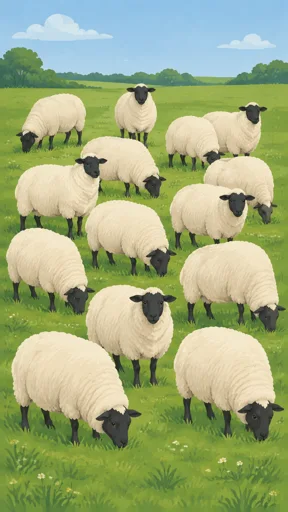](https://github.com/bigr/gpt-image-2.5-benchmark/releases/download/dataset-part2/part2__tally-sheep-15-overlap__gpt-image-2.5-flare__0.png)

## tally-sheep-15-overlap/gpt-image-2.5-flare/1

## tally-sheep-15-separate/gpt-image-2.5-flare/0

[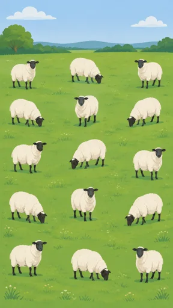](https://github.com/bigr/gpt-image-2.5-benchmark/releases/download/dataset-part2/part2__tally-sheep-15-separate__gpt-image-2.5-flare__0.png)

## tally-sheep-15-separate/gpt-image-2.5-flare/1

[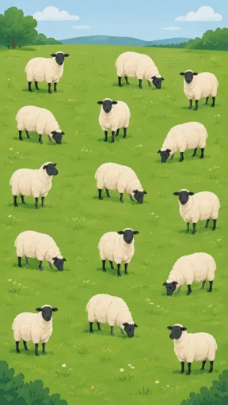](https://github.com/bigr/gpt-image-2.5-benchmark/releases/download/dataset-part2/part2__tally-sheep-15-separate__gpt-image-2.5-flare__1.png)

## misfit-alpine-meadow-clean/gpt-image-2.5-flare/0

## misfit-alpine-meadow-clean/gpt-image-2.5-flare/1

## misfit-alpine-meadow-clean/gpt-image-2.5-flare/2

## misfit-alpine-meadow-clean/gpt-image-2.5-sunburst/0

## misfit-alpine-meadow-clean/gpt-image-2.5-sunburst/1

## misfit-alpine-meadow-clean/gpt-image-2.5-sunburst/2

[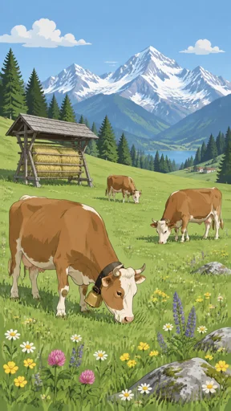](https://github.com/bigr/gpt-image-2.5-benchmark/releases/download/dataset-part2/part2__misfit-alpine-meadow-clean__gpt-image-2.5-sunburst__2.png)

## misfit-alpine-meadow-seeded/gpt-image-2.5-flare/0

## misfit-alpine-meadow-seeded/gpt-image-2.5-flare/1

[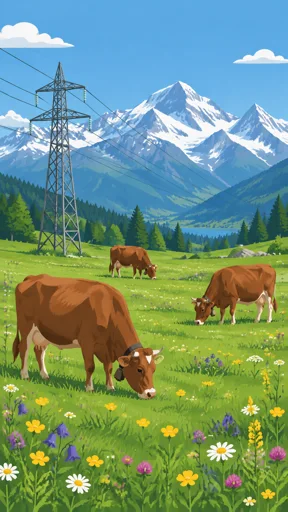](https://github.com/bigr/gpt-image-2.5-benchmark/releases/download/dataset-part2/part2__misfit-alpine-meadow-seeded__gpt-image-2.5-flare__1.png)

## misfit-alpine-meadow-seeded/gpt-image-2.5-flare/2

## misfit-alpine-meadow-seeded/gpt-image-2.5-sunburst/0

[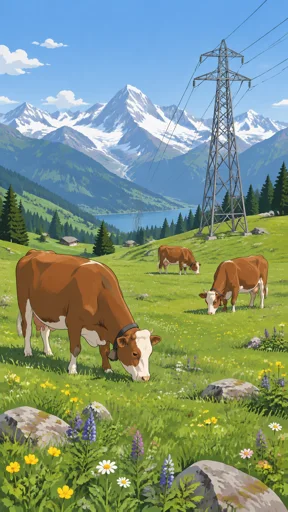](https://github.com/bigr/gpt-image-2.5-benchmark/releases/download/dataset-part2/part2__misfit-alpine-meadow-seeded__gpt-image-2.5-sunburst__0.png)

## misfit-alpine-meadow-seeded/gpt-image-2.5-sunburst/1

[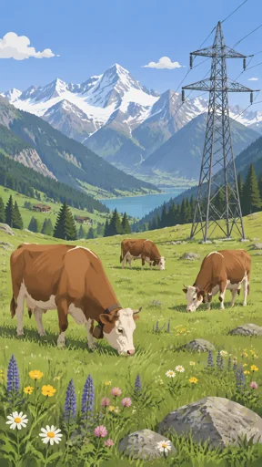](https://github.com/bigr/gpt-image-2.5-benchmark/releases/download/dataset-part2/part2__misfit-alpine-meadow-seeded__gpt-image-2.5-sunburst__1.png)

## misfit-alpine-meadow-seeded/gpt-image-2.5-sunburst/2

## misfit-beech-floor-clean/gpt-image-2.5-flare/0

## misfit-beech-floor-clean/gpt-image-2.5-flare/1

[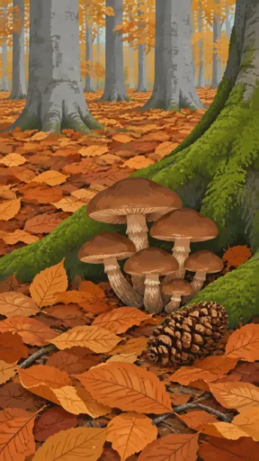](https://github.com/bigr/gpt-image-2.5-benchmark/releases/download/dataset-part2/part2__misfit-beech-floor-clean__gpt-image-2.5-flare__1.png)

## misfit-beech-floor-clean/gpt-image-2.5-flare/2

## misfit-beech-floor-clean/gpt-image-2.5-sunburst/0

## misfit-beech-floor-clean/gpt-image-2.5-sunburst/1

## misfit-beech-floor-clean/gpt-image-2.5-sunburst/2

## misfit-beech-floor-seeded/gpt-image-2.5-flare/0

## misfit-beech-floor-seeded/gpt-image-2.5-flare/1

[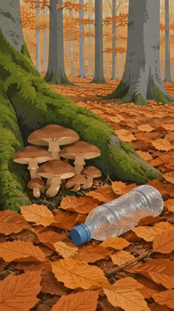](https://github.com/bigr/gpt-image-2.5-benchmark/releases/download/dataset-part2/part2__misfit-beech-floor-seeded__gpt-image-2.5-flare__1.png)

## misfit-beech-floor-seeded/gpt-image-2.5-flare/2

## misfit-beech-floor-seeded/gpt-image-2.5-sunburst/0

[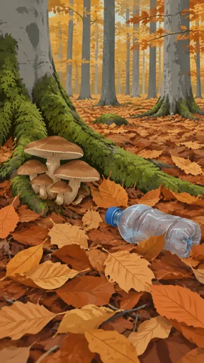](https://github.com/bigr/gpt-image-2.5-benchmark/releases/download/dataset-part2/part2__misfit-beech-floor-seeded__gpt-image-2.5-sunburst__0.png)

## misfit-beech-floor-seeded/gpt-image-2.5-sunburst/1

## misfit-beech-floor-seeded/gpt-image-2.5-sunburst/2

[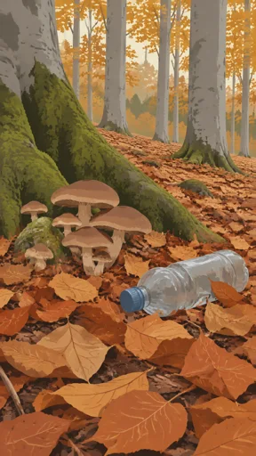](https://github.com/bigr/gpt-image-2.5-benchmark/releases/download/dataset-part2/part2__misfit-beech-floor-seeded__gpt-image-2.5-sunburst__2.png)

## misfit-egypt-quay-1400bc-clean/gpt-image-2.5-flare/0

## misfit-egypt-quay-1400bc-clean/gpt-image-2.5-flare/1

## misfit-egypt-quay-1400bc-clean/gpt-image-2.5-flare/2

## misfit-egypt-quay-1400bc-clean/gpt-image-2.5-sunburst/0

## misfit-egypt-quay-1400bc-clean/gpt-image-2.5-sunburst/1

## misfit-egypt-quay-1400bc-clean/gpt-image-2.5-sunburst/2

## misfit-egypt-quay-1400bc-seeded/gpt-image-2.5-flare/0

## misfit-egypt-quay-1400bc-seeded/gpt-image-2.5-flare/1

## misfit-egypt-quay-1400bc-seeded/gpt-image-2.5-flare/2

## misfit-egypt-quay-1400bc-seeded/gpt-image-2.5-sunburst/0

## misfit-egypt-quay-1400bc-seeded/gpt-image-2.5-sunburst/1

## misfit-egypt-quay-1400bc-seeded/gpt-image-2.5-sunburst/2

## misfit-farmyard-1850-clean/gpt-image-2.5-flare/0

## misfit-farmyard-1850-clean/gpt-image-2.5-flare/1

## misfit-farmyard-1850-clean/gpt-image-2.5-flare/2

## misfit-farmyard-1850-clean/gpt-image-2.5-sunburst/0

## misfit-farmyard-1850-clean/gpt-image-2.5-sunburst/1

## misfit-farmyard-1850-clean/gpt-image-2.5-sunburst/2

[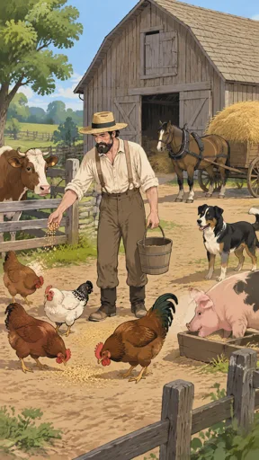](https://github.com/bigr/gpt-image-2.5-benchmark/releases/download/dataset-part2/part2__misfit-farmyard-1850-clean__gpt-image-2.5-sunburst__2.png)

## misfit-farmyard-1850-seeded/gpt-image-2.5-flare/0

## misfit-farmyard-1850-seeded/gpt-image-2.5-flare/1

## misfit-farmyard-1850-seeded/gpt-image-2.5-flare/2

## misfit-farmyard-1850-seeded/gpt-image-2.5-sunburst/0

[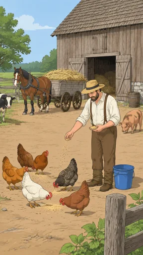](https://github.com/bigr/gpt-image-2.5-benchmark/releases/download/dataset-part2/part2__misfit-farmyard-1850-seeded__gpt-image-2.5-sunburst__0.png)

## misfit-farmyard-1850-seeded/gpt-image-2.5-sunburst/1

## misfit-farmyard-1850-seeded/gpt-image-2.5-sunburst/2

## misfit-longhouse-900-clean/gpt-image-2.5-flare/0

[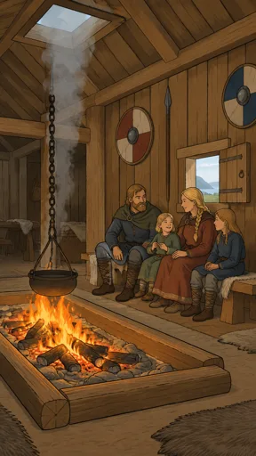](https://github.com/bigr/gpt-image-2.5-benchmark/releases/download/dataset-part2/part2__misfit-longhouse-900-clean__gpt-image-2.5-flare__0.png)

## misfit-longhouse-900-clean/gpt-image-2.5-flare/1

[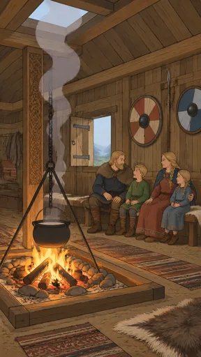](https://github.com/bigr/gpt-image-2.5-benchmark/releases/download/dataset-part2/part2__misfit-longhouse-900-clean__gpt-image-2.5-flare__1.png)

## misfit-longhouse-900-clean/gpt-image-2.5-flare/2

[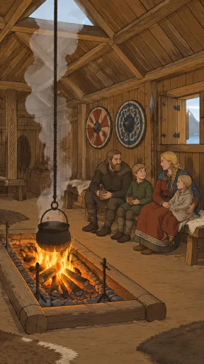](https://github.com/bigr/gpt-image-2.5-benchmark/releases/download/dataset-part2/part2__misfit-longhouse-900-clean__gpt-image-2.5-flare__2.png)

## misfit-longhouse-900-clean/gpt-image-2.5-sunburst/0

[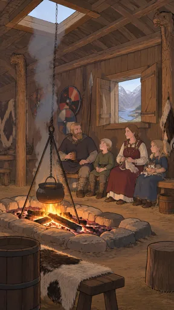](https://github.com/bigr/gpt-image-2.5-benchmark/releases/download/dataset-part2/part2__misfit-longhouse-900-clean__gpt-image-2.5-sunburst__0.png)

## misfit-longhouse-900-clean/gpt-image-2.5-sunburst/1

## misfit-longhouse-900-clean/gpt-image-2.5-sunburst/2

[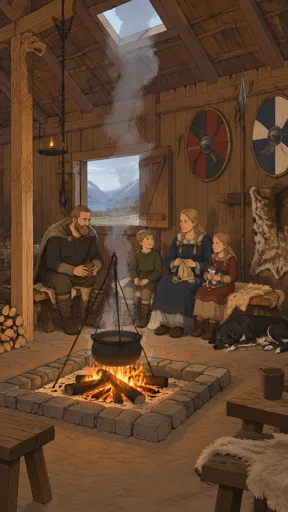](https://github.com/bigr/gpt-image-2.5-benchmark/releases/download/dataset-part2/part2__misfit-longhouse-900-clean__gpt-image-2.5-sunburst__2.png)

## misfit-longhouse-900-seeded/gpt-image-2.5-flare/0

[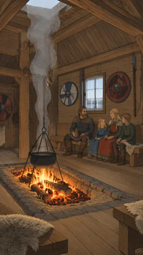](https://github.com/bigr/gpt-image-2.5-benchmark/releases/download/dataset-part2/part2__misfit-longhouse-900-seeded__gpt-image-2.5-flare__0.png)

## misfit-longhouse-900-seeded/gpt-image-2.5-flare/1

[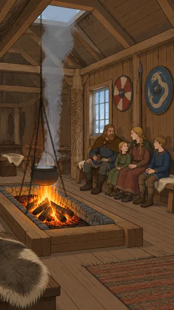](https://github.com/bigr/gpt-image-2.5-benchmark/releases/download/dataset-part2/part2__misfit-longhouse-900-seeded__gpt-image-2.5-flare__1.png)

## misfit-longhouse-900-seeded/gpt-image-2.5-flare/2

[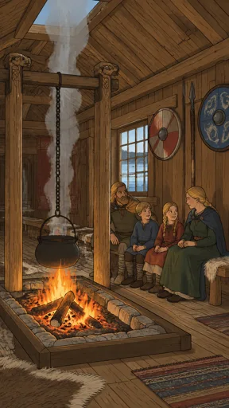](https://github.com/bigr/gpt-image-2.5-benchmark/releases/download/dataset-part2/part2__misfit-longhouse-900-seeded__gpt-image-2.5-flare__2.png)

## misfit-longhouse-900-seeded/gpt-image-2.5-sunburst/0

## misfit-longhouse-900-seeded/gpt-image-2.5-sunburst/1

[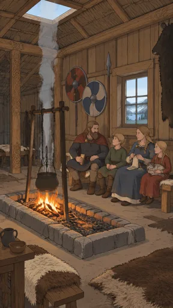](https://github.com/bigr/gpt-image-2.5-benchmark/releases/download/dataset-part2/part2__misfit-longhouse-900-seeded__gpt-image-2.5-sunburst__1.png)

## misfit-longhouse-900-seeded/gpt-image-2.5-sunburst/2

## misfit-roman-street-1st-clean/gpt-image-2.5-flare/0

## misfit-roman-street-1st-clean/gpt-image-2.5-flare/1

## misfit-roman-street-1st-clean/gpt-image-2.5-flare/2

## misfit-roman-street-1st-clean/gpt-image-2.5-sunburst/0

## misfit-roman-street-1st-clean/gpt-image-2.5-sunburst/1

## misfit-roman-street-1st-clean/gpt-image-2.5-sunburst/2

## misfit-roman-street-1st-seeded/gpt-image-2.5-flare/0

## misfit-roman-street-1st-seeded/gpt-image-2.5-flare/1

## misfit-roman-street-1st-seeded/gpt-image-2.5-flare/2

## misfit-roman-street-1st-seeded/gpt-image-2.5-sunburst/0

## misfit-roman-street-1st-seeded/gpt-image-2.5-sunburst/1

## misfit-roman-street-1st-seeded/gpt-image-2.5-sunburst/2

## misfit-scriptorium-medieval-clean/gpt-image-2.5-flare/0

## misfit-scriptorium-medieval-clean/gpt-image-2.5-flare/1

## misfit-scriptorium-medieval-clean/gpt-image-2.5-flare/2

## misfit-scriptorium-medieval-clean/gpt-image-2.5-sunburst/0

## misfit-scriptorium-medieval-clean/gpt-image-2.5-sunburst/1

## misfit-scriptorium-medieval-clean/gpt-image-2.5-sunburst/2

## misfit-scriptorium-medieval-seeded/gpt-image-2.5-flare/0

## misfit-scriptorium-medieval-seeded/gpt-image-2.5-flare/1

## misfit-scriptorium-medieval-seeded/gpt-image-2.5-flare/2

## misfit-scriptorium-medieval-seeded/gpt-image-2.5-sunburst/0

## misfit-scriptorium-medieval-seeded/gpt-image-2.5-sunburst/1

## misfit-scriptorium-medieval-seeded/gpt-image-2.5-sunburst/2

## misfit-village-1350-clean/gpt-image-2.5-flare/0

## misfit-village-1350-clean/gpt-image-2.5-flare/1

## misfit-village-1350-clean/gpt-image-2.5-flare/2

## misfit-village-1350-clean/gpt-image-2.5-sunburst/0

## misfit-village-1350-clean/gpt-image-2.5-sunburst/1

## misfit-village-1350-clean/gpt-image-2.5-sunburst/2

## misfit-village-1350-seeded/gpt-image-2.5-flare/0

## misfit-village-1350-seeded/gpt-image-2.5-flare/1

[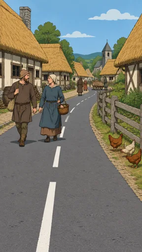](https://github.com/bigr/gpt-image-2.5-benchmark/releases/download/dataset-part2/part2__misfit-village-1350-seeded__gpt-image-2.5-flare__1.png)

## misfit-village-1350-seeded/gpt-image-2.5-flare/2

[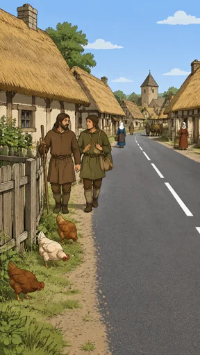](https://github.com/bigr/gpt-image-2.5-benchmark/releases/download/dataset-part2/part2__misfit-village-1350-seeded__gpt-image-2.5-flare__2.png)

## misfit-village-1350-seeded/gpt-image-2.5-sunburst/0

[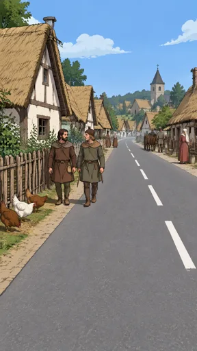](https://github.com/bigr/gpt-image-2.5-benchmark/releases/download/dataset-part2/part2__misfit-village-1350-seeded__gpt-image-2.5-sunburst__0.png)

## misfit-village-1350-seeded/gpt-image-2.5-sunburst/1

[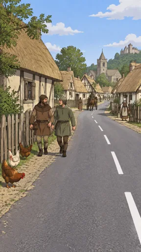](https://github.com/bigr/gpt-image-2.5-benchmark/releases/download/dataset-part2/part2__misfit-village-1350-seeded__gpt-image-2.5-sunburst__1.png)

## misfit-village-1350-seeded/gpt-image-2.5-sunburst/2

